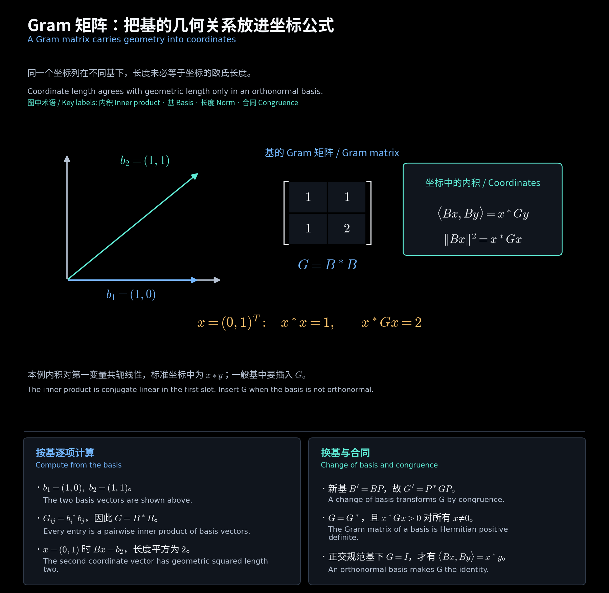

# 第 9 讲文件的双语笔记 / Bilingual Notes for Lecture File 9

**中文：** 原文件“线性代数_lecture_9.pdf”共 19 页，封面为 **Lecture 10**。目录沿用文件编号 `lecture09`，原课件仅改名归档，内容未改动。

**English:** The 19-page source was named lecture 9 but its cover says **Lecture 10**. This folder retains the filename-based sequence. The source PDF was renamed for filing without altering its contents.

<!-- diagram:36_inner_product_gram:start -->

**图解 · Gram 矩阵：把基的几何关系放进坐标公式**

**读图：** 蓝、绿两条基向量不正交，因此 Gram 矩阵含非零交叉项。坐标 $(0,1)^T$ 代表第二个基向量，普通坐标长度平方为 1，而原向量长度平方为 2；计算几何量时必须使用 $x^*Gx$。

<!-- diagram:36_inner_product_gram:end -->

## 阅读顺序 / Reading order

| 文件 / File | 内容 / Contents |
| --- | --- |
| [01 内积与 Gram 矩阵](01_内积与Gram矩阵.md) | 内积约定、共轭转置、Gram、合同、范数与不等式 / Inner products, Gram matrices, congruence and norms |
| [02 正交规范基与酉变换](02_正交规范基与酉变换.md) | Gram–Schmidt、Legendre 基、酉变换的等价条件 / Gram-Schmidt, Legendre bases and unitary criteria |
| [03 练习与公式速查](03_练习与公式速查.md) | 8 道双语练习、答案和中英术语 / Eight bilingual exercises, answers and terminology |

## 课件对照 / Slide map

| 原 PDF 页序 / PDF pages | 内容 / Contents | 笔记 / Notes |
| --- | --- | --- |
| 1—4 | 封面、第四章提纲与几何背景 / Cover, outline and geometric motivation | 本导航 / Guide |
| 5—7 | 内积、欧氏空间、共轭转置 / Inner products and conjugate transpose | 01 |
| 8—10 | Gram 矩阵与合同 / Gram matrices and congruence | 01 |
| 11 | 范数及两类不等式 / Norm inequalities | 01 |
| 12—15 | 正交规范基与 Gram–Schmidt / Orthonormal bases | 02 |
| 16—19 | 酉变换、酉矩阵与等价条件 / Unitary maps and matrices | 02 |

## 统一约定与阅读提示 / Conventions and reading notes

**中文：** 内积对第一变量共轭线性，$\langle x,y\rangle=x^*y$。Gram 矩阵按 $G_{ij}=\langle b_i,b_j\rangle$ 排列。$\mathbb F_n[\lambda]$ 的维数是 $n+1$。

**English:** The first inner-product slot is conjugate linear. The standard inner product is $x^*y$, and $G_{ij}=\langle b_i,b_j\rangle$. The polynomial space has dimension $n+1$.

**中文：** 第 2 页提纲中的“unitary space ... over R”不宜理解成只讨论实数域；正式定义见第 5—6 页。第 15 页标题 “Gram-Smith” 统一写为 Gram–Schmidt。第 19 页提到的教材例 4.7、4.8 没有题设，笔记中的数值计算均单独标为教学补充或作业例题。

**English:** The outline's wording on the scalar field is imprecise; use the formal definitions on slides 5-6. “Gram-Smith” is standardized to Gram-Schmidt. Examples referenced without a statement are not reconstructed as textbook originals.

## 作业与资料 / Homework and sources

- HW9.1 延续上一讲平移算子的最小多项式；HW9.2—4 对应本讲；HW9.5 对应下一讲正交投影。 / HW9.1 continues translation operators; HW9.2-4 cover this lecture and HW9.5 uses orthogonal projectors.
- [原课件 / Source slides](<../../materials/lectures/Lecture 9-linear algebra.pdf>)。
- [作业 9 中文解答 / Chinese solutions](../../homework/homework09/Homework9_题目与解答.pdf) · [英文解答 / English solutions](../../homework/homework09/Homework9_英文题目与解答.pdf) · [原题 / Original](../../homework/homework09/Homework9_原始题目.pdf)。
- [上一讲 / Previous](../lecture08/00_阅读导航.md) · [下一讲 / Next](../lecture10/00_阅读导航.md) · [中文精简版 / Chinese notes](../中文精简版/00_阅读导航.md)。
