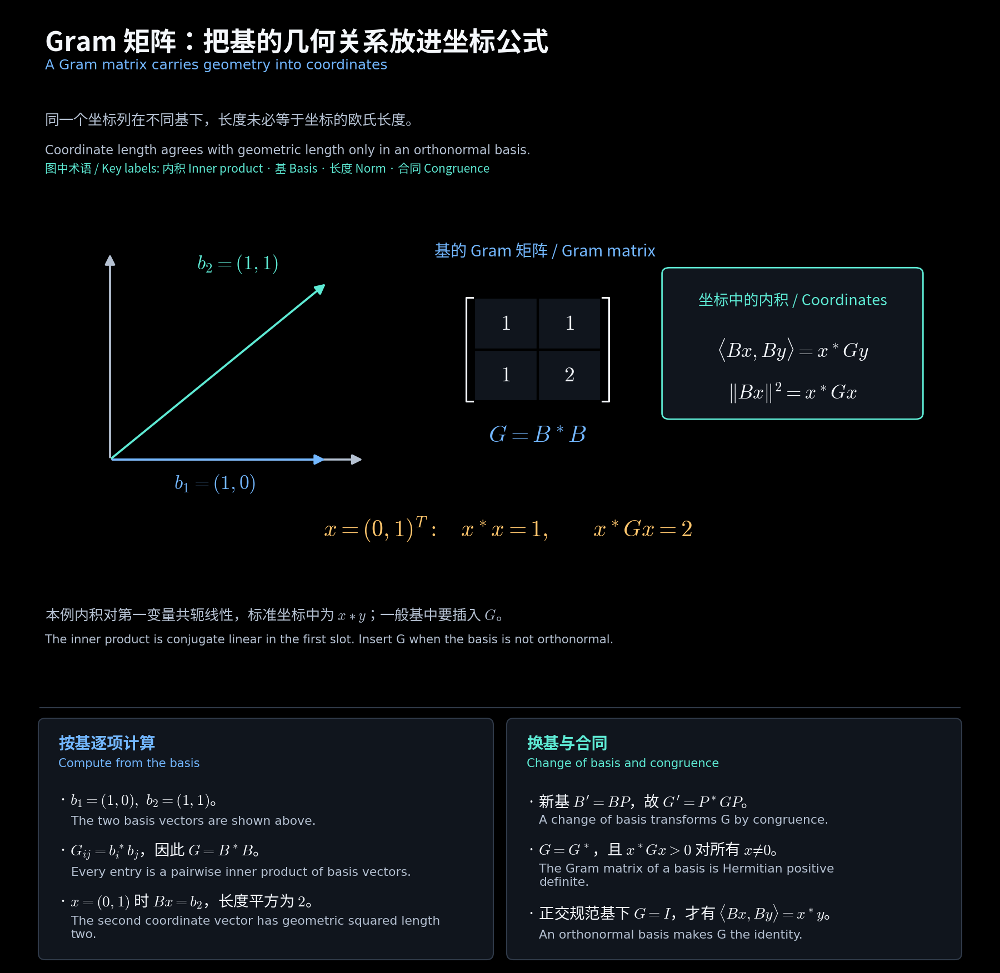

# 内积与 Gram 矩阵 / Inner Products and Gram Matrices

**中文：** 对应第 9 讲文件（封面 Lecture 10）第 5—11 页。先固定内积约定，再把长度、夹角和换基写成坐标公式。

**English:** This chapter follows slides 5-11 of the Lecture 9 file (cover: Lecture 10). Fix the inner-product convention before writing norms and changes of basis in coordinates.

## 一、内积约定与共轭转置 / Inner-product convention and adjoint matrices

**中文：** 本课程内积对第一变量共轭线性，对第二变量线性；实内积空间称欧氏空间。教材的“酉空间”泛指带内积的实或复空间。复数标准内积为 $x^*y$。

**English:** The course uses conjugate linearity in the first slot and linearity in the second. A real inner-product space is Euclidean; the textbook uses “unitary space” for an inner-product space over either field. The standard complex inner product is $x^*y$.

$$
\langle x,y\rangle=\overline{\langle y,x\rangle},\quad
\langle ax+bz,y\rangle=\bar a\langle x,y\rangle+\bar b\langle z,y\rangle,
\quad \langle x,x\rangle>0\ (x\ne0).
$$

$$
A^*=\bar A^T,\quad (AB)^*=B^*A^*,\quad
(aA+bB)^*=\bar aA^*+\bar bB^*,\quad (A^{-1})^*=(A^*)^{-1}.
$$

**中文：** 实数情形共轭不起作用。$A=A^*$ 为 Hermitian，$A^*=-A$ 为斜 Hermitian；两者都不代表 $A$ 必可逆。

**English:** Conjugation disappears over the reals. Hermitian means $A=A^*$ and skew-Hermitian means $A^*=-A$; neither implies invertibility.

## 二、Gram 矩阵把几何写入坐标 / The Gram matrix encodes geometry

**中文：** 有序基 $B=(b_1,\ldots,b_n)$，令 $G_{ij}=\langle b_i,b_j\rangle$。若 $v=Bx,w=By$，则

**English:** For an ordered basis $B$, set $G_{ij}=\langle b_i,b_j\rangle$. With $v=Bx,w=By$,

$$
\langle v,w\rangle=\sum_{i,j}\bar x_i y_j\langle b_i,b_j\rangle=x^*Gy,
\qquad G=G^*,\qquad x^*Gx=\|Bx\|^2>0\ (x\ne0).
$$

**教学补充例题 / Supplementary example：**

$$
B=\begin{bmatrix}1&1\\0&1\end{bmatrix},\quad
G=B^*B=\begin{bmatrix}1&1\\1&2\end{bmatrix},\quad
x=\begin{bmatrix}0\\1\end{bmatrix}:
\quad x^*x=1,\quad \|Bx\|^2=x^*Gx=2.
$$

**中文：** 坐标列的普通长度不一定是原向量的长度。只有正交规范基使 $G=I$。

**English:** The ordinary norm of a coordinate column need not equal the vector's geometric norm. An orthonormal basis makes $G=I$.

<!-- diagram:36_inner_product_gram:start -->

**图解 · Gram 矩阵：把基的几何关系放进坐标公式**

**读图：** 蓝、绿两条基向量不正交，因此 Gram 矩阵含非零交叉项。坐标 $(0,1)^T$ 代表第二个基向量，普通坐标长度平方为 1，而原向量长度平方为 2；计算几何量时必须使用 $x^*Gx$。

<!-- diagram:36_inner_product_gram:end -->

## 三、换基对应合同 / Change of basis gives congruence

$$
B'=BP,\quad P\text{ 可逆 / invertible},\qquad
\langle B'x,B'y\rangle=x^*P^*GPy
\quad\Longrightarrow\quad \boxed{G'=P^*GP}.
$$

**中文：** 合同变换是 $P^*GP$；算子同一空间换基的相似变换是 $P^{-1}AP$，用途不同。酉矩阵满足 $P^{-1}=P^*$ 时，两种写法才重合。

**English:** Congruence is $P^*GP$, whereas a matrix representing an operator changes by similarity $P^{-1}AP$. They coincide for unitary $P$.

## 四、范数、Cauchy–Schwarz 与距离 / Norms, Cauchy-Schwarz and distance

$$
\|v\|=\sqrt{\langle v,v\rangle},\quad
\|av\|=|a|\|v\|,\quad d(v,w)=\|v-w\|.
$$

**作业例题 / Homework example：HW9.2。** 对 $w\ne0$，令 $c=\langle w,v\rangle/\|w\|^2$。

$$
0\le\|v-cw\|^2=\|v\|^2-\frac{|\langle v,w\rangle|^2}{\|w\|^2}
\Longrightarrow |\langle v,w\rangle|\le\|v\|\|w\|.
$$

$$
\|v+w\|^2=\|v\|^2+2\operatorname{Re}\langle v,w\rangle+\|w\|^2
\le(\|v\|+\|w\|)^2.
$$

**中文：** Cauchy–Schwarz 等号当且仅当两向量线性相关；三角不等式在两个非零向量同向（正实倍数）时取等号。零向量情形直接检查。

**English:** Cauchy-Schwarz is an equality precisely for dependent vectors. For two nonzero vectors, equality in the triangle inequality requires a positive real multiple. Zero cases are immediate.

## 五、多项式内积的 Gram 矩阵 / A polynomial Gram matrix

**作业例题 / Homework example：HW9.3。**

$$
V=\mathbb R_n[\lambda],\quad
\langle p,q\rangle=\int_{-1}^1pq\,d\lambda,\quad
G_{ij}=\begin{cases}2/(i+j+1),&i+j\text{ 偶 / even},\\0,&i+j\text{ 奇 / odd},\end{cases}\quad0\le i,j\le n.
$$

$$
n=2:\quad G=\begin{bmatrix}2&0&2/3\\0&2/3&0\\2/3&0&2/5\end{bmatrix},
\qquad p\ne0\Longrightarrow\int_{-1}^1p^2\,d\lambda>0.
$$

**中文：** 偶函数与奇函数正交，但 $1$ 与 $\lambda^2$ 不正交；下一章用 Gram–Schmidt 消去这些交叉项。

**English:** Odd and even polynomials are orthogonal, but $1$ and $\lambda^2$ are not. Gram-Schmidt removes the remaining cross terms.

[阅读导航 / Guide](00_阅读导航.md)
