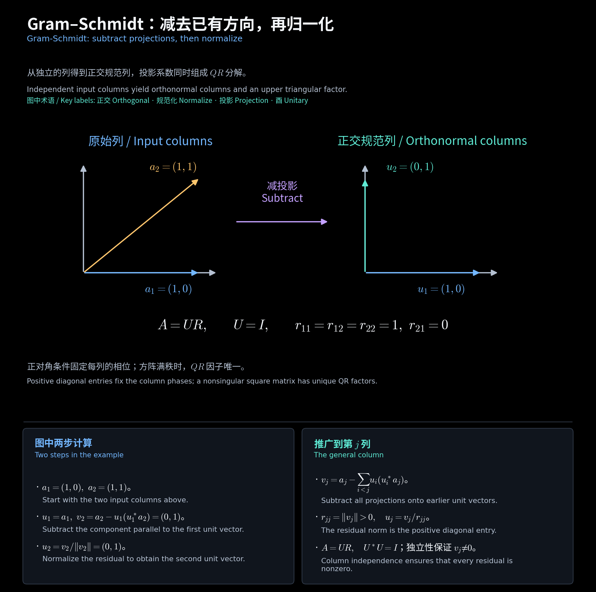

# 正交规范基与酉变换 / Orthonormal Bases and Unitary Maps

**中文：** 对应第 9 讲文件第 12—19 页。保留 Gram–Schmidt 的计算过程，并连接作业 9 的 Legendre 多项式与酉变换判据。

**English:** This chapter follows slides 12-19 of the Lecture 9 file, connecting Gram-Schmidt computations with Legendre polynomials and unitary-map criteria in Homework 9.

## 一、正交规范基与坐标 / Orthonormal bases and coordinates

$$
\langle u_i,u_j\rangle=\delta_{ij},\quad
v=\sum_i u_i\langle u_i,v\rangle,\quad
\|v\|^2=\sum_i|\langle u_i,v\rangle|^2.
$$

**中文：** 正交组中的向量须非零；对 $\sum c_i u_i=0$ 两边取与 $u_j$ 的内积得 $c_j\|u_j\|^2=0$，故正交组线性无关。$n$ 维空间中 $n$ 个正交规范向量自动成基。

**English:** Orthogonal systems exclude zero vectors. Taking inner products in a linear relation isolates each coefficient, so such a system is independent. In dimension $n$, $n$ orthonormal vectors form a basis.

## 二、Gram–Schmidt 的逐列计算 / Gram-Schmidt column by column

$$
v_1=a_1,\quad u_1=\frac{v_1}{\|v_1\|},\qquad
v_j=a_j-\sum_{i<j}u_i\langle u_i,a_j\rangle,\quad u_j=\frac{v_j}{\|v_j\|}.
$$

$$
\langle u_k,v_j\rangle
=\langle u_k,a_j\rangle-\sum_{i<j}\delta_{ki}\langle u_i,a_j\rangle=0\quad(k<j).
$$

**中文：** 输入无关才保证每个 $v_j\ne0$；遇到零残差，应判定当前列与前面的列相关。输出与输入逐级张成相同子空间。

**English:** Independent inputs ensure nonzero residuals. A zero residual signals dependence on earlier columns. The initial spans are preserved at every step.

**教学补充例题 / Supplementary example：**

$$
a_1=(1,1,0)^T,\quad a_2=(1,0,1)^T,
\quad u_1=\frac{(1,1,0)^T}{\sqrt2},
$$

$$
v_2=a_2-u_1(u_1^*a_2)=\tfrac12(1,-1,2)^T,
\quad \|v_2\|=\sqrt{3/2},\quad u_2=\frac{(1,-1,2)^T}{\sqrt6}.
$$

<!-- diagram:37_gram_schmidt_unitary:start -->

**图解 · Gram–Schmidt：减去已有方向，再归一化**

**读图：** 先保留第一列的单位方向，再从第二列减去该方向上的投影，剩余方向正交。投影系数及残差长度形成上三角矩阵 $R$；满秩与正对角条件一起保证 QR 唯一。

<!-- diagram:37_gram_schmidt_unitary:end -->

## 三、Legendre 基的推导 / Deriving the Legendre basis

**作业例题 / Homework example：HW9.3。**

$$
q_0=1,\quad q_1=\lambda,\quad
q_2=\lambda^2-\tfrac13,\quad q_3=\lambda^3-\tfrac35\lambda,
\qquad \langle q_i,q_j\rangle=0\ (i\ne j).
$$

$$
L_k(\lambda)=\frac1{2^kk!}\frac{d^k}{d\lambda^k}(\lambda^2-1)^k,
\quad c_k=\frac{(2k)!}{2^k(k!)^2},\quad q_k=L_k/c_k.
$$

**中文：** $(\lambda^2-1)^k$ 在两个端点均有 $k$ 重零点。分部积分 $k$ 次，所有边界项为零，因而

**English:** The Rodrigues polynomial has zeros of order $k$ at both endpoints. After $k$ integrations by parts, all boundary terms vanish:

$$
\int_{-1}^1L_k\lambda^j\,d\lambda=0\quad(j<k),\qquad
\int_{-1}^1L_k^2\,d\lambda=\frac2{2k+1}.
$$

$$
\boxed{e_k=\sqrt{\frac{2k+1}{2}}L_k},\quad
 e_0=1/\sqrt2,\quad e_1=\sqrt{3/2}\lambda,\quad
 e_2=\sqrt{5/8}(3\lambda^2-1).
$$

**中文：** 这里 $L_k(1)=1$；如果采用首一多项式 $q_k$，其归一化系数会不同。只保留 $0\le k\le n$。

**English:** Here $L_k(1)=1$. A monic normalization $q_k$ has a different scalar factor. Retain only $0\le k\le n$.

## 四、酉变换的四种等价判据 / Four equivalent unitary criteria

**中文：** 设 $\mathcal U\in L(V)$，在正交规范基下的矩阵为 $U$。定理 4.7—4.8 给出

**English:** Let $\mathcal U\in L(V)$ have matrix $U$ in an orthonormal basis. Theorems 4.7-4.8 give

$$
\langle\mathcal Ux,\mathcal Uy\rangle=\langle x,y\rangle
\iff\|\mathcal Ux\|=\|x\|\ (\forall x)
\iff\mathcal U\text{ 将正交规范基映为正交规范基 / maps an ON basis to an ON basis}
\iff U^*U=I.
$$

$$
(U^*U)_{ij}=u_i^*u_j=\delta_{ij},\quad
U^{-1}=U^*,\quad UU^*=I,\quad |\det U|=1.
$$

**中文：** 实数情形叫正交矩阵，$U^TU=I$、$\det U=\pm1$。一般非正交基下，保持内积的矩阵满足 $A^*GA=G$，不能直接写 $A^*A=I$。

**English:** Over the reals these are orthogonal matrices, with determinant $\pm1$. In a general basis, preservation of the inner product means $A^*GA=G$, rather than $A^*A=I$.

## 五、由范数恢复内积 / Recovering inner products from norms

$$
4\langle x,y\rangle=\|x+y\|^2-\|x-y\|^2
+i\|x-iy\|^2-i\|x+iy\|^2.
$$

**中文：** 因 $\mathcal U$ 线性且保范数，右侧每项均可替换成像向量的范数，于是保内积。实数域只需前两项。该推导补齐作业 9 第 4 题的反向证明。

**English:** Linearity and norm preservation let us replace each term by the corresponding image norm, proving inner-product preservation. Over the reals, the first two terms suffice. This proves the reverse implication in HW9.4.

[阅读导航 / Guide](00_阅读导航.md)
