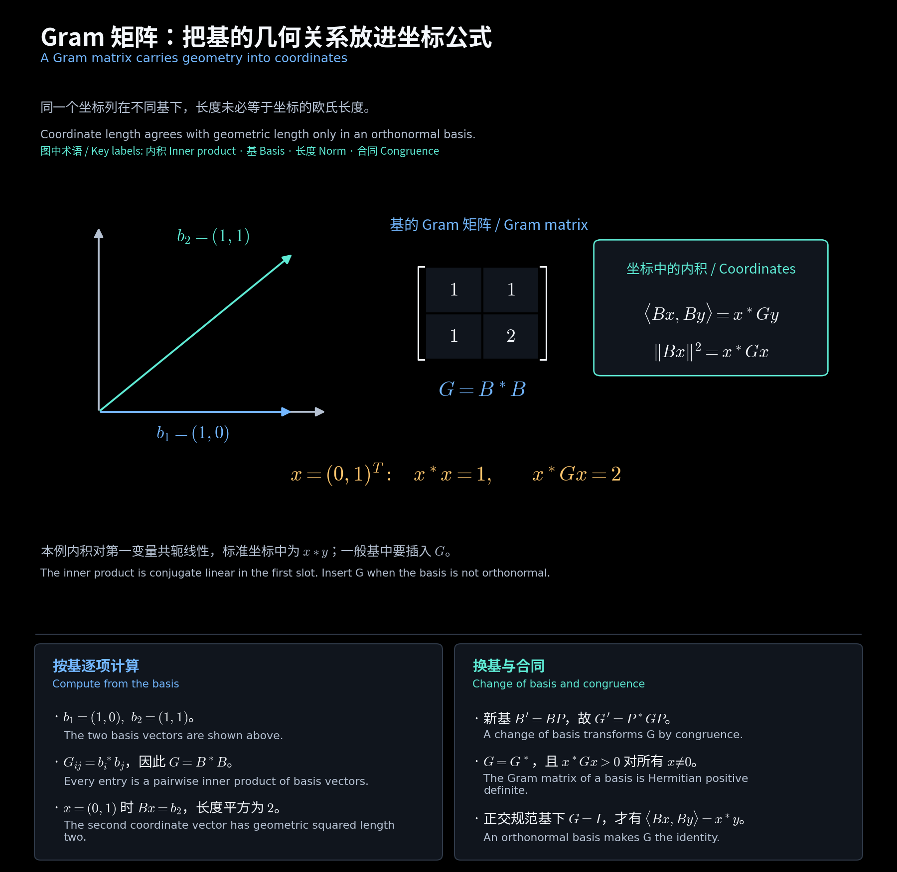

# 练习与公式速查 / Exercises and Formula Reference

所有数值题均为教学补充；作业原题及完整证明另见对应作业 PDF。 / Numerical exercises are teaching supplements; homework PDFs retain the original questions and complete proofs.

<!-- diagram:36_inner_product_gram:start -->

**图解 · Gram 矩阵：把基的几何关系放进坐标公式**

**读图：** 蓝、绿两条基向量不正交，因此 Gram 矩阵含非零交叉项。坐标 $(0,1)^T$ 代表第二个基向量，普通坐标长度平方为 1，而原向量长度平方为 2；计算几何量时必须使用 $x^*Gx$。

<!-- diagram:36_inner_product_gram:end -->

## 练习与答案 / Exercises and answers

[先看：练习中的符号与做题方法](../练习阅读说明.md) · [全部练习](../练习总导航.md)

本页逐题保留完整条件，并给出一般元素、计算步骤及检验。 / Each exercise includes its full assumptions, intermediate calculations and checks.

### 1. 第一变量中的复标量 / Complex scalars in the first slot

**题目：** 设 $V$ 是复内积空间，采用第一变量共轭线性、第二变量线性的约定：$\langle ax,y\rangle=\bar a\langle x,y\rangle$。对任意 $x,y\in V$ 求 $\langle ix,y\rangle$，其中 $i^2=-1$。

**Question:** In a complex inner-product space, use conjugate linearity in the first slot: $\langle ax,y\rangle=\bar a\langle x,y\rangle$. Evaluate $\langle ix,y\rangle$.

**解答 / Solution：**

**第 1 步。** 先识别标量 $i$ 位于第一变量中，因此移出内积时须取共轭。$i$ 的共轭为 $-i$。

**Step 1.** The scalar is in the first slot, so taking it outside requires complex conjugation. The conjugate of $i$ is $-i$.

$$
\begin{gathered}
\overline i=-i,\\
\boxed{\langle ix,y\rangle=-i\langle x,y\rangle}.
\end{gathered}
$$

**第 2 步。** 第二变量中的标量直接移出，不取共轭。可用一维标准内积核验本题符号：$\langle z,w\rangle=\bar z w$。

**Step 2.** Scalars in the second slot leave without conjugation. Check the sign using the standard one-dimensional inner product.

$$
\begin{gathered}
\langle x,iy\rangle=i\langle x,y\rangle,\\
\langle i,1\rangle=\overline i\cdot1=-i.
\end{gathered}
$$

### 2. 逐项计算 Gram 矩阵 / Computing a Gram matrix

**题目：** 在 $\mathbb R^2$ 中采用标准内积 $\langle x,y\rangle=x^Ty$，给定有序基 $B=(b_1,b_2)$。求其 Gram 矩阵 $G$，定义 $G_{ij}=\langle b_i,b_j\rangle$，并核验一般坐标的长度公式。

**Question:** For the displayed ordered basis in real two-space with standard inner product, compute every entry of its Gram matrix and verify the coordinate norm formula.

$$
\begin{gathered}
b_1=(1,0)^T,\\
b_2=(1,1)^T.
\end{gathered}
$$

**解答 / Solution：**

**第 1 步。** 按定义计算四个内积；对角元是基向量的长度平方，非对角元检查它们是否正交。

**Step 1.** Compute all four pairwise inner products. Diagonal entries are squared lengths and off-diagonal entries test orthogonality.

$$
\begin{gathered}
b_1^Tb_1=1,\quad b_1^Tb_2=1,\quad b_2^Tb_1=1,\quad b_2^Tb_2=2,\\
\boxed{G=\begin{pmatrix}1&1\\1&2\end{pmatrix}}.
\end{gathered}
$$

**第 2 步。** 将基向量按列组成普通坐标矩阵 $M$。向量 $v=xb_1+yb_2$ 的基坐标是 $(x,y)^T$，其实际标准坐标为 $(x+y,y)^T$；两种算法得到相同长度。

**Step 2.** Put the basis columns into a coordinate matrix. A coordinate pair represents standard vector $(x+y,y)^T$; its usual squared norm agrees with the Gram formula.

$$
\begin{gathered}
M=\begin{pmatrix}1&1\\0&1\end{pmatrix},\quad G=M^TM,\\
\|v\|^2=(x+y)^2+y^2=(x,y)G(x,y)^T.
\end{gathered}
$$

### 3. Gram 换基公式 / Changing a Gram matrix

**题目：** $V$ 是 $n$ 维复内积空间，第一变量共轭线性。有序基 $B$ 的 Gram 矩阵为 $G$，新基 $B'=BP$，其中 $P$ 可逆。求新 Gram 矩阵 $G'$，解释为何使用共轭转置 $P^*$。

**Question:** In an $n$-dimensional complex inner-product space with conjugate-linear first slot, let $G$ be the Gram matrix of $B$ and let $B'=BP$ with invertible $P$. Derive the new Gram matrix and explain the conjugate transpose.

**解答 / Solution：**

**第 1 步。** 写任意两向量的新坐标为 $x,y$，它们的旧坐标分别是 $Px,Py$。按旧 Gram 矩阵计算内积。

**Step 1.** Vectors with new coordinates $x,y$ have old coordinates $Px,Py$. Evaluate their inner product using the old Gram matrix.

$$
\langle B'x,B'y\rangle=\langle BPx,BPy\rangle=(Px)^*G(Py)=x^*P^*GPy.
$$

**第 2 步。** 新 Gram 矩阵按定义应使同一内积等于 $x^*G'y$。两式对全部坐标成立，可逐取标准坐标确定各元素，得到合同公式。共轭来自第一变量的共轭线性。

**Step 2.** The new Gram matrix represents the same inner product as $x^*G'y$. Testing standard coordinate pairs identifies every entry and yields congruence; conjugation comes from the first slot.

$$
x^*G'y=x^*P^*GPy\quad (\forall x,y)\Longrightarrow\boxed{G'=P^*GP}.
$$

### 4. 向量的 Gram–Schmidt 过程 / Gram-Schmidt for vectors

**题目：** 在 $\mathbb R^3$ 的标准内积下，对以下两个向量按给定顺序做 Gram–Schmidt，得到其张成的二维子空间的正交规范基。列出投影系数、残差、长度并检验结果。

**Question:** Apply Gram-Schmidt in the stated order to the two vectors in real three-space with the standard inner product. Give an orthonormal basis of their two-dimensional span, including projections, residuals, norms and checks.

$$
\begin{gathered}
a_1=(1,1,0)^T,\\
a_2=(1,0,1)^T.
\end{gathered}
$$

**解答 / Solution：**

**第 1 步。** 先将第一向量除以长度得到第一单位方向。第二向量在该方向上的投影系数是 $u_1^Ta_2$。

**Step 1.** Normalize the first vector. The second vector's projection coefficient on that unit direction is its inner product with it.

$$
\begin{gathered}
\|a_1\|=\sqrt2,\quad u_1=(1,1,0)^T/\sqrt2,\\
u_1^Ta_2=1/\sqrt2.
\end{gathered}
$$

**第 2 步。** 从第二向量减去投影，剩余量与第一方向正交。计算残差的长度，再归一化。

**Step 2.** Subtract the projection to obtain an orthogonal residual, then compute its norm and normalize.

$$
\begin{gathered}
v_2=a_2-u_1(u_1^Ta_2)=(1/2,-1/2,1)^T,\quad \|v_2\|^2=1/4+1/4+1=3/2,\\
\boxed{u_2=(1,-1,2)^T/\sqrt6}.
\end{gathered}
$$

**第 3 步。** 检验两个长度均为一、内积为零。残差只减去了第一个方向，故新旧向量组张成相同子空间。

**Step 3.** Verify both unit lengths and zero mutual inner product. Subtracting the earlier direction preserves the span.

$$
\begin{gathered}
u_1^Tu_1=1,\quad u_2^Tu_2=(1+1+4)/6=1,\quad u_1^Tu_2=(1-1)/\sqrt{12}=0,\\
a_2=\tfrac1{\sqrt2}u_1+\sqrt{3/2}u_2.
\end{gathered}
$$

### 5. 积分内积与正交多项式 / Integral inner product and orthogonal polynomials

**题目：** 在 $V=\mathbb R_2[\lambda]$ 上明确取积分内积如下。对有序基 $(1,\lambda,\lambda^2)$ 做 Gram–Schmidt 并归一化，写出全部三个基函数的投影系数和长度。

**Question:** On real polynomials of degree at most two, use the explicitly specified integral inner product. Apply Gram-Schmidt to the ordered monomials, computing the projection coefficients and norms of all three resulting basis functions.

$$
\langle p,q\rangle=\int_{-1}^{1}p(\lambda)q(\lambda)\,d\lambda.
$$

**解答 / Solution：**

**第 1 步。** 先求正交但尚未归一化的多项式。奇函数在对称区间积分为零，因此 $\lambda$ 与常数已正交。

**Step 1.** First find orthogonal, not yet normalized, polynomials. Odd functions integrate to zero on the symmetric interval, making the linear monomial orthogonal to constants.

$$
\begin{gathered}
q_0=1,\quad \langle1,1\rangle=2,\quad \langle1,\lambda\rangle=0,\\
q_1=\lambda,\quad \langle\lambda,\lambda\rangle=2/3.
\end{gathered}
$$

**第 2 步。** 对二次项减去在前两个正交方向上的投影。与 $\lambda$ 的内积为三次函数积分，所以该投影系数为零。

**Step 2.** Subtract the projections of the quadratic monomial onto the two previous orthogonal directions. The projection onto the linear polynomial is zero by oddness.

$$
q_2=\lambda^2-\frac{\langle q_0,\lambda^2\rangle}{\|q_0\|^2}q_0-\frac{\langle q_1,\lambda^2\rangle}{\|q_1\|^2}q_1=\lambda^2-\frac{2/3}{2}=\lambda^2-1/3.
$$

**第 3 步。** 逐项积分求长度平方，再分别除以长度。这样归一化保留已得到的正交性。

**Step 3.** Integrate the squared polynomials for their norms and divide each by its norm, preserving orthogonality.

$$
\begin{gathered}
\|q_2\|^2=\int_{-1}^1(\lambda^2-1/3)^2d\lambda=2/5-4/9+2/9=8/45,\\
\boxed{e_0=1/\sqrt2,\quad e_1=\sqrt{3/2}\lambda,\quad e_2=\sqrt{5/8}(3\lambda^2-1)}.
\end{gathered}
$$

### 6. 酉矩阵的列为何成基 / Columns of a unitary matrix

**题目：** 设 $U\in\mathbb C^{n\times n}$ 为酉矩阵，即 $U^*U=I_n$，标准内积为 $\langle x,y\rangle=x^*y$。证明其列向量构成 $\mathbb C^n$ 的正交规范基，并说明独立性如何得到。

**Question:** Let $U^*U=I_n$ for a complex square matrix and use the standard inner product. Prove its columns form an orthonormal basis, including the independence argument.

**解答 / Solution：**

**第 1 步。** 将列记为 $u_1,\ldots,u_n$。矩阵乘积的第 $i,j$ 元就是第 $i,j$ 列的内积，等于单位矩阵相应元素。

**Step 1.** The entry in position $(i,j)$ of $U^*U$ is the inner product of columns $i,j$. The identity specifies every such value.

$$
\begin{gathered}
U=[u_1\ \cdots\ u_n],\\
u_i^*u_j=(U^*U)_{ij}=\delta_{ij}=\begin{cases}1,&i=j,\\0,&i\ne j.\end{cases}
\end{gathered}
$$

**第 2 步。** 所以每列长度为一，不同列正交。若它们有零线性组合，分别左乘各列的共轭转置，即可把每个系数单独取出，证明独立；$n$ 个独立向量便构成 $n$ 维空间的基。

**Step 2.** The columns have unit length and are mutually orthogonal. Taking inner products of a zero linear combination with each column isolates every coefficient, proving independence and hence a basis.

$$
\sum_{j=1}^nc_ju_j=0\Longrightarrow u_i^*\sum_jc_ju_j=\sum_jc_j\delta_{ij}=c_i=0\quad (\forall i).
$$

### 7. 具体矩阵的酉性检验 / Testing a specific unitary matrix

**题目：** 把下列实矩阵视为 $\mathbb C^2$ 标准内积下的矩阵，判断是否酉；同时判断它是否为实正交矩阵并求行列式。请计算完整的 $U^*U$，不能仅用行列式判断酉性。

**Question:** Determine whether the displayed real matrix is unitary in complex standard coordinates and orthogonal over the reals. Compute its determinant and the full product $U^*U$, rather than relying on determinant alone.

$$
U=\frac15\begin{pmatrix}3&-4\\4&3\end{pmatrix}.
$$

**解答 / Solution：**

**第 1 步。** 元素全为实数，所以共轭转置等于转置。实际相乘，两个非对角元相消，两个对角元都为一。

**Step 1.** Real entries make the adjoint equal to the transpose. Multiply to check that off-diagonal entries vanish and both diagonal entries are one.

$$
U^*U=U^TU=\frac1{25}\begin{pmatrix}3&4\\-4&3\end{pmatrix}\begin{pmatrix}3&-4\\4&3\end{pmatrix}=\frac1{25}\begin{pmatrix}25&0\\0&25\end{pmatrix}=I_2.
$$

**第 2 步。** 故它既酉又实正交。行列式为正一，与二维旋转的性质相符，但行列式结果本身不是上述内积保持验证的替代。

**Step 2.** Thus it is both unitary and real orthogonal. Its determinant is positive one, consistent with a planar rotation, though that fact alone would not prove orthogonality.

$$
\det U=\frac{3\cdot3-(-4)\cdot4}{25}=1.
$$

### 8. 平移算子的最小多项式 / Minimal polynomial of translation

**题目：** 设 $n\ge0$，$V=\mathbb C_n[s]$ 为次数不超过 $n$ 的复多项式空间，$a\in\mathbb C\setminus\{0\}$。平移算子 $Tf(s)=f(s+a)$ 的整体最小多项式是什么？用平移差证明零化和最小性，零化多项式的变量记为 $z$。

**Question:** Find the global minimal polynomial of translation by nonzero complex $a$ on polynomials of degree at most $n\ge0$. Use finite differences to prove both annihilation and minimality, with $z$ as the annihilator variable.

**解答 / Solution：**

**第 1 步。** 令 $\Delta=T-I$，作用是相邻平移值相减。二项式展开使最高次项抵消，次数每次至少下降一；常数会被映成零。

**Step 1.** Set $\Delta=T-I$. Binomial expansion cancels the leading term, reducing degree by at least one each time, while constants go to zero.

$$
\begin{gathered}
\Delta(s^k)=(s+a)^k-s^k=ka\,s^{k-1}+\text{lower powers}\quad (k\ge1),\\
\Delta1=0.
\end{gathered}
$$

**第 2 步。** 所有输入次数至多为 $n$，所以作用 $n+1$ 次必为零；但对最高次单项式连续取首项，作用 $n$ 次后仍得到非零常数。

**Step 2.** Every input is killed after $n+1$ differences, but tracking the leading coefficients of $s^n$ gives a nonzero constant after $n$ differences.

$$
\begin{gathered}
\Delta^{n+1}=0,\\
\Delta^n(s^n)=n!a^n\ne0.
\end{gathered}
$$

**第 3 步。** 最小多项式必须整除已知零化多项式 $(z-1)^{n+1}$，故只能是它的某个幂因子；若指数不超过 $n$，将与 $\Delta^n\ne0$ 矛盾。

**Step 3.** The minimal polynomial divides the known annihilator, so it is a power of $z-1$. Every lower power would contradict the nonzero $n$th difference.

$$
\begin{gathered}
\boxed{m_T(z)=(z-1)^{n+1}}.\\
a=0\Longrightarrow T=I\Longrightarrow m_T=z-1.
\end{gathered}
$$

## 中英术语 / Terminology

| 中文 | English |
| --- | --- |
| 内积 | inner product |
| Gram 矩阵 | Gram matrix |
| 正交规范基 | orthonormal basis |
| 合同 | congruence |
| 酉变换 | unitary transformation |

[阅读导航 / Guide](00_阅读导航.md)
