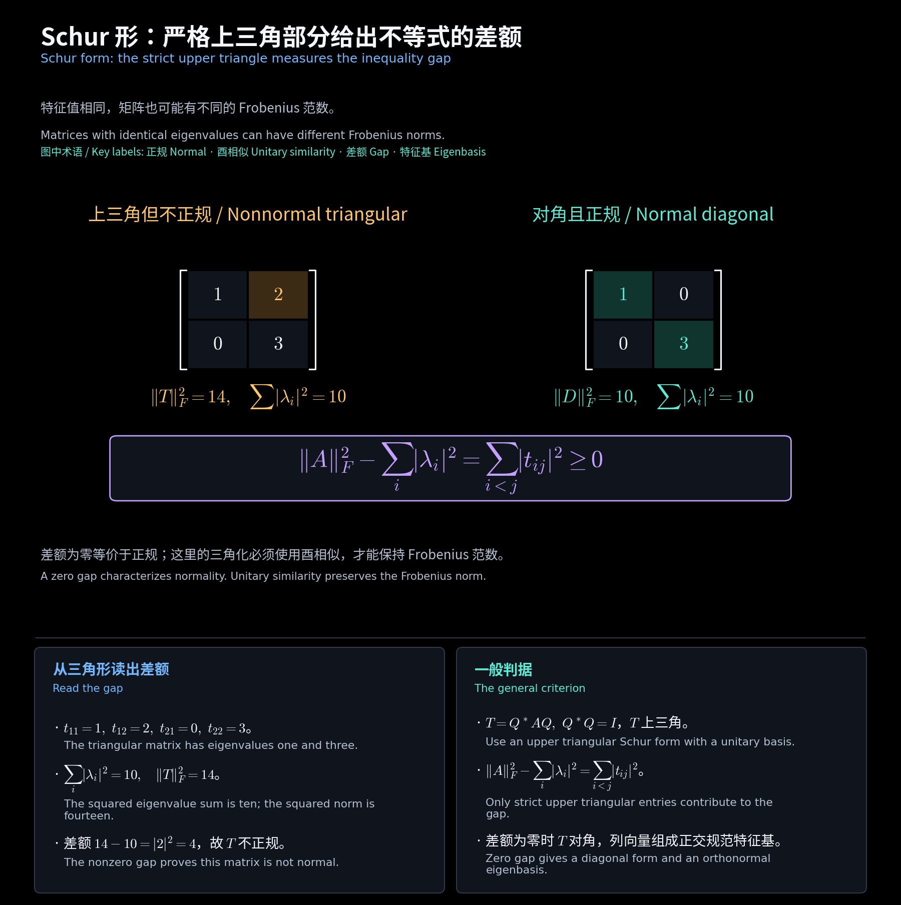

# 第 10 讲两份文件的双语笔记 / Bilingual Notes for Lecture Files 10(1) and 10(2)

**中文：** 新增两份文件分别为 28、35 页，封面分别写 **Lecture 11、Lecture 12**。第 10(2) 文件第 2—24 页重复第 10(1) 文件第 6—28 页的投影、伴随和正规内容；笔记合并讲解，保留两份原课件。

**English:** The two source files have 28 and 35 pages and covers labeled **Lecture 11** and **Lecture 12**. Part 10(2), pages 2-24, repeats the material on projections, adjoints and normality in part 10(1), pages 6-28. The notes merge this overlap while retaining both source files.

<!-- diagram:39_normal_schur:start -->

**图解 · Schur 形：严格上三角部分给出不等式的差额**

**读图：** 两矩阵都有特征值 1、3。左图严格上三角元 2 额外贡献平方范数 4；右图差额为零。一般矩阵先作酉 Schur 三角化，才能用这个差额判断正规性。

<!-- diagram:39_normal_schur:end -->

## 阅读顺序 / Reading order

| 文件 / File | 内容 / Contents |
| --- | --- |
| [01 投影与伴随变换](01_投影与伴随变换.md) | 幂等、直和、正交补、正交投影、伴随的 Gram 公式 / Projections, complements and adjoints |
| [02 正规矩阵、Schur 与 QR](02_正规矩阵与Schur及QR分解.md) | 定义、直接证明、酉对角化、Schur 不等式、QR / Normality, diagonalization and factorizations |
| [03 Hermitian 型与正定性](03_Hermitian型与正定性.md) | 实值型、合同、正定、主子式、Cholesky、平方根 / Hermitian forms and positive definiteness |
| [04 练习与公式速查](04_练习与公式速查.md) | 10 道双语练习、答案和条件速查 / Ten bilingual exercises with answers |

## 课件对照 / Slide map

| 10(1) 页序 / Pages | 10(2) 页序 / Pages | 对应内容 / Contents |
| --- | --- | --- |
| 2—5 | — | 酉变换复习，见上一讲 02 / Review of unitary maps; previous chapter |
| 6—11 | 2—7 | 投影、幂等、像与核 / Projectors and idempotents |
| 12—15 | 8—11 | 正交补、正交投影与半酉矩阵 / Orthogonal complements and projectors |
| 16—21 | 12—17 | 伴随的存在、构造及核像关系 / Adjoints and kernel-image relations |
| 22—26 | 18—22 | 正规的定义、交换判据与酉对角化 / Normality and unitary diagonalization |
| 27—28 | 23—24 | Schur、QR、特殊正规矩阵 / Schur, QR and special classes |
| — | 25—29 | Hermitian 矩阵与 Hermitian 型 / Hermitian matrices and forms |
| — | 30—35 | 正定、半正定、主子式、平方根、广义特征值 / Definiteness, square roots and generalized eigenvalues |

## 必要条件与课件提示 / Conditions and slide clarifications

**中文：** 正规按“具有正交规范特征基”定义，再证明 $AA^*=A^*A$。作业 10 第 5 题的独立证明不引用谱定理、Schur 引理或已知正规判据。

**English:** Start from the orthonormal-eigenbasis definition before proving the commutation test. HW10.5 is proved directly without citing the spectral theorem, Schur's lemma or another normality criterion.

**中文：** QR 定理要求满秩，$\mathbb C_n^{n\times n}$ 的下标 $n$ 表示秩。正规矩阵实谱推出 Hermitian 的反向结论也需要正规前提。伴随矩阵等于共轭转置，需要输入输出基均正交规范。

**English:** QR with positive diagonal assumes full rank. The real-spectrum criterion for being Hermitian assumes normality. Identifying the adjoint matrix with a conjugate transpose assumes orthonormal bases.

**中文：** 第 10(2) 文件第 27 页将 $(A-A^*)/(2i)$ 称作 skew-symmetric part，名称不准确：该矩阵本身是 Hermitian；斜 Hermitian 部分是 $(A-A^*)/2$。第 32 页 Sylvester 判据的编号重复为 4.33，笔记按名称区分。正定检查顺序主子式；半正定检查全部主子式。

**English:** On part 10(2), page 27, $(A-A^*)/(2i)$ is Hermitian, despite its label as a skew-symmetric part. Page 32 repeats theorem number 4.33 for Sylvester's criterion. Leading principal minors test positive definiteness, whereas all principal minors test semidefiniteness.

## 作业与资料 / Homework and sources

- [原课件 10(1) / Source part 1](<../../materials/lectures/Lecture 10-1-linear algebra.pdf>) · [原课件 10(2) / Source part 2](<../../materials/lectures/Lecture 10-2-linear algebra.pdf>)。
- [作业 9 第 5 题 / HW9.5](../../homework/homework09/Homework9_题目与解答.pdf)：$A=A^*=A^2\iff A=UU^*$。
- [作业 10 中文解答 / Chinese solutions](../../homework/homework10/Homework10_题目与解答.pdf) · [英文解答 / English solutions](../../homework/homework10/Homework10_英文题目与解答.pdf) · [原题 / Original](../../homework/homework10/Homework10_原始题目.pdf)。
- [上一讲 / Previous](../lecture09/00_阅读导航.md) · [中文精简版 / Chinese notes](../中文精简版/00_阅读导航.md)。
