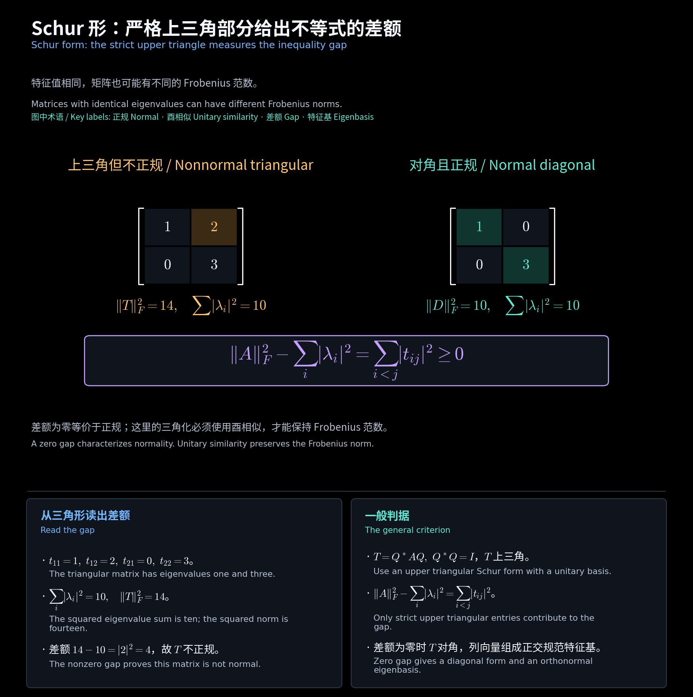

# 正规矩阵、Schur 与 QR 分解 / Normal Matrices, Schur and QR Factorizations

**中文：** 对应第 10(1) 文件第 22—28 页及第 10(2) 文件第 18—24 页。以下矩阵均在 $\mathbb C$ 上，算子矩阵采用正交规范基。

**English:** This chapter follows slides 22-28 of part 10(1) and slides 18-24 of part 10(2). Matrices are complex and operator matrices use orthonormal bases.

## 一、正规从正交规范特征基定义 / Normality starts with an orthonormal eigenbasis

**中文：** 课件定义 4.17：具有正交规范特征基的算子叫正规算子。在标准内积下，矩阵判据为

**English:** Definition 4.17 calls an operator normal when it has an orthonormal eigenbasis. In standard coordinates,

$$
Au_j=\lambda_ju_j,\quad u_i^*u_j=\delta_{ij}
\iff U^*AU=\Lambda,\quad U^*U=I,
\quad\Lambda=\operatorname{diag}(\lambda_1,\ldots,\lambda_n).
$$

**中文：** “可对角化”只要求特征基线性无关，正规还要求能选为正交规范基。不能把所有可对角化矩阵都叫正规。

**English:** Diagonalizability requires only an independent eigenbasis; normality requires an orthonormal one.

**教学补充反例 / Supplementary counterexample：**

$$
A=\begin{bmatrix}1&1\\0&2\end{bmatrix},\quad
AA^*=\begin{bmatrix}2&2\\2&4\end{bmatrix}\ne
A^*A=\begin{bmatrix}1&1\\1&5\end{bmatrix}.
$$

**中文：** 该矩阵有两个不同实特征值，因而可对角化，但不正规，也不 Hermitian。

**English:** Two distinct real eigenvalues make this matrix diagonalizable, yet it is neither normal nor Hermitian.

## 二、直接证明交换判据 / Proving the commutation criterion directly

**作业例题 / Homework example：HW10.5。**

$$
Au_j=\lambda_ju_j\Longrightarrow A^*u_j=\bar\lambda_ju_j
\Longrightarrow AA^*u_j=A^*Au_j=|\lambda_j|^2u_j.
$$

**中文：** 反向不引用谱定理或 Schur 引理。若 $AA^*=A^*A$，取单位特征向量 $Au=\mu u$，$B=A-\mu I$，则

**English:** The reverse implication need not cite the spectral theorem or Schur's lemma. If $AA^*=A^*A$, take a unit eigenvector $Au=\mu u$ and set $B=A-\mu I$:

$$
\|B^*u\|^2=u^*BB^*u=u^*B^*Bu=0
\Longrightarrow A^*u=\bar\mu u.
$$

$$
u^*x=0\Longrightarrow u^*Ax=\mu u^*x=0,\quad
u^*A^*x=\bar\mu u^*x=0.
$$

**中文：** 因而 $u^\perp$ 对 $A,A^*$ 都不变，限制仍交换。对维数归纳得到其正交规范特征基，再加上 $u$，得

**English:** The orthogonal complement is invariant under both maps and their restrictions commute. Induction supplies its orthonormal eigenbasis; adjoining $u$ gives

$$
\boxed{A\text{ 正规 / normal}\iff AA^*=A^*A}.
$$

## 三、三类特殊正规矩阵 / Three special normal classes

| 类别 / Class | 交换计算 / Commutation | 特征值条件（假设正规）/ Spectral condition assuming normality |
| --- | --- | --- |
| Hermitian | $AA^*=A^2=A^*A$ | $\lambda_j\in\mathbb R$ |
| 斜 Hermitian / Skew-Hermitian | $AA^*=-A^2=A^*A$ | $\lambda_j\in i\mathbb R$ |
| 酉 / Unitary | $AA^*=I=A^*A$ | $\lvert\lambda_j\rvert=1$ |

**中文：** 对正规矩阵写 $A=U\Lambda U^*$，各判据归结为 $\Lambda=\bar\Lambda$、$\Lambda=-\bar\Lambda$ 或 $\bar\Lambda\Lambda=I$。

**English:** Substitute $A=U\Lambda U^*$ and reduce each criterion to its diagonal entries. The normality hypothesis is necessary for the reverse spectral tests.

## 四、Schur 三角化与不等式 / Schur triangularization and inequality

**中文：** 任意复方阵都能酉相似为上三角。取单位特征向量作第一列并补全正交规范基，得第一列下方为零；对右下块递归。

**English:** Every complex square matrix has a unitary upper triangular form. Extend a unit eigenvector to an orthonormal basis, then recurse on the trailing block.

$$
Q^*AQ=T,\quad Q^*Q=I,\quad t_{ii}=\lambda_i,
\qquad\|A\|_F^2=\operatorname{tr}(A^*A)=\|T\|_F^2.
$$

$$
\boxed{\|A\|_F^2-\sum_i|\lambda_i|^2=\sum_{i<j}|t_{ij}|^2\ge0}.
$$

**中文：** 等号意味着 $T$ 已对角，从而 $A$ 正规；正规矩阵可选对角 Schur 形，必取等号。例 $T=\begin{bmatrix}1&2\\0&3\end{bmatrix}$ 的差额为 $4$。

**English:** Equality makes $T$ diagonal and hence $A$ normal. Normal matrices admit diagonal Schur forms, so the converse holds. The displayed two-dimensional example has gap four.

<!-- diagram:39_normal_schur:start -->

**图解 · Schur 形：严格上三角部分给出不等式的差额**

**读图：** 两矩阵都有特征值 1、3。左图严格上三角元 2 额外贡献平方范数 4；右图差额为零。一般矩阵先作酉 Schur 三角化，才能用这个差额判断正规性。

<!-- diagram:39_normal_schur:end -->

## 五、正对角 QR 的构造与唯一性 / QR with positive diagonal

$$
A\in\mathbb C^{n\times n},\quad\det A\ne0,
\qquad v_j=a_j-\sum_{i<j}u_i(u_i^*a_j),\quad
r_{jj}=\|v_j\|>0,\quad r_{ij}=u_i^*a_j\ (i<j).
$$

$$
u_j=v_j/r_{jj},\quad r_{ij}=0\ (i>j),\quad A=UR,\quad U^*U=I.
$$

**中文：** 若 $U_1R_1=U_2R_2$，则 $M=U_2^*U_1=R_2R_1^{-1}$ 同时酉、上三角且正对角。第一列单位化使 $m_{11}=1$，与其余列正交使第一行其余元为零；对子块重复可得 $M=I$，故唯一。

**English:** If two factorizations exist, $M=U_2^*U_1=R_2R_1^{-1}$ is unitary, triangular and positive on the diagonal. Unit length of the first column gives $m_{11}=1$; orthogonality clears the remaining first-row entries. Repeating proves $M=I$ and uniqueness.

**中文：** 原题 $\mathbb C_n^{n\times n}$ 中下标 $n$ 表示满秩。奇异矩阵不可能有全部正对角的 $R$，因为 $\det A=\det U\prod_jr_{jj}\ne0$。

**English:** The subscript in $\mathbb C_n^{n\times n}$ denotes full rank. A singular matrix cannot have a QR factor with every diagonal entry positive.

## 六、作业的三阶酉基 / A three-dimensional homework basis

**作业例题 / Homework example：HW10.4。**

$$
A=\begin{bmatrix}1&1&1\\-1&1&1\\-1&-1&1\end{bmatrix},\quad K=A-I,
\quad v_0=\frac{(1,-1,1)^T}{\sqrt3},\quad
u=\frac{(1,0,-1)^T}{\sqrt2},\quad v=\frac{(1,2,1)^T}{\sqrt6}.
$$

$$
Kv_0=0,\quad Ku=-\sqrt3v,\quad Kv=\sqrt3u,\quad
z_\pm=(u\pm iv)/\sqrt2,\quad Kz_\pm=\pm i\sqrt3z_\pm.
$$

$$
W=[v_0\ z_+\ z_-],\quad W^*W=I,\quad
W^*AW=\operatorname{diag}(1,1+i\sqrt3,1-i\sqrt3).
$$

[阅读导航 / Guide](00_阅读导航.md)
