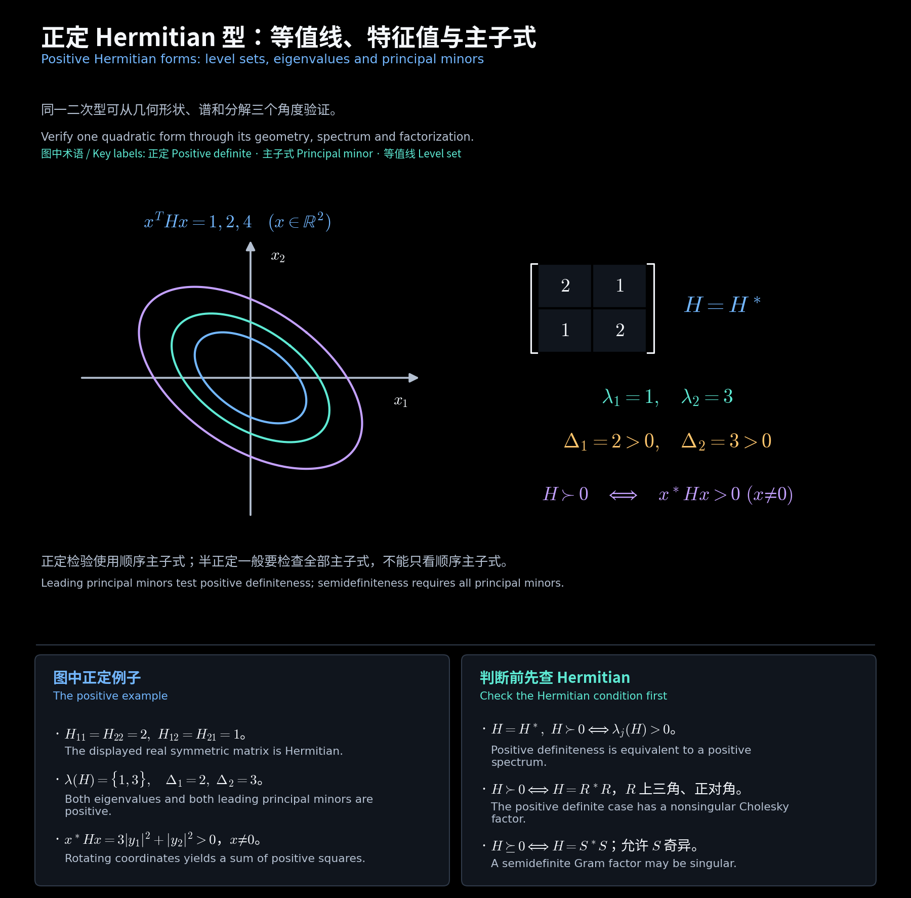

# Hermitian 型与正定性 / Hermitian Forms and Positive Definiteness

**中文：** 对应第 10(2) 文件第 25—35 页；第 1 部分未包含这些新内容。矩阵条件、二次型条件和谱条件要在同一域与同一种变换下比较。

**English:** Slides 25-35 of part 10(2) introduce these topics beyond part 10(1). Compare matrix, quadratic-form and spectral conditions over the same field and with the same transformation.

## 一、实值二次型刻画 Hermitian / Real quadratic values characterize Hermitian matrices

$$
A=A^*\Longrightarrow \overline{x^*Ax}=x^*A^*x=x^*Ax\in\mathbb R.
$$

**作业例题 / Homework example：HW10.8。** 若对所有复向量 $x$ 均有 $x^*Ax\in\mathbb R$，置 $H=A-A^*$。

$$
x^*Hx=0,\quad x=e_i\Rightarrow h_{ii}=0,\quad
x=e_i+e_j\Rightarrow h_{ij}+h_{ji}=0,\quad
x=e_i+ie_j\Rightarrow i(h_{ij}-h_{ji})=0.
$$

$$
H=0\Longrightarrow A=A^*.
$$

**中文：** 必须允许复向量测试。实向量只能看见实斜对称矩阵的二次型为零，例如 $\begin{bmatrix}0&1\\-1&0\end{bmatrix}$ 并非 Hermitian。

**English:** Testing all complex vectors matters. Real vectors alone give a zero quadratic form for a real skew-symmetric matrix, which need not be Hermitian.

## 二、Hermitian 运算、分解与标准形 / Algebra, decomposition and canonical form

$$
A=H+iK,\quad H=\frac{A+A^*}{2}=H^*,\quad
K=\frac{A-A^*}{2i}=K^*.
$$

**中文：** 分解中的 $K$ 是 Hermitian；真正的斜 Hermitian 部分是 $iK=(A-A^*)/2$。若 $H$ 为 Hermitian，$H^m,H^{-1}$（存在时）也为 Hermitian；实系数线性组合仍 Hermitian。

**English:** Here $K$ is Hermitian; the skew-Hermitian part is $iK$. Powers, existing inverses and real linear combinations of Hermitian matrices stay Hermitian.

$$
A=A^*,\ B=B^*:\qquad (AB)^*=BA
\Longrightarrow AB\text{ Hermitian}\iff AB=BA.
$$

$$
A=A^*\Longrightarrow A=U\operatorname{diag}(\lambda_i)U^*,\quad\lambda_i\in\mathbb R,
\qquad x=Uy\Longrightarrow x^*Ax=\sum_i\lambda_i|y_i|^2.
$$

**中文：** 酉变换保留特征值，给出上式的谱标准形。进一步允许可逆合同，非零系数才可归一化到 $\pm1$；不要将合同标准形误作酉相似结果。

**English:** Unitary changes preserve eigenvalues. Only after allowing general nonsingular congruence can nonzero coefficients be normalized to $\pm1$.

## 三、正定与半正定 / Positive definite and semidefinite

$$
A\succ0\iff A=A^*,\ x^*Ax>0\ (x\ne0),\qquad
A\succeq0\iff A=A^*,\ x^*Ax\ge0\ (\forall x).
$$

$$
A\succ0\iff\lambda_i>0\ (\forall i)
\iff A=Q^*Q\ (Q\text{ 可逆 / invertible})
\iff P^*AP=I\ (P\text{ 可逆 / invertible}).
$$

$$
A\succeq0\iff\lambda_i\ge0\ (\forall i)
\iff A=Q^*Q
\iff P^*AP=\operatorname{diag}(I_r,0),\quad r=\rank A.
$$

**中文：** 半正定的因子 $Q$ 可以奇异。可逆合同保持正定性和半正定性：$x^*P^*APx=(Px)^*A(Px)$。

**English:** A semidefinite factor $Q$ may be singular. Nonsingular congruence preserves definiteness by substituting $Px$ in the quadratic form.

## 四、主子式与 Cholesky 计算 / Principal minors and Cholesky computation

**中文：** Sylvester 判据要求先有 $A=A^*$。正定当且仅当所有顺序主子式 $\Delta_k=\det A[1\!:\!k,1\!:\!k]>0$。半正定当且仅当所有主子式非负，不能只检查顺序主子式。

**English:** Sylvester's criterion assumes $A=A^*$. Positive definiteness is equivalent to positive leading principal minors. Semidefiniteness requires all principal minors to be nonnegative.

$$
\operatorname{diag}(0,-1):\quad\Delta_1=\Delta_2=0,
\qquad e_2^*Ae_2=-1<0.
$$

**教学补充例题 / Supplementary example：**

$$
H=\begin{bmatrix}2&1\\1&2\end{bmatrix},\quad
\Delta_1=2,\quad\Delta_2=3,\quad\sigma(H)=\{1,3\},
$$

$$
R=\begin{bmatrix}\sqrt2&1/\sqrt2\\0&\sqrt{3/2}\end{bmatrix},
\qquad H=R^*R,\qquad x^*Hx=\|Rx\|^2>0\ (x\ne0).
$$

**中文：** 对正定 $A$，上三角正对角的 Cholesky 因子唯一。递推时 $r_{kk}=\sqrt{a_{kk}-\sum_{i<k}|r_{ik}|^2}$，再求 $r_{kj}$。

**English:** A positive definite matrix has a unique upper triangular Cholesky factor with positive diagonal. Compute each diagonal residual first, then the remaining row:

$$
r_{kj}=\frac{a_{kj}-\sum_{i<k}\bar r_{ik}r_{ij}}{r_{kk}}\quad(j>k).
$$

<!-- diagram:40_hermitian_positive:start -->

**图解 · 正定 Hermitian 型：等值线、特征值与主子式**

**读图：** 左图是实平面上的三条椭圆等值线，长短轴对应特征值 1、3。右图用正特征值和正顺序主子式验证同一矩阵正定；对复向量的结论由酉谱分解给出。

<!-- diagram:40_hermitian_positive:end -->

## 五、唯一非负平方根 / The unique nonnegative square root

$$
A=U\operatorname{diag}(\lambda_i)U^*\succeq0
\Longrightarrow A^{1/2}=U\operatorname{diag}(\sqrt{\lambda_i})U^*\succeq0,
\quad(A^{1/2})^2=A.
$$

**中文：** 若 $H\succeq0$ 且 $H^2=A$，则 $HA=AH$，每个 $A$ 的特征空间对 $H$ 不变。在特征值 $\lambda$ 的空间内，$H$ 的非负特征值只能是 $\sqrt\lambda$，故限制为 $\sqrt\lambda I$，得到唯一性。与 $A$ 交换的矩阵也保持这些特征空间，因此与 $A^{1/2}$ 交换。

**English:** Any nonnegative square root commutes with $A$ and preserves its eigenspaces. On the eigenspace at $\lambda$, its nonnegative eigenvalues must all equal $\sqrt\lambda$, forcing that scalar restriction and proving uniqueness. Every matrix commuting with $A$ preserves those same spaces and hence commutes with its square root.

## 六、正定矩阵的广义特征值 / Generalized eigenvalues of positive matrices

**讲义例题 / Slide example：例 / Example 4.13，$A\succ0,B\succ0$。**

$$
C=B^{-1/2}AB^{-1/2}\succ0,\qquad
\det(\lambda B-A)=\det B\cdot\det(\lambda I-C).
$$

$$
\det(\lambda B-A)=0\Longrightarrow\lambda\in\sigma(C)\subset(0,\infty).
$$

**中文：** $B^{-1}A$ 不一定 Hermitian，但与正定 Hermitian 的 $C$ 相似，所以根仍全为正实数。

**English:** Although $B^{-1}A$ need not be Hermitian, it is similar to the positive Hermitian matrix $C$, so its eigenvalues are positive real numbers.

[阅读导航 / Guide](00_阅读导航.md)
