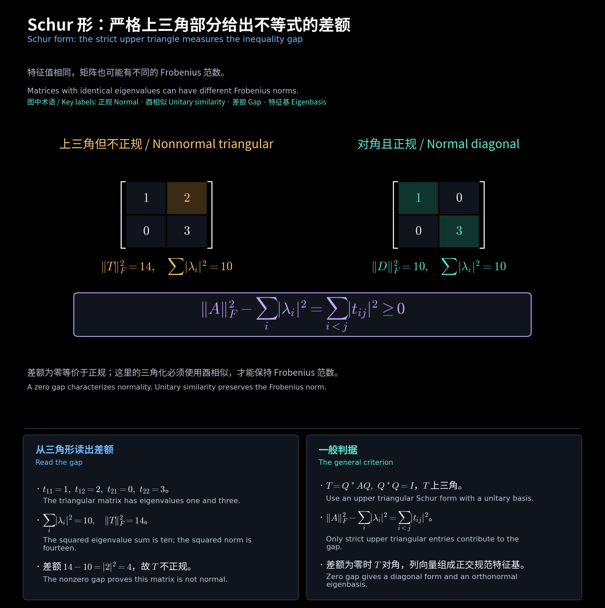

# 练习与公式速查 / Exercises and Formula Reference

第 10 讲两份课件合并出题；正规按正交规范特征基定义。 / The two slide files share one exercise set; normality is defined via an orthonormal eigenbasis.

<!-- diagram:39_normal_schur:start -->

**图解 · Schur 形：严格上三角部分给出不等式的差额**

**读图：** 两矩阵都有特征值 1、3。左图严格上三角元 2 额外贡献平方范数 4；右图差额为零。一般矩阵先作酉 Schur 三角化，才能用这个差额判断正规性。

<!-- diagram:39_normal_schur:end -->

## 练习与答案 / Exercises and answers

[先看：练习中的符号与做题方法](../练习阅读说明.md) · [全部练习](../练习总导航.md)

本页逐题保留完整条件，并给出一般元素、计算步骤及检验。 / Each exercise includes its full assumptions, intermediate calculations and checks.

[本讲课件与页码索引](00_阅读导航.md) · [作业原题](../../homework/homework10/Homework10_原始题目.pdf)

### 1. 幂等与正交投影的区别 / Idempotence and orthogonal projection

**对照：** 讲义 10(1) pp. 6–15；作业 9.5 的幂等反例。

**题目：** 在 $\mathbb C^2$ 标准内积下，构造一个投影矩阵 $P$，使 $P^2=P$，但它不是正交投影。写出对应映射、计算 $P^2,P^*$，并用核与像的方向解释。

**Question:** Construct a two-dimensional complex standard-coordinate idempotent that is not an orthogonal projector. Give its map, verify idempotence and failure of self-adjointness, and interpret its kernel and image.

**解答 / Solution：**

**第 1 步。** 让映射保留第一轴上的点，同时沿一条斜方向把其他点送到第一轴，例如令输出第一分量为两个输入分量之和。

**Step 1.** Project onto the first coordinate axis along an oblique direction, for example by adding both input coordinates in the first output component.

$$
\begin{gathered}
P=\begin{pmatrix}1&1\\0&0\end{pmatrix},\quad P\big((x,y)^T\big)=(x+y,0)^T,\\
P^2=\begin{pmatrix}1&1\\0&0\end{pmatrix}=P.
\end{gathered}
$$

**第 2 步。** 正交投影还须自伴。这里共轭转置不同于原矩阵，核也不与像垂直，所以它是斜投影。

**Step 2.** An orthogonal projector must also be self-adjoint. Here the adjoint differs and the kernel is not perpendicular to the image.

$$
P^*=\begin{pmatrix}1&0\\1&0\end{pmatrix}\ne P,\quad \ker P=\operatorname{span}\{(-1,1)^T\},\quad \operatorname{im}P=\operatorname{span}\{(1,0)^T\},\quad (1,0)^*(-1,1)=-1\ne0.
$$

### 2. 作业矩阵的酉三角化 / A unitary Schur basis

**对照：** 讲义 10(1) pp. 22–28；作业 10.4 原矩阵。

**题目：** 对 $A=\begin{pmatrix}1&1&1\\-1&1&1\\-1&-1&1\end{pmatrix}$ 构造酉矩阵 $W$ 使 $W^*AW$ 上三角。提示：令 $K=A-I$，先求核，再研究其正交补。

**Question:** Construct a unitary triangularization by splitting off the kernel of $K=A-I$.

**解答 / Solution：** 解 $Kx=0$ 得单位向量 $w=(1,-1,1)^T/\sqrt3$。在 $w^\perp$ 中取单位正交向量 $u=(1,0,-1)^T/\sqrt2,\ v=(1,2,1)^T/\sqrt6$。逐列计算 $Ku=-\sqrt3v,\ Kv=\sqrt3u$。因此 $z_\pm=(u\pm iv)/\sqrt2$ 满足 $Kz_\pm=\pm i\sqrt3z_\pm$。两者正交且均垂直于 $w$。取
$$
W=[w,z_+,z_-],\qquad W^*AW=\operatorname{diag}(1,1+i\sqrt3,1-i\sqrt3).
$$
对角阵已满足上三角要求；三列的内积检验给出 $W^*W=I$。

**English:** On the orthogonal complement, $K$ exchanges two real directions with opposite signs. Their normalized complex combinations diagonalize the restriction and complete the unitary basis.

### 3. 一般基下的伴随矩阵 / Adjoint matrices in general bases

**对照：** 讲义 10(1) pp. 16–21；作业 10.1、10.5 所用伴随的坐标公式。

**题目：** 设 $T:V\to W$ 为有限维复内积空间之间的线性映射，$\dim V=n,\dim W=m$。输入基 $B$、输出基 $C$ 的 Gram 矩阵为 $G_V,G_W$，$A=[T]_{C\leftarrow B}\in\mathbb C^{m\times n}$。由伴随定义 $\langle Tv,w\rangle_W=\langle v,T^*w\rangle_V$ 求 $F=[T^*]_{B\leftarrow C}$，并说明何时 $F=A^*$。

**Question:** Let $T:V\to W$ have matrix $A$ in possibly nonorthonormal bases with Gram matrices $G_V,G_W$. Derive its adjoint matrix $F$ from the defining inner-product identity and specify when it equals the conjugate transpose. The spaces have dimensions $n,m$.

$$
\begin{gathered}
A=[T]_{C\leftarrow B}\in\mathbb C^{m\times n},\quad F=[T^*]_{B\leftarrow C}\in\mathbb C^{n\times m},\\
\langle Tv,w\rangle_W=\langle v,T^*w\rangle_V.
\end{gathered}
$$

**解答 / Solution：**

**第 1 步。** 记任意输入、输出向量的坐标为 $x=[v]_B,y=[w]_C$。伴随的输入输出方向相反，所以 $F$ 是 $n\times m$ 矩阵；分别用 Gram 矩阵写定义两侧。

**Step 1.** Use arbitrary coordinate columns in the two spaces. The adjoint reverses the spaces, so its matrix is $n$ by $m$. Express both inner products with their Gram matrices.

$$
\begin{gathered}
\langle Tv,w\rangle_W=(Ax)^*G_Wy=x^*A^*G_Wy,\\
\langle v,T^*w\rangle_V=x^*G_VFy.
\end{gathered}
$$

**第 2 步。** 等式对所有 $x,y$ 成立，逐取标准坐标便知中间矩阵相等。基的 Gram 矩阵正定可逆，因此可以解出 $F$。

**Step 2.** Equality for every coordinate pair identifies the middle matrices. A basis Gram matrix is positive definite and invertible, so solve for the adjoint matrix.

$$
\begin{gathered}
A^*G_W=G_VF\Longrightarrow\boxed{F=G_V^{-1}A^*G_W}.\\
G_V=I_n,\ G_W=I_m\Longrightarrow F=A^*.
\end{gathered}
$$

**第 3 步。** 两组基均正交规范时，上述两个 Gram 矩阵才都是单位矩阵。给一个一般基的例子，可以直接看到伴随的坐标矩阵与共轭转置的差别。

**Step 3.** Orthonormal bases make both Gram matrices identities. The example below shows the distinction in a general basis and checks the defining matrix identity.

$$
G_V=\operatorname{diag}(1,2),\ G_W=I_2,\ A=\begin{pmatrix}1&1\\0&1\end{pmatrix}:\quad F=\begin{pmatrix}1&0\\1/2&1/2\end{pmatrix},\quad G_VF=A^*.
$$

### 4. 从定义得到正规判据 / Derive the normality criterion

**对照：** 讲义 10(1) pp. 22–26；作业 10.5 独立证明及 10.2。

**题目：** 在有限维复内积空间中，“正规”指有正交规范特征基。直接证明它等价于 $A^*A=AA^*$。逆向证明从 $A-\lambda I$ 的核入手，不能调用 Schur 分解或预设正规谱定理。

**Question:** Prove the criterion from the eigenbasis definition, without using Schur or the spectral theorem.

**解答 / Solution：** 若 $A=U\Lambda U^*$，其中 $U$ 酉、$\Lambda$ 对角，则 $\Lambda^*\Lambda=\Lambda\Lambda^*$，乘回 $U,U^*$ 即得交换式。反之，复数域上可取单位特征向量 $v$，$Av=\lambda v$。置 $M=A-\lambda I$，展开可得 $M^*M=MM^*$，故 $\|Mx\|^2=\|M^*x\|^2$ 对所有 $x$ 成立。取 $x=v$ 得 $A^*v=\bar\lambda v$。于是 $v^\perp$ 对 $A,A^*$ 均不变（例如 $v^*Ax=(A^*v)^*x=0$）。在 $\mathbb Cv\oplus v^\perp$ 下 $A$ 分块对角，补空间上的限制仍满足交换式。按维数归纳，从一维起逐个补出正交规范特征基。

**English:** A unitary eigenbasis proves commutation directly. Conversely the shifted operator and its adjoint have the same kernel by equality of norms. The orthogonal complement of one eigenvector reduces both operators; induction constructs the rest of the basis.

### 5. Schur 不等式及等号 / Schur's inequality and equality

**对照：** 讲义 10(1) pp. 27–28；作业 10.3。

**题目：** 已知任意复方阵 $A$ 与上三角矩阵 $T$ 酉相似。用此结论证明 $\sum_j|\lambda_j|^2\le\sum_{ij}|a_{ij}|^2$ 并刻画等号，其中 $\lambda_j$ 按代数重数计。以 $T=\begin{pmatrix}1&2\\0&3\end{pmatrix}$ 核对差额。

**Question:** Prove Schur's bound, characterize equality, and compute the gap in the displayed example.

**解答 / Solution：** 取 $T=U^*AU$，$U$ 酉。由迹的循环性，$\operatorname{tr}(T^*T)=\operatorname{tr}(A^*A)=\sum_{ij}|a_{ij}|^2$。三角阵的对角元就是特征值，扣除对角平方和后，差额为 $\sum_{i<j}|t_{ij}|^2\ge0$。等号意味着 $T$ 对角，于是 $A$ 有正交规范特征基；反之正规矩阵可选对角的 $T$。例中差额为 $|2|^2=4$。

**English:** Unitary similarity preserves the squared Frobenius norm. After subtracting the eigenvalue contribution only strictly upper triangular entries remain; they all vanish precisely in the equality case.

### 6. 逐列构造正对角 QR / Constructing positive-diagonal QR

**对照：** 讲义 10(1) pp. 27–28；作业 10.6 的构造及唯一性。

**题目：** 对实矩阵 $A$ 求唯一的正对角 QR 分解 $A=UR$：$U^TU=I_2$，$R$ 上三角且 $r_{11},r_{22}>0$。按列做 Gram–Schmidt，列出各投影系数、残差及长度，再实际相乘检验。

**Question:** Find the positive-diagonal QR factorization $A=UR$ of the displayed real matrix, showing Gram-Schmidt projections, residuals and norms, and checking the product and orthogonality.

$$
\begin{gathered}
A=\begin{pmatrix}1&1\\1&0\end{pmatrix},\\
\det A=-1\ne0.
\end{gathered}
$$

**解答 / Solution：**

**第 1 步。** 第一列 $a_1=(1,1)^T$ 的长度成为 $r_{11}$，归一化后是 $u_1$；第二列 $a_2=(1,0)^T$ 对第一方向的投影系数成为 $r_{12}$。

**Step 1.** Normalize the first column and record its norm. The inner product of its unit direction with the second column gives the first-row off-diagonal coefficient.

$$
r_{11}=\sqrt2,\quad u_1=(1,1)^T/\sqrt2,\quad r_{12}=u_1^Ta_2=1/\sqrt2.
$$

**第 2 步。** 减去第一方向上的投影得到正交残差，残差长度取正值，固定第二列的方向符号。

**Step 2.** Subtract the projection to obtain the second orthogonal residual. Taking its norm positively fixes the sign of the second unit column.

$$
v_2=a_2-r_{12}u_1=(1/2,-1/2)^T,\quad r_{22}=\|v_2\|=1/\sqrt2,\quad u_2=(1,-1)^T/\sqrt2.
$$

**第 3 步。** 把单位向量作为 $U$ 的列，把已算出的系数放入 $R$；原列的分解正好给出 $A=UR$。若另有 $A=U'R'$，则 $U'^*U=R'R^{-1}$ 既酉又上三角。逐列用正交性可知它是对角阵；正对角元又须模为 1，故它是单位阵，分解唯一。

**Step 3.** Assemble the unit columns and triangular coefficients. The column decompositions reconstruct the original matrix; nonsingularity and positive diagonal give the required unique factorization.

$$
\boxed{U=\frac1{\sqrt2}\begin{pmatrix}1&1\\1&-1\end{pmatrix},\quad R=\begin{pmatrix}\sqrt2&1/\sqrt2\\0&1/\sqrt2\end{pmatrix}},\quad U^TU=I_2,\quad UR=\begin{pmatrix}1&1\\1&0\end{pmatrix}.
$$

### 7. Hermitian 矩阵的乘积 / Products of Hermitian matrices

**对照：** 讲义 10(2) pp. 25–29；作业 10.9。

**题目：** 设 $A,B\in\mathbb C^{n\times n}$ 均为 Hermitian，即 $A^*=A,B^*=B$。证明 $AB$ 为 Hermitian 当且仅当 $AB=BA$，并给一个二阶反例说明乘积不一定 Hermitian。

**Question:** For Hermitian matrices of the same order, prove that their product is Hermitian exactly when they commute. Give a two-by-two counterexample to unconditional closure under products.

**解答 / Solution：**

**第 1 步。** 共轭转置会把乘积次序倒过来。用两个矩阵自身的 Hermitian 条件化简，再对照乘积的 Hermitian 定义。

**Step 1.** Taking an adjoint reverses product order. Substitute the two Hermitian identities and compare with the definition for the product.

$$
\begin{gathered}
(AB)^*=B^*A^*=BA,\\
\boxed{AB=(AB)^*\iff AB=BA}.
\end{gathered}
$$

**第 2 步。** 下列两矩阵各自为实对称矩阵，因而 Hermitian；但它们不交换，乘积的两个非对角元也不满足对称条件。

**Step 2.** Both displayed real symmetric matrices are Hermitian, but they do not commute and their product is not symmetric or Hermitian.

$$
A=\begin{pmatrix}1&0\\0&2\end{pmatrix},\quad B=\begin{pmatrix}0&1\\1&0\end{pmatrix},\quad AB=\begin{pmatrix}0&1\\2&0\end{pmatrix}\ne\begin{pmatrix}0&2\\1&0\end{pmatrix}=BA.
$$

### 8. 两种正定检验 / Two positive-definiteness tests

**对照：** 讲义 10(2) pp. 30–35；正定判据与非正定边界。

**题目：** 在复标准内积下，用顺序主子式与特征值两种方法证明下列 $H$ 正定。正定指 $H=H^*$ 且对全部非零复向量 $x$ 有 $x^*Hx>0$；先核验 Hermitian 条件。

**Question:** Prove positive definiteness of the displayed matrix using both leading principal minors and eigenvalues. First check that it is Hermitian; positive definiteness refers to every nonzero complex vector.

$$
H=\begin{pmatrix}2&1\\1&2\end{pmatrix}.
$$

**解答 / Solution：**

**第 1 步。** 该实矩阵对称，故 Hermitian。Sylvester 判据要求所有顺序主子式严格为正；二阶矩阵只有左上角一阶子式与整个行列式。

**Step 1.** The matrix is real symmetric and hence Hermitian. Sylvester's criterion here checks its upper-left entry and full determinant.

$$
H^*=H,\quad \Delta_1=2>0,\quad \Delta_2=2\cdot2-1\cdot1=3>0\Longrightarrow H\succ0.
$$

**第 2 步。** 另一方法求特征多项式。Hermitian 矩阵可酉对角化，二次型变成特征值加权的模平方之和；全部特征值为正就得到正定。

**Step 2.** Alternatively compute the eigenvalues. Unitary diagonalization of a Hermitian matrix expresses its quadratic form as a weighted sum of squared moduli; positive weights give positive definiteness.

$$
\begin{gathered}
\det(zI-H)=(z-2)^2-1=(z-1)(z-3),\\
\lambda_1=1>0,\quad \lambda_2=3>0.
\end{gathered}
$$

**第 3 步。** 还可直接展开定义作核验。非零向量不可能同时满足 $x_1+x_2=0$ 与 $x_1-x_2=0$，因此下面的和严格为正。

**Step 3.** A direct check of the defining form gives a sum of positive squares. Both linear combinations can vanish only for the zero vector.

$$
x^*Hx=\tfrac32|x_1+x_2|^2+\tfrac12|x_1-x_2|^2>0\quad (x\ne0).
$$

## 中英术语 / Terminology

| 中文 | English |
| --- | --- |
| 幂等 | idempotent |
| 正交投影 | orthogonal projector |
| 伴随 | adjoint |
| 正规 | normal |
| 正定 | positive definite |
| 顺序主子式 | leading principal minor |

[阅读导航 / Guide](00_阅读导航.md)
