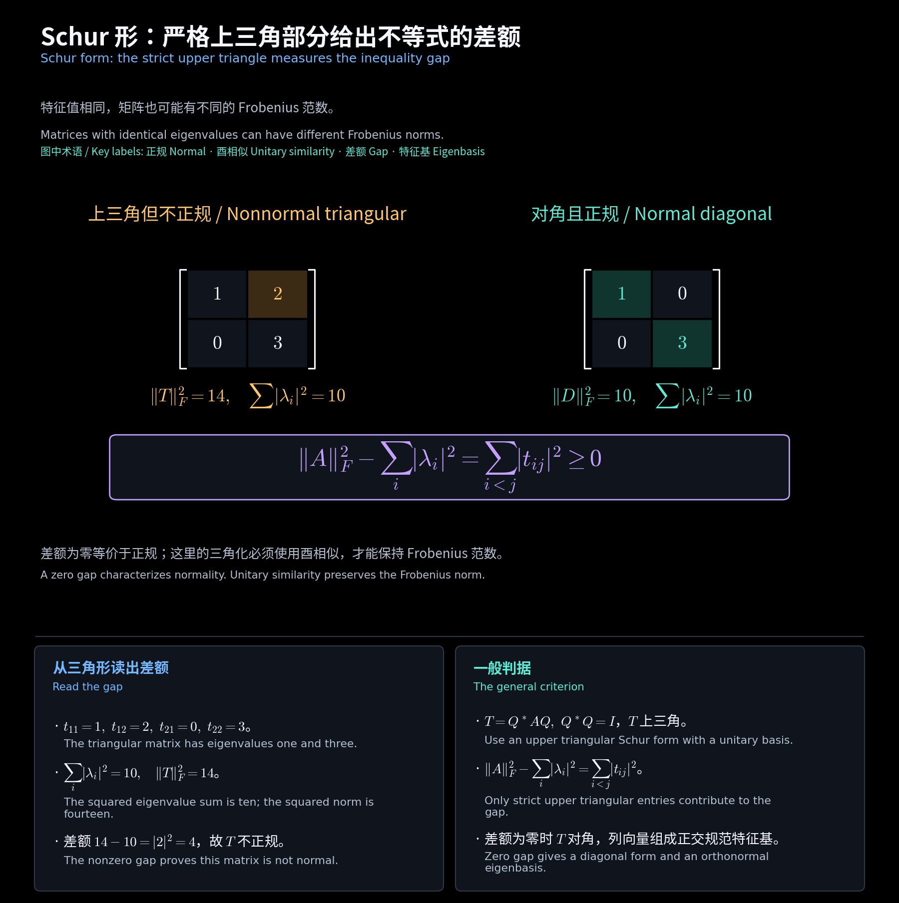

# 练习与公式速查 / Exercises and Formula Reference

所有数值题均为教学补充；作业原题及完整证明另见对应作业 PDF。 / Numerical exercises are teaching supplements; homework PDFs retain the original questions and complete proofs.

<!-- diagram:39_normal_schur:start -->

**图解 · Schur 形：严格上三角部分给出不等式的差额**

**读图：** 两矩阵都有特征值 1、3。左图严格上三角元 2 额外贡献平方范数 4；右图差额为零。一般矩阵先作酉 Schur 三角化，才能用这个差额判断正规性。

<!-- diagram:39_normal_schur:end -->

## 练习与答案 / Exercises and answers

### 1

**题目：** 给出一个幂等但非正交投影的矩阵。

**Question:** Give an idempotent that is not an orthogonal projector.

**答案 / Answer：** $P=\begin{bmatrix}1&1\\0&0\end{bmatrix}$，$P^2=P\ne P^*$。

### 2

**题目：** 求投影到 $\operatorname{span}(1,1)^T$ 的正交投影矩阵。

**Question:** Find the orthogonal projector onto $\operatorname{span}(1,1)^T$.

**答案 / Answer：** $u=(1,1)^T/\sqrt2,\ P=uu^*=\frac12\begin{bmatrix}1&1\\1&1\end{bmatrix}$。

### 3

**题目：** 给定一般基的 Gram 矩阵，写出伴随的坐标矩阵。

**Question:** Give the adjoint matrix in general bases with specified Gram matrices.

**答案 / Answer：** $C=G_V^{-1}A^*G_W$，输入输出基均正交规范时为 $A^*$。 / Orthonormal bases reduce this to $A^*$.

### 4

**题目：** 矩阵 $A=\begin{bmatrix}1&1\\0&2\end{bmatrix}$ 可对角化吗？正规吗？

**Question:** Is the displayed matrix diagonalizable? Is it normal?

**答案 / Answer：** 两个不同特征值，故可对角化；$AA^*\ne A^*A$，故不正规。 / Distinct eigenvalues give diagonalizability; the products differ, so it is not normal.

### 5

**题目：** 求 $T=\begin{bmatrix}1&2\\0&3\end{bmatrix}$ 的 Schur 不等式差额。

**Question:** Find the Schur inequality gap for the displayed matrix.

**答案 / Answer：** $\|T\|_F^2-(|1|^2+|3|^2)=14-10=4$。

### 6

**题目：** 求 $A=\begin{bmatrix}1&1\\1&0\end{bmatrix}$ 的正对角 QR。

**Question:** Find the QR factorization with positive diagonal of the displayed matrix.

**答案 / Answer：** $U=\frac1{\sqrt2}\begin{bmatrix}1&1\\1&-1\end{bmatrix},\quad R=\begin{bmatrix}\sqrt2&1/\sqrt2\\0&1/\sqrt2\end{bmatrix}$。

### 7

**题目：** Hermitian 矩阵的乘积一定 Hermitian 吗？

**Question:** Is a product of Hermitian matrices always Hermitian?

**答案 / Answer：** $(AB)^*=BA$，当且仅当 $AB=BA$。 / Exactly when the two factors commute.

### 8

**题目：** 用两种方法验证 $H=\begin{bmatrix}2&1\\1&2\end{bmatrix}\succ0$。

**Question:** Verify positive definiteness of the displayed matrix in two ways.

**答案 / Answer：** $\Delta_1=2,\Delta_2=3>0$；或 $\sigma(H)=\{1,3\}\subset(0,\infty)$。

### 9

**题目：** 顺序主子式全非负能否推出半正定？

**Question:** Do nonnegative leading principal minors imply semidefiniteness?

**答案 / Answer：** 不能：$\operatorname{diag}(0,-1)$ 的顺序主子式均为零，但 $e_2^*Ae_2=-1$。 / No; the displayed diagonal matrix is a counterexample.

### 10

**题目：** 若 $A\succ0,B\succ0$，为何 $\det(\lambda B-A)$ 的根全为正实数？

**Question:** Why are all roots of the displayed generalized characteristic polynomial positive?

**答案 / Answer：** $C=B^{-1/2}AB^{-1/2}\succ0,\ \det(\lambda B-A)=\det B\det(\lambda I-C)$。

## 中英术语 / Terminology

| 中文 | English |
| --- | --- |
| 幂等 | idempotent |
| 正交投影 | orthogonal projector |
| 伴随 | adjoint |
| 正规 | normal |
| 正定 | positive definite |
| 顺序主子式 | leading principal minor |

[阅读导航 / Guide](00_阅读导航.md)
