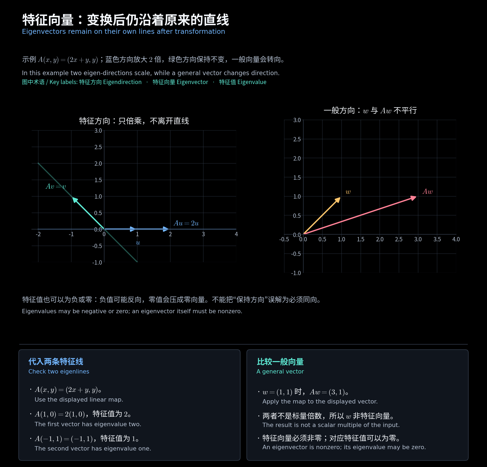

# 第 11 讲阅读导航 / Spectral Decomposition and SVD

[原始课件（封面 Lecture 13）](<../../materials/lectures/Lecture 11-linear algebra.pdf>) · [上一讲](../lecture10/00_阅读导航.md) · [下一讲](../lecture12/00_阅读导航.md)

**中文：** 谱分解追踪同一个空间里的特征分量。奇异值分解允许输入、输出空间不同，用两组正交规范方向描述矩阵。课件第 2 页列出第五章五节；本讲实际讲到第 5.2 节。

**English:** Slides 3–23 decompose a diagonalizable operator on one space. Slides 24–32 pair input and output directions for a general rectangular map.

**读图：** 先在图中找到变换前后仍共线的方向。谱分解把每个特征空间上的作用记为一个标量；SVD 另选输入和输出两组方向。

| 课件页 | 阅读与计算 |
| --- | --- |
| 3—10 | [谱投影与谱分解](01_谱投影与谱分解.md)：由右特征向量和对偶行构造投影；合并重特征值；例 5.2 将共轭对合为实块。 |
| 11—23 | 同篇：算子表述、投影的秩与乘积、Jordan 块的幂零项、正规矩阵的正交投影。 |
| 24—29 | [奇异值与施密特对](02_奇异值与施密特对.md)：两个 Gram 矩阵的核与正谱，构造左右成对的单位向量。 |
| 30—32 | 同篇：矩形对角阵、完整与紧 SVD、例 5.4 的秩一矩阵。 |
| 自测 | [练习与公式速查](03_练习与公式速查.md)：插值投影、斜投影、SVD 补基与迹。 |

本讲各正文章末均有 8 道带解例题，另可在练习与公式速查中集中自测 8 题。

**作业对照。** HW11.1、5、6 求谱分解，第 5 题用自伴性，第 6 题用最小多项式。HW11.2 证明 Schmidt 对的两个等式和算子展开；第 3、4 题分别计算秩一和满行秩矩阵的 SVD。

[原题](../../homework/homework11/Homework11_原始题目.pdf) · [中文解答](../../homework/homework11/Homework11_题目与解答.pdf) · [English solutions](../../homework/homework11/Homework11_英文题目与解答.pdf)
