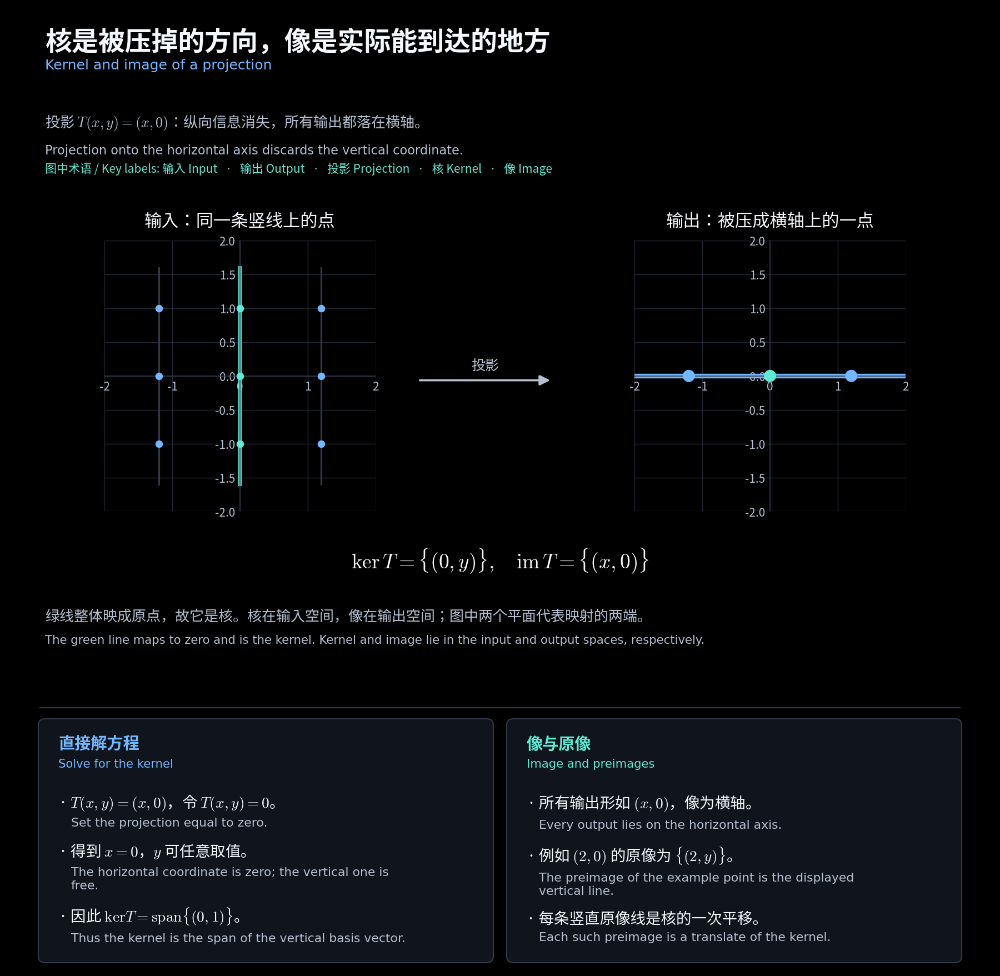

# 奇异值与施密特对 / Singular Values and Schmidt Pairs

**中文：** 对应第 11 讲文件第 24—32 页。设 $A:\mathbb C^n\to\mathbb C^m$，秩为 $r$。输入、输出空间可以有不同维数。课件把输入空间的基排在 $U$，输出空间的基排在 $V$，从头到尾采用 $A=VDU^*$。

**English:** Slides 24–32 use $U$ for the input basis and $V$ for the output basis. The rectangular diagonal factor maps coordinates from an $n$-dimensional domain to an $m$-dimensional codomain.

## 一、为什么看两个 Gram 矩阵 / Why take Gram matrices?

$$
x^*A^*Ax=\|Ax\|^2,\qquad
\ker(A^*A)=\ker A,\qquad \ker(AA^*)=\ker A^*.
$$

**中文：** 两个 Gram 矩阵均为半正定 Hermitian 矩阵，秩都等于 $r$。若 $A^*Ax=\lambda x$ 且 $\lambda>0$，则 $Ax\ne0$，又有 $AA^*(Ax)=\lambda Ax$。在这对特征空间之间，$A$ 的逆映射为 $A^*/\lambda$，故正特征值连同重数一致。两个零空间的维数分别为 $n-r$ 和 $m-r$。

**English:** Multiplication by $A$ identifies the two eigenspaces for a positive eigenvalue, with inverse $A^*/\lambda$. The positive spectra therefore agree with multiplicity, although the nullities may differ.

**读图：** 将图中的横、纵坐标轴换成例 5.4 的两个右奇异方向：沿第一方向的分量放大五倍，沿第二方向的分量全部消失。

## 二、用一个向量确定一对 / Constructing matched vectors

**中文：** 在 $A^*A$ 的正特征空间内取正交规范基 $x_j$。务必用同一对向量的公式确定另一端，特别是在重奇异值的子空间中：

$$
\sigma_j=\sqrt{\lambda_j},\quad y_j=Ax_j/\sigma_j,\quad
Ax_j=\sigma_jy_j,\quad A^*y_j=\sigma_jx_j,\qquad
y_i^*y_j=\frac{x_i^*A^*Ax_j}{\sigma_i\sigma_j}=\delta_{ij}.
$$

**中文：** 将两边分别用 $\ker A$、$\ker A^*$ 的正交规范基补齐。$D$ 是 $m\times n$，左上角为正奇异值降序排列的对角阵。若仅保留前 $r$ 列，便得到紧分解和逐项展开：

$$
A=V_r\operatorname{diag}(\sigma_1,\ldots,\sigma_r)U_r^*
=\sum_{j=1}^r\sigma_jy_jx_j^*,\qquad
Ax=\sum_{j=1}^r\sigma_jy_j\langle x_j,x\rangle .
$$

**English:** Complete the two bases in their respective kernels for a full SVD. Omitting zero directions gives the compact factorization. For a repeated singular value, choose the input basis freely inside its eigenspace, then compute the matching output basis from $Ax_j/\sigma_j$.

## 三、例 5.4：一行数据给出两种方向 / One row, two input directions

$$
 A=\begin{bmatrix}3&4\\0&0\\0&0\end{bmatrix},\quad
 AA^*=\operatorname{diag}(25,0,0),\quad y_1=e_1,\quad
 x_1=A^*e_1/5=(3,4)^T/5.
$$

**中文：** 单位向量 $x_1$ 被送到 $5e_1$。与它垂直的 $x_2=(-4,3)^T/5$ 被送到零，因为 $3(-4)+4(3)=0$。任意 $(s,t)^T$ 只留下沿 $x_1$ 的分量，结果是 $(3s+4t,0,0)^T$。于是 $V=I_3$、$U=[x_1\ x_2]$、$D_{11}=5$，其余元素为零。

**English:** The input component along $(3,4)^T/5$ is stretched by five; its perpendicular component is annihilated. This immediately verifies the dimensions and product of the full SVD.

**中文：** 作业 11 第 4 题是 $3\times4$ 矩阵。先取较小的 $3\times3$ 矩阵 $AA^*$，解出 $y_j$ 后反算 $x_j=A^*y_j/\sigma_j$，最后补一个右零向量。可用 $\sum_j\sigma_j^2=\operatorname{tr}(AA^*)$ 检查数值。

**English:** For the $3\times4$ exercise, starting on the left saves one dimension in the eigenproblem. A right null vector completes the four-column input basis.

## 分章例题 / Worked examples

### 例 1　秩一矩阵的紧分解 / Compact SVD of an outer product

令 $A=(1,2)^T(2,-1)$。求唯一的正奇异值和一组配对向量。

**Question.** Find the positive singular value and a Schmidt pair.

**解。** 写 $A=ab^T$，两因子的长度均为 $\sqrt5$。分别单位化，得到输入方向 $x$、输出方向 $y$。回乘可检验方向次序。

$$
x=(2,-1)^T/\sqrt5,\quad y=(1,2)^T/\sqrt5,\quad A=5yx^T,\quad Ax=5y .
$$

**Solution.** For a rank-one outer product, the positive singular value is the product of the two vector lengths.

### 例 2　负对角元的符号 / Track the sign of a diagonal entry

$A=\operatorname{diag}(-2,3)$。按奇异值降序，求 $A=VDU^T$。

**Question.** Compute a full SVD in descending order.

**解。** $A^TA=\operatorname{diag}(4,9)$，因此首个输入方向为 $e_2$。用 $y_j=Ax_j/\sigma_j$ 得输出方向 $e_2,-e_1$。

$$
U=[e_2,e_1],\quad V=[e_2,-e_1],\quad D=\operatorname{diag}(3,2),\quad VDU^T=A .
$$

**Solution.** The sign belongs to the paired vector; the singular values stay nonnegative.

### 例 3　矩形矩阵的零空间 / Complete a rectangular SVD

给定 $A=\begin{bmatrix}1&1&0\\0&0&2\end{bmatrix}$。从 $AA^T$ 出发，求完整 SVD。

**Question.** Find a full SVD starting from $AA^T$.

**解。** $AA^T=\operatorname{diag}(2,4)$，取 $y_1=e_2,\ y_2=e_1$。反算 $x_j=A^Ty_j/\sigma_j$，再解 $Ax_3=0$。

$$
U=\left[e_3,\tfrac{(1,1,0)^T}{\sqrt2},\tfrac{(1,-1,0)^T}{\sqrt2}\right],\quad V=[e_2,e_1],\quad D=\begin{bmatrix}2&0&0\\0&\sqrt2&0\end{bmatrix}.
$$

**Solution.** The third input direction has zero image; $AU=VD$ verifies the full factorization.

### 例 4　从奇异值恢复范数 / Recover two norms

一个 $4\times3$ 矩阵的正奇异值为 4、3。求谱范数、Frobenius 范数及左右零空间维数。

**Question.** Determine both norms and both nullities.

**解。** 秩为 2。输入、输出端各减去秩得到零空间维数；对角因子 $D$ 保留了矩阵的两个范数。

$$
\|A\|_2=4,\quad \|A\|_F=\sqrt{4^2+3^2}=5,\quad \dim\ker A=1,\quad \dim\ker A^*=2 .
$$

**Solution.** The maximum stretch is the largest singular value. The squared Frobenius norm sums the squared stretches.

### 例 5　重奇异值的配对 / Match vectors for a repeated value

令 $A=2\begin{bmatrix}0&-1\\1&0\end{bmatrix}$。取 $x_1=(1,1)^T/\sqrt2$、$x_2=(-1,1)^T/\sqrt2$。求配对的输出基。

**Question.** Find the output basis paired with the two given input vectors.

**解。** $A^TA=4I$，两奇异值均为 2。虽然任意正交基均可作输入基，选定后须逐列计算 $Ax_j/2$。

$$
y_1=(-1,1)^T/\sqrt2,\quad y_2=(-1,-1)^T/\sqrt2,\quad A=2[y_1,y_2][x_1,x_2]^T .
$$

**Solution.** The output vectors are the rotated input vectors, in the same order.

### 例 6　复矩阵中伴随的作用 / Use the adjoint for a complex row

设 $A=[1,\ i]$。取 $y_1=1$，求 $x_1$ 与一个单位右零向量。

**Question.** Find the matched right vector and a unit vector in the right kernel.

**解。** $AA^*=2$ 给出 $\sigma_1=\sqrt2$。取 $x_1=A^*/\sqrt2$；再解 $s+it=0$ 并归一化。

$$
x_1=(1,-i)^T/\sqrt2,\quad x_2=(-i,1)^T/\sqrt2,\quad Ax_1=\sqrt2,\quad Ax_2=0,\quad x_1^*x_2=0 .
$$

**Solution.** Conjugating the row is essential both for the positive pair and for checking orthogonality.

### 例 7　求最大放大的方向 / Find the maximum-gain input

$A=\begin{bmatrix}2&1\\1&2\end{bmatrix}$。求单位输入下 $\|Ax\|$ 的最大值和一个取得最大值的实向量。

**Question.** Find the largest output norm over unit inputs and a maximizing vector.

**解。** $A^TA=\begin{bmatrix}5&4\\4&5\end{bmatrix}$ 的正交特征方向为 $(1,\pm1)^T$，特征值为 9、1。最大 Rayleigh 商给出最大输出长度的平方。

$$
\max_{\|x\|=1}\|Ax\|^2=9,\quad x=(1,1)^T/\sqrt2,\quad Ax=3x .
$$

**Solution.** The maximal stretch is 3, attained along the first right singular direction.

### 例 8　从配对重建线性映射 / Reconstruct a map from a pair

已知一个实秩一映射的 $\sigma=3$、$x=(1,-1)^T/\sqrt2$、$y=(0,1)^T$。求矩阵及 $(2,1)^T$ 的像。

**Question.** Recover the matrix and evaluate it on $(2,1)^T$.

**解。** 任意输入 $v$ 在 $x$ 上的坐标为 $x^Tv$；乘以 3 后沿 $y$ 输出。因此矩阵的两列可由外积直接读出。

$$
A=3yx^T=\tfrac3{\sqrt2}\begin{bmatrix}0&0\\1&-1\end{bmatrix},\qquad A(2,1)^T=(0,3/\sqrt2)^T .
$$

**Solution.** Only the component along $x$ contributes; the perpendicular input direction lies in the kernel.

[阅读导航 / Guide](00_阅读导航.md) · [中文精简版](../中文精简版/22_奇异值与施密特对.md)
