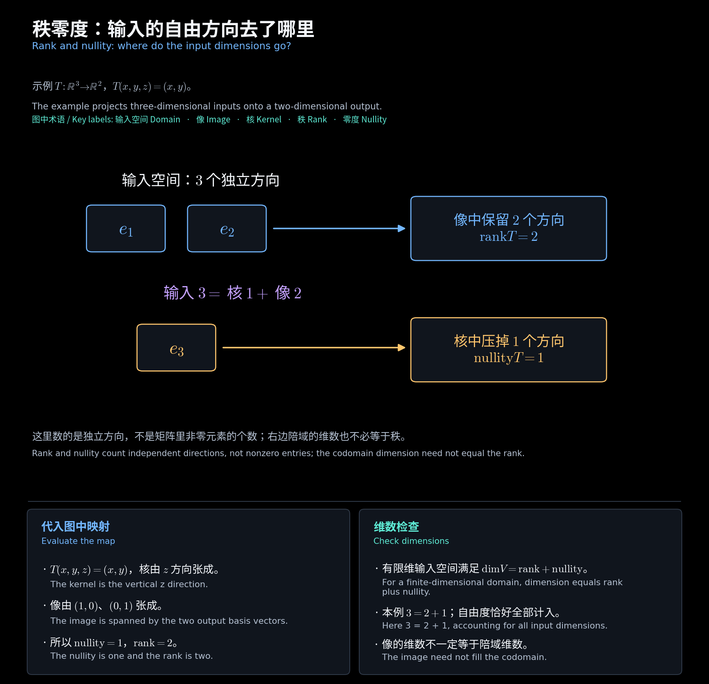

# 练习与公式速查 / Exercises and Formula Guide

[第 11 讲阅读导航](00_阅读导航.md) · [作业 11 原题](../../homework/homework11/Homework11_原始题目.pdf)

**读图：** 把图中的维数关系分别应用于输入端和输出端，就能检查第 3、4 题补了多少个零奇异方向。

## 1. 从两个特征值读出投影 / Recover two projectors

已知 $A$ 可对角化且谱为 $\{2,5\}$。直接写出 $P_5$，检验它的像。 / Find the projector onto the eigenspace for 5.

**解。** 标量函数 $p(t)=(t-2)/3$ 在 2 上取 0、在 5 上取 1，故 $P_5=(A-2I)/3$。在两组特征向量上分别作用即知 $\operatorname{im}P_5=\ker(A-5I)$，另一个投影为 $I-P_5$。  
**Solution.** Evaluate the interpolating polynomial on an eigenbasis; it keeps precisely the vectors in the eigenspace for 5.

## 2. 怎样区分斜投影与正交投影？ / Is the projector orthogonal?

令 $P=\begin{bmatrix}1&2\\0&0\end{bmatrix}$。求像、核并判断投影类型。 / Find the range and kernel, and classify $P$.

**解。** $P(x,y)^T=(x+2y,0)^T$，像为 $\operatorname{span}\{(1,0)^T\}$，核为 $\operatorname{span}\{(-2,1)^T\}$。$P^2=P$；两条直线不垂直，且 $P^*\ne P$，所以这是斜投影。  
**Solution.** The map selects the first axis along the line $x+2y=0$. Idempotence makes it a projector; lack of self-adjointness identifies it as oblique.

## 3. 从左奇异向量补全右基 / Complete a right basis

设 $A=\begin{bmatrix}0&2&0\\0&0&0\end{bmatrix}$。给出完整 SVD 的非零配对和两侧要补的方向。 / Give the nonzero Schmidt pair and both null-space completions.

**解。** $AA^*=\operatorname{diag}(4,0)$。取左向量 $y_1=e_1\in\mathbb R^2$，得 $\sigma_1=2$、$x_1=A^*e_1/2=e_2\in\mathbb R^3$。右侧补 $e_1,e_3$，左侧补 $e_2$。核对 $Ax_1=2y_1$，另外两列的像为零。  
**Solution.** The only nonzero input direction is the second coordinate. Two right null vectors and one left null vector complete the orthonormal bases.

## 4. 用奇异值核对秩和长度 / Rank and length checks

已知 $3\times4$ 矩阵的正奇异值为 3、1。求 $\dim\ker A$、$\dim\ker A^*$ 及 $\operatorname{tr}(AA^*)$。 / Compute both nullities and the Gram trace.

**解。** 秩为 2。分别从输入、输出维数扣除秩，得 $4-2=2$、$3-2=1$。$AA^*$ 的特征值为 $9,1,0$，故迹为 10。  
**Solution.** Count positive singular values for rank; square them before summing for the Gram trace.

## 5. 由投影求矩阵幂 / Compute a matrix power

设 $P^2=P$，$A=2P-(I-P)$。求 $A^5$，再求它对 $z\in\ker P$ 的作用。 / Find $A^5$ and its action on $\ker P$.

**解。** 置 $Q=I-P$。由于 $PQ=QP=0$，正整数次幂中的混合项全为零，两条分量可单独取幂。

$$
A^5=2^5P+(-1)^5Q=33P-I,\qquad Pz=0\ \Longrightarrow\ A^5z=-z .
$$

**Solution.** The fifth power scales the image by 32 and the kernel by $-1$.

## 6. 判断何时缺少幂零项 / Detect the missing nilpotent part

$J=\begin{bmatrix}3&1\\0&3\end{bmatrix}$。能否写成仅按特征值对谱投影加权的分解？求 $J^2$ 核对。 / Can eigenvalue-weighted projectors alone recover $J$? Check by computing $J^2$.

**解。** 唯一特征值为 3，若谱投影之和为 $I$，加权和只能是 $3I$。实际上 $N=J-3I$ 满足 $N\ne0,\ N^2=0$。

$$
J^2=(3I+N)^2=9I+6N=\begin{bmatrix}9&6\\0&9\end{bmatrix}.
$$

**Solution.** The off-diagonal entry survives squaring. Its source is the length-two Jordan chain.

## 7. 复矩阵中伴随的作用 / Use the adjoint for a complex row

设 $A=[1,\ i]$。取 $y_1=1$，求 $x_1$ 与一个单位右零向量。 / Find the matched right vector and a unit vector in the right kernel.

**解。** $AA^*=2$ 给出 $\sigma_1=\sqrt2$。取 $x_1=A^*/\sqrt2$；再解 $s+it=0$ 并归一化。

$$
x_1=(1,-i)^T/\sqrt2,\quad x_2=(-i,1)^T/\sqrt2,\quad Ax_1=\sqrt2,\quad Ax_2=0,\quad x_1^*x_2=0 .
$$

**Solution.** Conjugating the row is essential both for the positive pair and for checking orthogonality.

## 8. 求最大放大的方向 / Find the maximum-gain input

$A=\begin{bmatrix}2&1\\1&2\end{bmatrix}$。求单位输入下 $\|Ax\|$ 的最大值和一个取得最大值的实向量。 / Find the largest output norm over unit inputs and a maximizing vector.

**解。** $A^TA=\begin{bmatrix}5&4\\4&5\end{bmatrix}$ 的正交特征方向为 $(1,\pm1)^T$，特征值为 9、1。最大 Rayleigh 商给出最大输出长度的平方。

$$
\max_{\|x\|=1}\|Ax\|^2=9,\quad x=(1,1)^T/\sqrt2,\quad Ax=3x .
$$

**Solution.** The maximal stretch is 3, attained along the first right singular direction.
