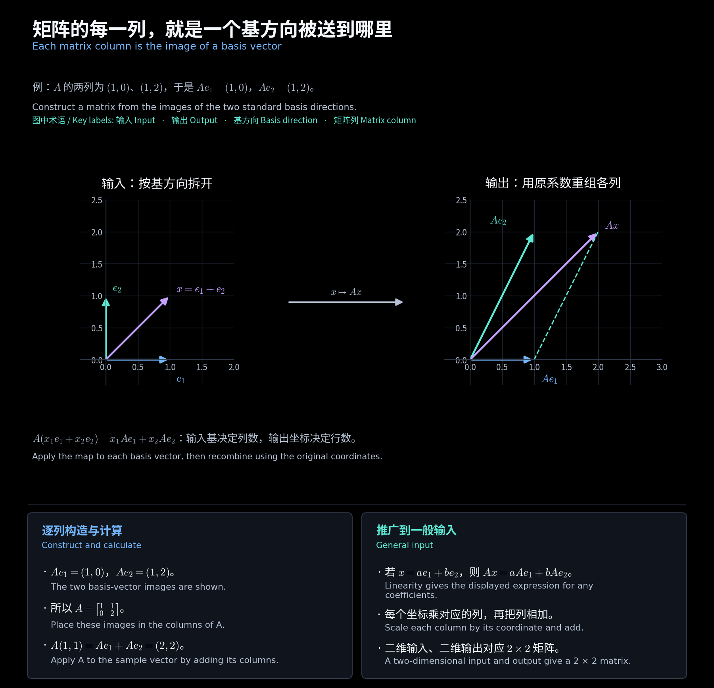

# 第 12 讲阅读导航 / Matrix Factorizations and Course Review

[上篇原课件（Lecture 14）](<../../materials/lectures/Lecture 12-1-linear algebra.pdf>) · [下篇原课件（Lecture 15）](<../../materials/lectures/Lecture 12-2-linear algebra.pdf>) · [上一讲](../lecture11/00_阅读导航.md)

**中文：** 上篇 21 页，依次处理满秩分解、薄 QR、最小二乘和极分解。下篇 12 页，是教材第一至第四章的复习提纲。两份材料分开对照。

**English:** Part 1 completes Chapter 5. Part 2 returns to earlier chapters and identifies the definitions, computations and examples to practise.

**读图：** 满秩分解只选一组独立列放入左因子；其余每列如何由它们组合，记录在右因子的对应列。

| 文件及页码 | 阅读与计算 |
| --- | --- |
| 上篇 2—6 | [满秩分解](01_满秩分解.md)：定理 5.10、满秩因子之间的换基、例 5.6 的非连续主元列。 |
| 上篇 7—11 | [UR 分解与最小二乘](02_UR分解与最小二乘.md)：Gram–Schmidt、正对角唯一性、行满秩与一般秩情形。 |
| 上篇 12—15 | 同篇：投影、三角回代、第 15 页拟合例题的残差检验。 |
| 上篇 16—21 | [极分解](03_极分解.md)：左右半正定平方根、核上的酉延拓、正规与因子交换。 |
| 下篇 2—12 | [全课程复习提纲](04_全课程复习提纲.md)：四章的课件页码、笔记链接与自查方法。 |
| 自测 | [练习与公式速查](05_练习与公式速查.md)：课件例 5.6 的消元、HW12.1–4 的满秩因子与核证明、第 15 页拟合及极分解。 |

本讲各正文章末均有 8 道带解例题，另可在练习与公式速查中集中自测 8 题。

**作业对照。** HW12.1 构造定理 5.10 中的 $P,Q$；第 2 题记录例 5.6 的两步消元；第 3 题用核证明 Gram 矩阵秩恒等式；第 4 题按原题保留 (a)、(d) 两小问。

[原题](../../homework/homework12/Homework12_原始题目.pdf) · [中文解答](../../homework/homework12/Homework12_题目与解答.pdf) · [English solutions](../../homework/homework12/Homework12_英文题目与解答.pdf)
