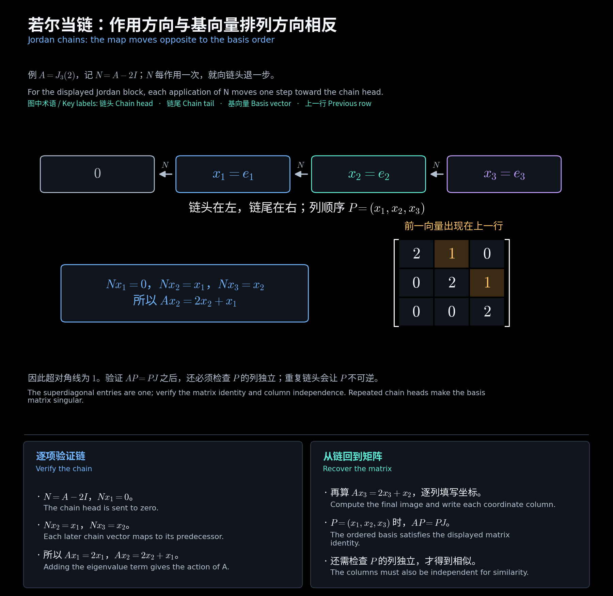

# 全课程复习提纲 / Course Review

第 12(2) 文件封面为 Lecture 15。第 2—11 页按教材第 1—4 章回顾，第 12 页要求能独立重做例题。第 8—9 页的 Jordan 链与最小多项式合并在下表同一行。第五章的矩阵分解另见[第 11 讲](../lecture11/00_阅读导航.md)和[第 12(1) 讲](00_阅读导航.md)。

The review slides revisit textbook Chapters 1–4. The links below lead to the relevant worked notes; the last column gives a concrete check for each calculation.

**读图：** 对照下表第 7—9 页：沿链作用一次 $A-\lambda I$，便向链首移动一级。把同一条链按顺序排成列，可以逐列检查 $AX=XJ$。

| 课件页 | 知识点与对应笔记 | 怎样检查自己的答案 |
| --- | --- | --- |
| 2—3 | [空间、基与坐标](../中文精简版/02_基与换基及子空间.md)、[线性映射](../中文精简版/03_线性映射及其矩阵表示.md) | 先固定标量域，判子空间时检验零向量和线性组合。求映射矩阵时逐列写出基向量像在输出基下的坐标。用秩–零度核对核与像的维数。 |
| 4—5 | [多项式除法、理想与互素](../中文精简版/04_代数与多项式及理想.md) | 在域上的一元多项式环中，理想的和由首一最大公因式生成，交由首一最小公倍式生成。用 Bézout 等式检验互素。 |
| 6 | [Smith 形与不变多项式](../中文精简版/06_史密斯标准形与不变多项式.md)、[初等因子](../中文精简版/07_初等因子与特征矩阵.md) | 对照教材例 2.21—2.23。记录幺模行列变换；检查非零对角元的整除链、各阶子式的最大公因式，并注明分解所取的域。 |
| 7—9 | [自然标准形](../中文精简版/09_相似不变量与自然标准形.md)、[Jordan 链](../中文精简版/11_若尔当链与子空间分解.md)、[最小多项式](../中文精简版/12_最小多项式与第一分解.md)、[循环分解](../中文精简版/13_循环子空间与第二分解.md) | 写出各链 $(A-\lambda I)v_{j+1}=v_j$，把列排成 $X$ 并验 $AX=XJ$。最大块长给出最小多项式中该因子的指数。 |
| 10 | [内积与 Gram 矩阵](../中文精简版/16_内积与Gram矩阵.md)、[正交化与酉变换](../中文精简版/17_正交规范基与酉变换.md)、[投影](../中文精简版/18_投影与伴随变换.md) | 内积的 Gram 矩阵须 Hermitian 正定。正交化后算 $Q^*Q$；投影后算 $P^2$。在正交规范坐标中，正交投影还应满足 $P^*=P$。 |
| 11—12 | [正规与 Schur](../中文精简版/19_正规矩阵与Schur及QR分解.md)、[Hermitian 与正定](../中文精简版/20_Hermitian型与正定性.md) | 复方阵可酉三角化；正规时可酉对角化。用 Hermitian 条件和谱或顺序主子式判正定。最后合上解答，按题面重做例题。 |

## 串联例题 / Worked review question

取 $A=\begin{bmatrix}2&1\\0&2\end{bmatrix}$。如何从核、链和最小多项式三个角度得到同一结论？

1. $N=A-2I$ 满足 $Ne_2=e_1$、$Ne_1=0$，故 $\ker N=\operatorname{span}\{e_1\}$。特征值 2 的几何重数为 1。
2. $N^2=0$ 但 $N\ne0$，故 $m_A(t)=(t-2)^2$。链 $(e_1,e_2)$ 恰为一条长度 2 的 Jordan 链。
3. 唯一特征空间上的恒等作用无法重建整个 $A$。对照第 11 讲的谱投影条件，即可解释为什么此题要保留 $N$。

**English:** The kernel gives one eigenvector, while the nilpotency index gives a chain of length two. Together they account for both dimensions and explain why the simple-matrix projector formula does not apply.
