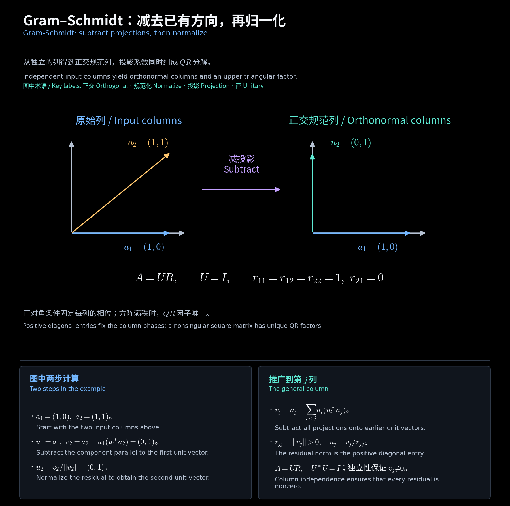

# 练习与公式速查 / Exercises and Formula Guide

[第 12 讲阅读导航](00_阅读导航.md) · [作业 12 原题](../../homework/homework12/Homework12_原始题目.pdf)

**读图：** 第 2 题只有一列，图中的正交化只需第一步。列的长度就是标量 $R$，单位列给出拟合的投影方向。

## 1. 从列关系构造满秩分解 / Factor using column relations

设 $A=[u,2u,v,u-v]$，其中 $u,v$ 独立。求一组满秩因子。 / Find two full rank factors.

**解。** 取 $B=[u,v]$。逐列写坐标得 $C=\begin{bmatrix}1&2&0&1\\0&0&1&-1\end{bmatrix}$。$BC$ 依次重建题面四列；$C$ 的第 1、3 列给出 $I_2$。  
**Solution.** The columns of $C$ are coordinates in the basis $(u,v)$; its identity minor verifies the required rank.

## 2. 从法方程检验拟合 / Check a least-squares fit

将一个常数 $c$ 拟合到两个观测值 $1,3$。用薄 QR 求解并检查残差。 / Fit a constant to two observations by thin QR.

**解。** 设计矩阵 $A=(1,1)^T$，故 $U=(1,1)^T/\sqrt2$，$R=[\sqrt2]$。回代给出 $c=(1+3)/2=2$。残差 $(-1,1)^T$ 的两项和为零，所以 $A^T(b-Ac)=0$。  
**Solution.** The projection onto the constant direction gives the mean. The signed errors cancel, proving orthogonality and optimality.

## 3. 求可逆矩阵的极因子 / Compute the polar factors

令 $A=\begin{bmatrix}0&-3\\2&0\end{bmatrix}$。求 $A=WH_1=H_2W$。 / Find both polar factorizations.

**解。** $A^TA=\operatorname{diag}(4,9)$，故 $H_1=\operatorname{diag}(2,3)$。再算 $W=AH_1^{-1}=\begin{bmatrix}0&-1\\1&0\end{bmatrix}$ 及 $H_2=WH_1W^T=\operatorname{diag}(3,2)$。回乘两式都给出 $A$。  
**Solution.** The right stretch comes from the positive Gram square root. Conjugation by the quarter-turn exchanges its two axes for the left stretch.

## 4. 哪个因子具有唯一性？ / Which factor is unique?

令 $A=\operatorname{diag}(1,0)$。若 $A=WH$，其中 $W$ 酉且 $H$ 半正定，求 $H$ 并写出所有 $W$。 / Determine the positive factor and all admissible unitary factors.

**解。** $H^2=A^*A=A$，故 $H=A$。等式 $WH=A$ 强制 $We_1=e_1$。第二列须与第一列正交且长度为 1，故 $W=\operatorname{diag}(1,e^{i\theta})$，任意实数 $\theta$ 均可。  
**Solution.** The positive square root is unique. Unitarity leaves one free phase in the one-dimensional null space.

## 5. 更换列空间的基 / Change the intermediate basis

设 $A=BC$ 是秩二分解，$C=\begin{bmatrix}1&0&2\\0&1&1\end{bmatrix}$。若新基为 $B'=BS$，$S=\begin{bmatrix}1&1\\0&1\end{bmatrix}$，求 $C'$。 / Find the coordinate factor for the new basis $BS$.

**解。** 解 $SC'=C$ 得 $C'=S^{-1}C$。$S^{-1}$ 的第一行把旧坐标的第二个分量从第一个分量中减去。

$$
S^{-1}=\begin{bmatrix}1&-1\\0&1\end{bmatrix},\quad C'=\begin{bmatrix}1&-1&1\\0&1&1\end{bmatrix},\quad B'C'=BSS^{-1}C=A.
$$

**Solution.** The two factors change inversely, so the represented columns do not change.

## 6. 拟合一条直线 / Fit a straight line

对 $(t,y)=(-1,1),(0,2),(1,4)$ 拟合 $y=c+dt$。求 $c,d$ 并检查残差。 / Fit an intercept and slope, then verify the residual.

**解。** 设计矩阵的两列为 $a=(1,1,1)^T,b=(-1,0,1)^T$，已彼此正交。因此各系数等于观测向量在该列上的内积除以该列长度平方。

$$
c=\tfrac{1+2+4}{3}=\tfrac73,\quad d=\tfrac{-1+4}{2}=\tfrac32,\quad y-ca-db=\tfrac16(1,-2,1)^T .
$$

**Solution.** The residual has zero sum and zero inner product with the time coordinates, verifying both normal equations.

## 7. 秩亏时为何有多解 / A rank-deficient least-squares fit

对 $A=\begin{bmatrix}1&2\\1&2\end{bmatrix}$、$b=(0,2)^T$，求全部最小二乘解。 / Find all least-squares minimizers.

**解。** 记 $s=x_1+2x_2$。两个预测值都是 $s$，残差平方只依赖这一个标量。配方后在 $s=1$ 取得最小值。

$$
\|Ax-b\|^2=s^2+(s-2)^2=2(s-1)^2+2,\quad x=(1-2t,t)^T,\quad t\in\mathbb R .
$$

**Solution.** All minimizers give the same fitted vector $(1,1)^T$. They differ by elements of the kernel.

## 8. 非对角正因子 / A nondiagonal positive factor

已知 $A=\begin{bmatrix}-1&-2\\2&1\end{bmatrix}$。验证 $H=\begin{bmatrix}2&1\\1&2\end{bmatrix}$ 是右正因子，并求 $W$。 / Verify the proposed right stretch and compute the orthogonal factor.

**解。** $H$ 的特征值为 3、1，故 $H$ 正定。直接平方得 $H^2=A^TA$，由正平方根唯一性确定 $H$。

$$
H^2=\begin{bmatrix}5&4\\4&5\end{bmatrix},\quad H^{-1}=\tfrac13\begin{bmatrix}2&-1\\-1&2\end{bmatrix},\quad W=AH^{-1}=\begin{bmatrix}0&-1\\1&0\end{bmatrix}.
$$

**Solution.** Checking positivity is essential: a matrix square root alone need not be the positive polar factor.
