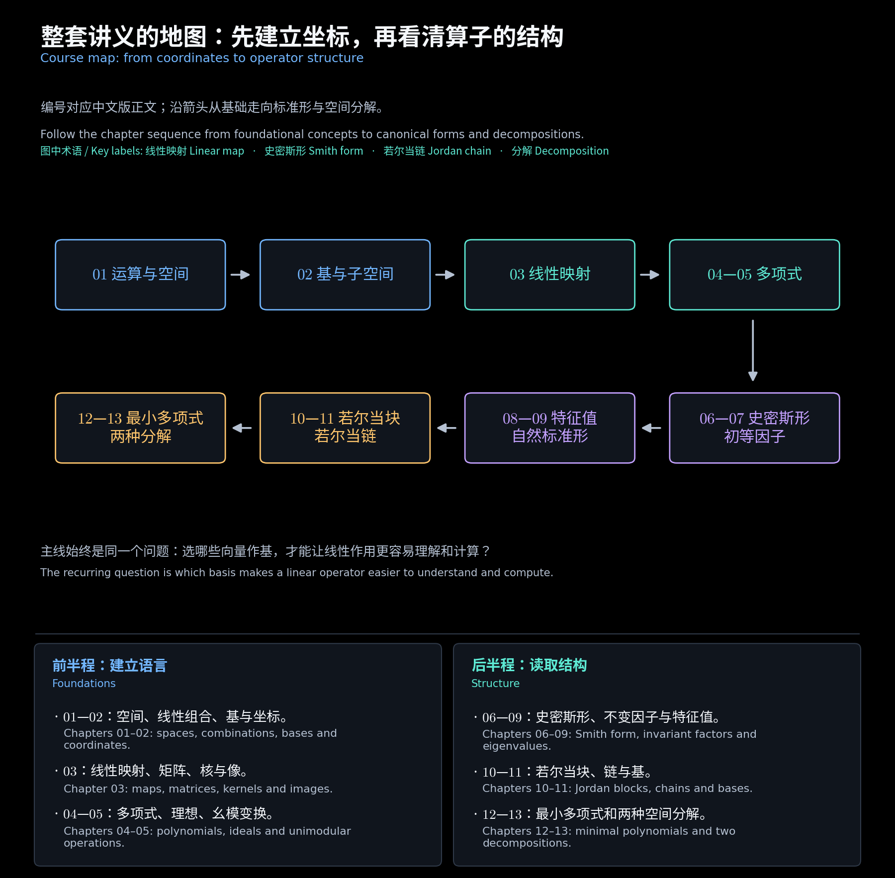

# 中文精简讲义

覆盖第 1—8 份讲义，共 **13 个正文大章**，另附本导航和两份练习答案，共 16 个文件。第 4—8 讲各分两章，例题直接放在对应知识点后。保留核心定义、必要条件、推导思路和完整计算步骤，不附英文对照。两份练习共 **40 道题**：第 1—3 讲 20 道，第 5—8 讲 20 道。

每章均有通俗图解与读图说明，放在相应知识点后；可以先看具体例子，再回到定义和公式。需要集中找图时，打开[图解索引](../图解索引.md)。

<!-- diagram:33_course_map:start -->

**图解 · 整套讲义的地图：先建立坐标，再看清算子的结构**

**读图：** 图中的 01—13 是中文版章节编号。先用空间、基和映射建立坐标语言，再用多项式工具读取矩阵结构，最后把各条链组织成不同的不变分量。

<!-- diagram:33_course_map:end -->

## 目录

| 文件 | 内容 |
| --- | --- |
| [第一章：代数基础与线性空间](01_代数基础与线性空间.md) | 运算、群、环、域、多项式、线性空间、线性相关性 |
| [第二章：基与换基及子空间](02_基与换基及子空间.md) | 基、维数、坐标、过渡矩阵、交与和、直和、补空间 |
| [第三章：线性映射及其矩阵表示](03_线性映射及其矩阵表示.md) | 线性性、矩阵表示、等价与相似、核与像、秩零度、同构、复合、控制联系 |
| [第四章：代数、多项式与理想](04_代数与多项式及理想.md) | 第四讲上篇：代数、代入、除法、主理想、和与交、互素、因式分解 |
| [第五章：多项式矩阵与幺模变换](05_多项式矩阵与幺模变换.md) | 第四讲下篇：次数、左右除法、秩、幺模、初等变换与等价 |
| [第六章：史密斯标准形与不变多项式](06_史密斯标准形与不变多项式.md) | 第五讲上篇：合法变换、整除链、降次、行列式因子、完整计算与等价判据 |
| [第七章：初等因子与特征矩阵](07_初等因子与特征矩阵.md) | 第五讲下篇：因子重数、指数左补零、分块合并、特征矩阵及作业例题 |
| [第八章：特征值与不变子空间](08_特征值与不变子空间.md) | 第六讲上篇：不变子空间、特征空间、两种重数、可对角化条件、微分与平移 |
| [第九章：相似不变量与自然标准形](09_相似不变量与自然标准形.md) | 第六讲下篇：相似判据、列伴随块、自然标准形、循环基与换基验证 |
| [第十章：复数与实数若尔当标准形](10_复数与实数若尔当标准形.md) | 第七讲上篇：Jordan 块、初等因子与块长、共轭实块、三阶及十一阶例题 |
| [第十一章：若尔当链与子空间分解](11_若尔当链与子空间分解.md) | 第七讲下篇：广义特征向量、链、核维数反推块长、完整换基矩阵、广义特征空间 |
| [第十二章：最小多项式与第一分解](12_最小多项式与第一分解.md) | 第八讲上篇：局部与整体零化、三种计算方法、互素分解、取得定理及作业例题 |
| [第十三章：循环子空间与第二分解](13_循环子空间与第二分解.md) | 第八讲下篇：循环基、伴随矩阵、第二分解、平移算子及换基例题 |
| [第 1—3 讲综合练习与答案](14_第一至第三讲综合练习与答案.md) | 原笔记的 20 道自测题，保留必要解题依据 |
| [第 5—8 讲综合练习与答案](15_第五至第八讲综合练习与答案.md) | 20 道题及解答，串联史密斯形、初等因子、特征空间、若尔当链、最小多项式与两种分解 |

正文文件按 01—13 连续编号，练习集中放在 14、15。初次学习按表中第一至第十三章顺序阅读。复习若尔当矩阵，可先读第八章的特征空间与重数，再读第十、十一章；若不熟悉初等因子，先补第六、七章。复习第八讲时读第十二、十三章，需要的不变多项式、初等因子、若尔当块和链均可在本版前文查到。各章保留的讲义例题、作业例题与补充例题分别标注；新增练习用于串联知识点。

## 标准形的学习顺序

| 问题 | 方法 | 阅读位置 |
| --- | --- | --- |
| 多项式矩阵能化成什么唯一形式 | 幺模变换、行列式因子、史密斯形 | 第五、六章 |
| 怎样保留每个根的分块信息 | 不变多项式分解、初等因子及重数 | 第七章 |
| 常数矩阵怎样判断相似 | 比较特征矩阵的不变多项式，构造自然标准形 | 第八、九章 |
| 怎样求若尔当形和换基矩阵 | 初等因子或核维数确定块长，再构造独立链 | 第十、十一章 |
| 怎样把整个空间分成较小的不变空间 | 最小多项式、第一分解、循环子空间与第二分解 | 第十二、十三章 |

## 符号与条件

- $\mathbb F$ 表示标量域，通常取 $\mathbb R$ 或 $\mathbb C$。比较空间**维数**、讨论线性性时必须使用同一标量域。
- $\mathbb F_d[\lambda]$ 表示次数不超过 $d$ 的多项式，包含**零多项式**，维数为 $d+1$。
- $B=(b_1,\ldots,b_n)$ 是有序基，$[v]_B$ 是**坐标**列；$Bx$ 表示 $\sum_i x_i b_i$。
- $\operatorname{span}$、$\dim$、$\operatorname{rank}$、$\ker$、$\operatorname{im}$ 分别表示**生成空间**、维数、秩、核、像。
- 全文换基约定为“新基 = 旧基 × **过渡矩阵**”。维数公式和用维数判定**同构**的结论均在有限维情形下使用。
- $\langle a\rangle=\{aq:q\in\mathbb F[\lambda]\}$ 是主理想；非零**最大公因式**与**最小公倍式**取首一形式。第四讲具体例题取实数或复数域。
- **多项式矩阵**的“非零子式”指它作为多项式不恒为零；不能用单点代入后的秩代替多项式矩阵秩。
- $D_k$ 表示**行列式因子**，$d_k$ 表示**不变多项式**；去掉单位项后的不变多项式记为 $\psi_i$。对 $n$ 阶常数矩阵，这些因子属于特征矩阵 $\lambda I-A$，总次数为 $n$。
- **若尔当块** $J_m(\rho)$ 的超对角线取 $1$；列伴随矩阵的次对角线取 $1$。实共轭块取 $R(a,b)=\begin{bmatrix}a&b\\-b&a\end{bmatrix}$，$b>0$，链按链头到链尾排列。
- 第八讲用 $z$ 表示零化多项式变量、$s$ 表示被平移的变量；$m_v,m_W,m_T$ 区分向量、子空间与整体最小多项式，均非零首一，$m_0=m_{\{0\}}=1$。平移例题取复数域且步长 $a\ne0$。

## 核心公式

| 用途 | 公式与条件 |
| --- | --- |
| 无关性 | $\sum_i a_i v_i=0\Rightarrow a_i=0$ |
| 坐标换基 | $C=BP\Rightarrow[v]_B=P[v]_C$ |
| 和的维数 | $\dim(U+W)=\dim U+\dim W-\dim(U\cap W)$ |
| 两空间直和 | $U\cap W=\{0\}$；若分解整个 $V$，还须 $U+W=V$ |
| 线性性 | $T(au+bv)=aT(u)+bT(v)$ |
| 矩阵表示 | $[T(u)]_C=[T]_{C\leftarrow B}[u]_B$ |
| 输入、输出独立换基 | $B'=BP,\ C'=CQ\Rightarrow A'=Q^{-1}AP$ |
| 同一空间同步换基 | $A'=P^{-1}AP$ |
| 秩零度 | $\dim\ker T+\operatorname{rank}T=\dim U$ |
| 同构的维数判据 | 同一域上有限维空间满足 $U\cong V\iff\dim U=\dim V$ |
| 复合矩阵 | $[T\circ S]=[T][S]$，中间基必须相同 |
| 多项式除法 | $a=bq+r$，$b\ne0$，且 $r=0$ 或 $\deg r<\deg b$ |
| 理想的和与交 | $\langle a\rangle+\langle b\rangle=\langle\gcd(a,b)\rangle$；$\langle a\rangle\cap\langle b\rangle=\langle\operatorname{lcm}(a,b)\rangle$ |
| 幺模 | 行列式为非零常数 $\iff$ 方阵多项式有多项式逆 |
| 多项式矩阵等价 | $B=PAQ$，左右因子 $P,Q$ 必须幺模 |
| 行列式因子与不变多项式 | $D_k=d_1\cdots d_k$，$d_k=D_k/D_{k-1}$，仅对 $1\le k\le r$ 使用 |
| 常数矩阵相似判据 | 同阶 $A\sim B\iff\lambda I-A$ 与 $\lambda I-B$ 幺模等价 |
| 自然标准形 | $A\sim\operatorname{diag}(C(\psi_1),\ldots,C(\psi_\ell))$，$\sum_i\deg\psi_i=n$ |
| 初等因子与若尔当块 | 复数域上 $(\lambda-\rho)^m\leftrightarrow J_m(\rho)$，每次出现分别计数 |
| 两种重数 | 代数重数为该根块长之和，几何重数为该根块数 |
| 可对角化 | 在当前域上能选到 $n$ 个独立特征向量；复数域上等价于所有块均为一阶 |
| 核维数读块长 | $h_k=\dim\ker(A-\rho I)^k$，$h_0=0$；长度至少 $k$ 的块数为 $h_k-h_{k-1}$ |
| 若尔当换基 | $(A-\rho I)x_{r+1}=x_r$；拼成 $P$ 后同时检查 $AP=PJ$ 与 $\det P\ne0$ |
| 广义特征空间 | $G_\rho=\ker(A-\rho I)^n$，维数为代数重数；$\mathbb C^n=\bigoplus_\rho G_\rho$ |
| 最小多项式 | $p(T)v=0\iff m_v\mid p$；$m_A$ 为特征矩阵的最大不变多项式 |
| 分块最小多项式 | $m_{\operatorname{diag}(A_i)}=\operatorname{lcm}_i m_{A_i}$ |
| 循环维数 | $\dim\mathcal S_T[v]=\deg m_v$ |
| 两种分解 | 第一分解按互素因子；第二分解按不变多项式组成循环分量，均要求相应空间不变 |

## 讲义范围与勘误

| 原讲义 | 页数 | 本版对应内容 |
| --- | --- | --- |
| [第 1 讲](<../../materials/lectures/Lecture 1-linear algebra.pdf>) | 46 | 第一章；第二章的基与换基 |
| [第 2 讲](<../../materials/lectures/Lecture 2-linear algebra.pdf>) | 29 | 第二章的子空间；第三章的线性映射与矩阵表示 |
| [第 3 讲](<../../materials/lectures/Lecture 3-linear algebra.pdf>) | 27 | 第三章的换基、等价、同构、核与像、复合 |
| [第 4 讲](<../../materials/lectures/Lecture 4-linear algebra.pdf>) | 40 | 第四章：第 3—30 页；第五章：第 31—40 页 |
| [第 5 讲](<../../materials/lectures/Lecture 5-linear algebra.pdf>) | 21 | 第六章：第 4—15 页；第七章：第 16—21 页 |
| [第 6 讲](<../../materials/lectures/Lecture 6-linear algebra.pdf>) | 24 | 第八章：第 2—16、19 页；第九章：第 17—18、20—24 页 |
| [第 7 讲](<../../materials/lectures/Lecture 7-linear algebra.pdf>) | 21 | 第十章：第 2—11 页；第十一章：第 12—21 页 |
| [第 8 讲文件](<../../materials/lectures/Lecture 8-linear algebra.pdf>) | 23 | 第十二章：第 2—17 页；第十三章：第 18—23 页 |

页码指原文件页序。第三讲第 2 页只预告了多项式章节，正文尚未展开，本版不将预告补写为已讲内容。第三讲第 17 页传递性应得 $C\cong A$；第 19 页**满射**定义中的原像应属于输入空间；第 27 页从 $p$ 维到 $m$ 维的矩阵应为 $m\times p$。正文已使用正确表述。

第四讲第 2 页提纲只列到第 2.4 节，但正文讲到第 2.6 节；第 32 页标题中的“2.2”应为“2.5”。第 34 页余式次数应小于除式次数，而非被除式次数。课件所用“正则”条件特指**最高次系数矩阵**可逆，与幺模条件不同。两章正文均已按正确条件表述；教材例题仅被课件引用而未给出题设时，不补写为教材原例。

第五讲提纲预告的第 2.8 节未在该文件展开；初等因子判断一般多项式矩阵等价时，须同时保留大小和秩。第六讲中的不变子空间不必是特征空间，特征向量必须非零，几何重数与代数重数不能混用。第七讲第 13、14 页重复；链的不可延长条件与截短链的递推条件在第十一章中分别说明。

第八讲文件封面标作第九讲；目录沿用文件编号。第 22、23 页重复；第 5 页低次多项式推论须排除零多项式，最小多项式唯一性须首一化。第 15、21 页**直和**式中第二个重复的 $W_1$ 应为 $W_2$；第 21 页基向量中第二个重复的 $\alpha_1$ 应为 $\alpha_2$。第 16 页公式分母明确记为**行列式因子** $D_{d-1}$。课件未完整展示的教材数值例题不补写为原例；正文保留已核验的补充及作业例题。

原双语版：[第 1—2 讲](../lecture01-02/00_阅读导航.md) · [第 3 讲](../lecture03/00_阅读导航.md) · [第 4 讲](../lecture04/00_阅读导航.md) · [第 5 讲](../lecture05/00_阅读导航.md) · [第 6 讲](../lecture06/00_阅读导航.md) · [第 7 讲](../lecture07/00_阅读导航.md) · [第 8 讲文件](../lecture08/00_阅读导航.md)。
