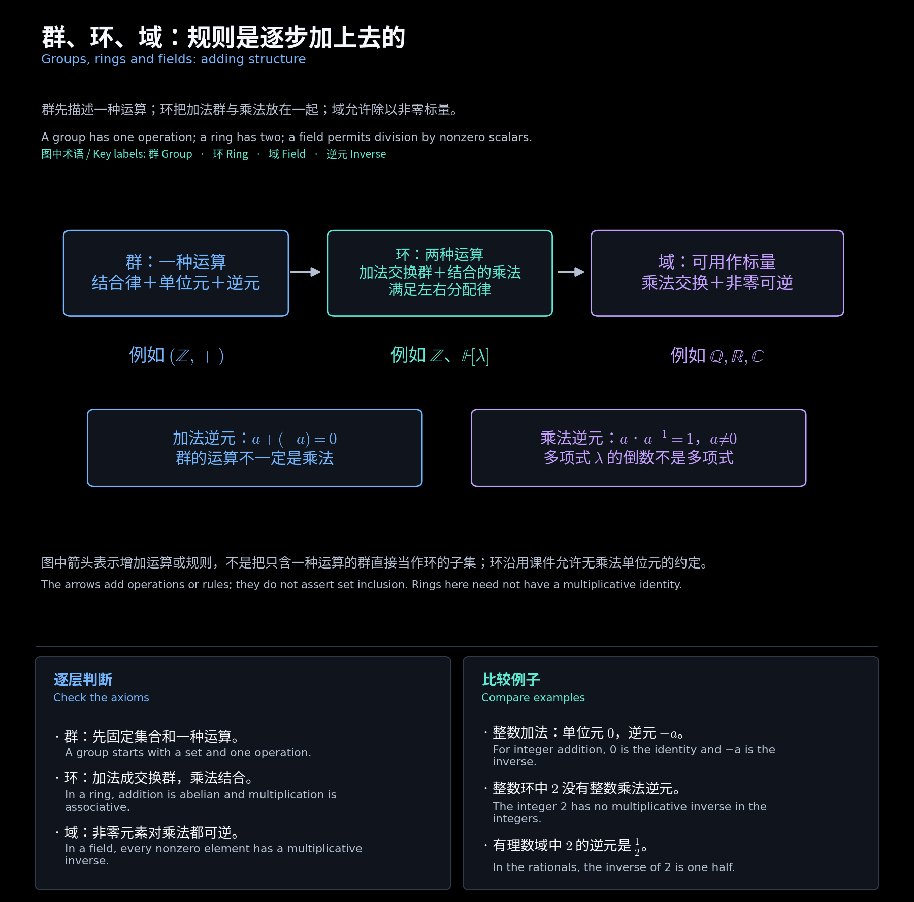
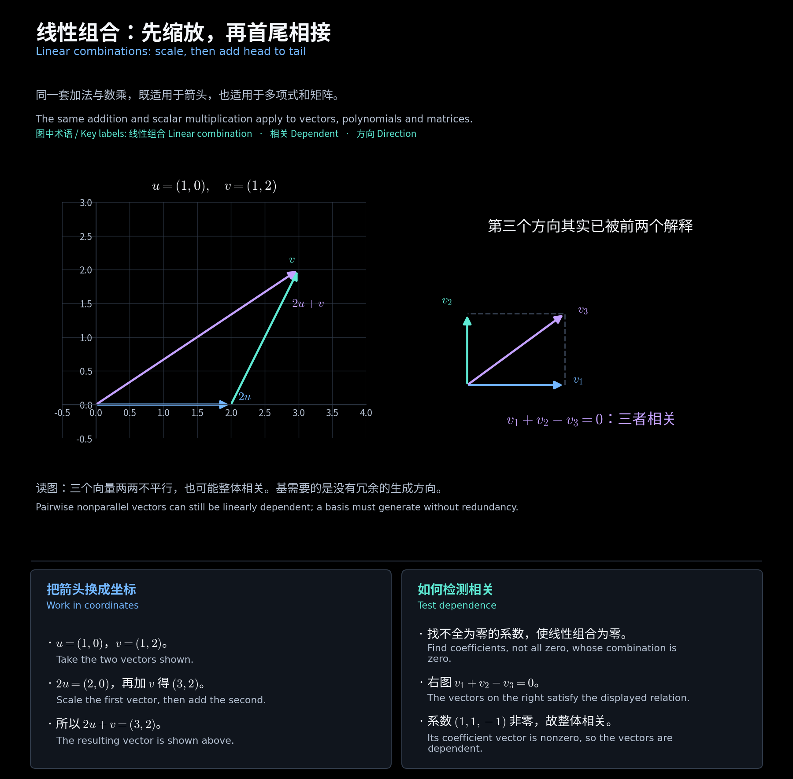

# 第一章　代数基础与线性空间

[阅读导航](00_阅读导航.md) · [下一章](02_基与换基及子空间.md)

对应第 1 讲第 10—37 页。以下向量运算均须先明确集合、标量域和运算规则。

## 一、运算与群

**二元运算**把两个输入唯一对应到一个输出。研究同一集合 $S$ 上的运算时，**封闭性**要求 $a\star b\in S$。

$$
\text{交换律： }a\star b=b\star a,\qquad
\text{结合律： }(a\star b)\star c=a\star(b\star c).
$$

二者互不替代。矩阵乘法满足**结合律**，通常不满足**交换律**；$m\times n$ 矩阵乘 $n\times p$ 矩阵，结果为 $m\times p$。

**补充例题：矩阵乘法不交换。**

$$
A=\begin{bmatrix}1&1\\0&1\end{bmatrix},\quad
B=\begin{bmatrix}1&0\\1&1\end{bmatrix},\quad
AB=\begin{bmatrix}2&1\\1&1\end{bmatrix},\quad
BA=\begin{bmatrix}1&1\\1&2\end{bmatrix}.
$$

非空集合 $G$ 配上封闭运算，若满足结合律、有双侧**单位元** $e$、每个元素有双侧**逆元**，就构成**群**；再满足交换律，称为**交换群**。

$$
e\star a=a\star e=a,\qquad
a^{-1}\star a=a\star a^{-1}=e.
$$

单位元唯一，因为 $e=e\star f=f$。逆元唯一：若 $b,c$ 都是 $a$ 的逆元，

$$
b=b\star(a\star c)=(b\star a)\star c=c.
$$

**判断例题：**

| 集合与运算 | 结论 | 关键理由 |
| --- | --- | --- |
| 整数或实数的加法 | 交换群 | 单位元为 $0$，逆元为 $-a$ |
| 全体实数的乘法 | 不是群 | $0$ 无乘法逆元 |
| 非零实数的乘法 | 交换群 | 单位元为 $1$，逆元为 $1/a$ |
| 全体方阵的乘法 | 不是群 | 含不可逆矩阵 |
| 全体可逆 $n\times n$ 实矩阵的乘法 | 群 | 乘积与逆矩阵仍可逆 |
| 非负整数的加法 | 不是群 | 正整数的加法逆元不在集合内 |

<!-- diagram:01_algebra_rules:start -->

**图解 · 群、环、域：规则是逐步加上去的**

**读图：** 先看集合配了几种运算，再看每种运算满足什么规则。群只讨论一种运算；环增加乘法与分配律；域要求非零标量可除。图中的箭头表示增加规则，不表示群、环、域是同一集合里的三层子集。

<!-- diagram:01_algebra_rules:end -->

## 二、多项式、环与域

**形式多项式** $p(\lambda)=\sum_{i=0}^n a_i\lambda^i$ 由系数确定。若两个多项式各次幂的系数分别相同，则称它们**相等**；反过来，相等的多项式各次幂系数必分别相同。在某一点取值相同不足以判断相等。最高非零系数对应的指数为次数，首项系数为 $1$ 时称**首一多项式**。**零多项式**没有最高非零项；次数有界的空间始终包含它。

**讲义例型：多项式加法群。** 补齐缺项的零系数，逐项相加；零多项式为单位元，逐项取负得逆元。因此 $\mathbb F[\lambda]$ 在加法下是交换群。例如

$$
(1+2\lambda+\lambda^2)+(3-\lambda)=4+\lambda+\lambda^2.
$$

**补充例题：四位状态的异或群。** 在 $\{0,1\}^4$ 中逐位模 $2$ 相加，例如 $1101\oplus1011=0110$。单位元为 $0000$，每个元素都是自己的逆元，共 $16$ 个元素。这是练习群公理的补充模型，不等同于课件未完整给出运算的移位寄存器例子。

在一个集合上定义加法和乘法，若加法构成交换群、乘法满足结合律，并满足左右分配律，则称这一代数结构为**环**。若乘法还满足交换律，则称为**交换环**。课件将乘法单位元另列讨论，因此不把“必须有单位元”加入其最初的环定义。

$$
a(b+c)=ab+ac,\qquad(a+b)c=ac+bc.
$$

多项式乘法按展开、合并同类项计算，$\mathbb F[\lambda]$ 是有单位元 $1$ 的交换环。例如 $(1+\lambda)(1-\lambda)=1-\lambda^2$。

若一个非零元素与另一非零元素相乘得到零，则称它为**零因子**；非交换环须区分乘法次序。若一个交换环有乘法单位元、$1\ne0$ 且无零因子，则称为**整环**，本文采用这一有幺约定。若其中每个非零元素还都有乘法逆元，则称为**域**。

**补充例题：非零不等于可逆。**

$$
A=\begin{bmatrix}1&0\\0&0\end{bmatrix},\quad
B=\begin{bmatrix}0&0\\0&1\end{bmatrix},\qquad AB=BA=0.
$$

两矩阵都非零，却不可逆。$\mathbb Q,\mathbb R,\mathbb C$ 是域；$\mathbb Z$ 不是域，因为 $2$ 无整数逆元。$\mathbb F[\lambda]$ 不是域，因为 $1/\lambda$ 不是多项式；允许非零多项式作分母后，得到**有理函数域** $\mathbb F(\lambda)$。

## 三、线性空间

给定域 $\mathbb F$ 和非空集合 $V$，在 $V$ 上定义封闭的**向量加法**与**数乘**。若向量加法构成交换群，且对任意 $a,b\in\mathbb F$、$u,v\in V$ 满足

$$
1v=v,\quad a(bv)=(ab)v,\quad
(a+b)v=av+bv,\quad a(u+v)=au+av.
$$

则称 $V$ 为域 $\mathbb F$ 上的**线性空间**，其中的元素称为**向量**。向量可以是数字列、矩阵、多项式或函数。

由公理推出 $0v=0_V$、$a0_V=0_V$、$(-1)v=-v$。例如 $0v=(0+0)v=0v+0v$，在加法群中相减即得 $0v=0_V$；一般不能“除以向量”。

**讲义例型：矩阵空间。** 通常加法、数乘下，$\mathbb F^{n\times m}$ 是线性空间，**维数**为 $nm$，基可取矩阵单位基元 $E_{ij}$（仅第 $(i,j)$ 个位置为 $1$，其余为 $0$）。这里一整张矩阵就是一个向量，矩阵乘法不参与线性空间的定义。

$$
\begin{bmatrix}1&2\\3&4\end{bmatrix}
+2\begin{bmatrix}0&1\\1&0\end{bmatrix}
=\begin{bmatrix}1&4\\5&4\end{bmatrix}.
$$

**讲义例型：次数有界的多项式空间。**

$$
\mathbb F_{n-1}[\lambda]
=\left\{\sum_{i=0}^{n-1}a_i\lambda^i:a_i\in\mathbb F\right\},\qquad
\dim\mathbb F_{n-1}[\lambda]=n.
$$

“次数恰好为 $n-1$”的集合在 $n\ge1$ 时不含零多项式，不是线性空间。所有多项式组成的 $\mathbb F[\lambda]$ 则是无限维空间。

**补充例题：标量域影响维数。** $\mathbb C$ 在复数域上的基为 $(1)$，维数为 $1$；在实数域上的基为 $(1,i)$，维数为 $2$。

## 四、线性组合与相关性

$$
v=\sum_{i=1}^s a_i v_i
$$

称为 $v$ 可由这些向量**线性表示**。若方程 $\sum_i a_i v_i=0$ 只有所有 $a_i=0$ 这一组解，则称该向量组**线性无关**；若有系数不全为零的解，则**线性相关**。相关不要求每个系数都非零。

**补充例题：两两不平行仍可能相关。**

$$
v_1=(1,0)^T,\quad v_2=(0,1)^T,\quad v_3=(1,1)^T.
$$

前两个向量无关，但 $v_1+v_2-v_3=0$，所以三个向量相关。含零向量的向量组也必相关。

**讲义结论及证明要点：** 若 $v_1,\ldots,v_r$ 无关，加入 $v_{r+1}$ 后相关，则 $v_{r+1}$ 可由前者唯一表示。相关关系中的最后一个系数必非零，否则与前者无关矛盾；于是

$$
v_{r+1}=-\sum_{i=1}^r\frac{a_i}{a_{r+1}}v_i.
$$

若有两种表示，相减后由无关性得对应系数相同，故唯一。

**计算方法：** 把生成向量按列写成 $M=[v_1\ \cdots\ v_s]$。解 $Ma=0$ 判断无关性；解 $Ma=v$ 判断能否表示。后一方程可能无解、唯一解或多解。

<!-- diagram:02_linear_combination:start -->

**图解 · 线性组合：先缩放，再首尾相接**

**读图：** 左图把 $2u+v$ 画成首尾相接的两段，紫色箭头是结果。右图的第三个方向已能由前两个相加得到，因此三个向量整体相关；不能仅凭两两不平行判断无关。

<!-- diagram:02_linear_combination:end -->

[阅读导航](00_阅读导航.md) · [下一章](02_基与换基及子空间.md)
