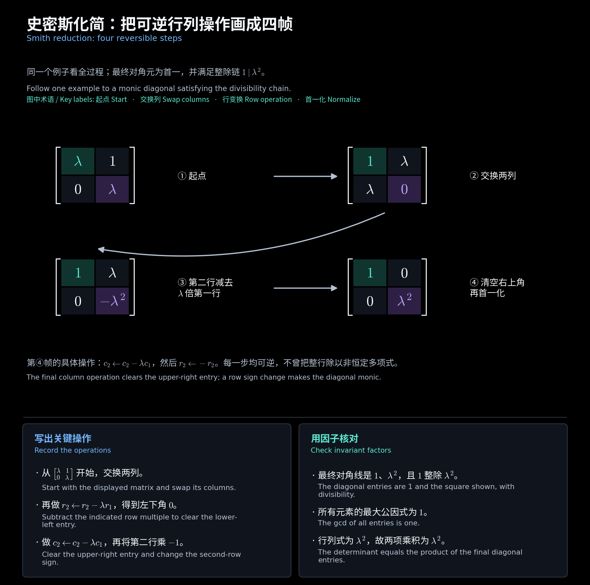
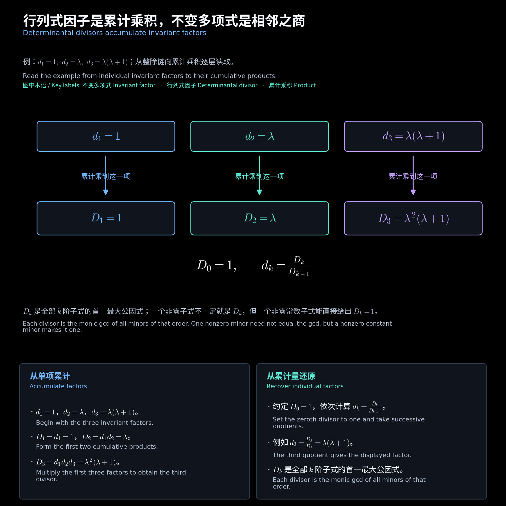

# 第六章　史密斯标准形与不变多项式

[阅读导航](00_阅读导航.md) · [上一章](05_多项式矩阵与幺模变换.md) · [下一章](07_初等因子与特征矩阵.md)

对应[第五讲](<../../materials/lectures/Lecture 5-linear algebra.pdf>)第 4—15 页。上一章说明了可以做哪些多项式行列变换；本章要回答的是：经过这些变换，能否把矩阵化成一种唯一的标准形式，并据此判断两个矩阵是否等价？以下在域 $\mathbb F$ 的一元多项式环上讨论，数值例题取实数或复数域。

## 一、先明确允许的变换

**幺模矩阵**是逆矩阵仍为多项式矩阵的方阵，等价条件是行列式为非零常数。合法的初等行变换为：交换两行、一行乘非零常数、把一行的多项式倍数加到另一行；列变换同理。

例如 $r_2\leftarrow r_2-\lambda r_1$ 合法，但 $r_2\leftarrow\lambda r_2$ 不合法：后者的逆需要除以 $\lambda$。多项式环里能任意相除的只有非零常数。

对同型矩阵 $H,K\in\mathbb F[\lambda]^{m\times n}$，若存在幺模矩阵 $U,V$ 使

$$
K=UHV,
$$

则称二者**幺模等价**。这里左右变换相互独立，与常数矩阵的相似变换 $P^{-1}AP$ 要区分。

## 二、史密斯标准形与整除链

设多项式矩阵 $H$ 的秩为 $r$，则它等价于同型的伪对角矩阵

$$
S_H=\begin{bmatrix}\operatorname{diag}(d_1,\ldots,d_r)&0\\0&0\end{bmatrix},
\qquad d_i\ne0,\quad d_i\text{ 首一},\quad d_i\mid d_{i+1}.
$$

这称为 **史密斯标准形**，也常记作 Smith 标准形；非零对角元 $d_i$ 称为**不变多项式**。首一是指最高次项系数为 $1$，整除链是指后一个多项式总是前一个的倍数。大小和秩确定剩余的零行、零列；单位多项式 $1$ 也必须计入不变多项式。

**补充例题：对角矩阵未必已经标准化。**

$$
\operatorname{diag}(\lambda,\lambda-1)
\quad\longrightarrow\quad
\operatorname{diag}(1,\lambda(\lambda-1)).
$$

左边两项互不整除，不能直接叫史密斯形。右边才满足首一和整除链条件。史密斯形在这些约定下唯一。

## 三、化简为什么能够完成

核心是**带余除法使主元降次**。把一个非零元移到左上角，用它除同行、同列的元素；若出现非零余式，就把余式移到主元位置。余式次数更小，因此这个过程不能无限继续。

清空第一行、第一列以后，还要检查主元能否整除右下块的每个元素。若不能，把含有该元素的行加到第一行，再作列除法，又能制造次数更低的主元。直到主元整除余下全部元素，才固定它并处理右下块。这样才能得到整除链，而不仅是任意对角形式。

**补充例题：完整的二阶化简。**

$$
\begin{aligned}
\begin{bmatrix}\lambda&1\\0&\lambda\end{bmatrix}
&\xrightarrow{c_1\leftrightarrow c_2}
\begin{bmatrix}1&\lambda\\\lambda&0\end{bmatrix}
\xrightarrow{r_2\leftarrow r_2-\lambda r_1}
\begin{bmatrix}1&\lambda\\0&-\lambda^2\end{bmatrix}\\
&\xrightarrow{c_2\leftarrow c_2-\lambda c_1}
\begin{bmatrix}1&0\\0&-\lambda^2\end{bmatrix}
\xrightarrow{r_2\leftarrow-r_2}
\operatorname{diag}(1,\lambda^2).
\end{aligned}
$$

每一步都可逆。若只要求最终标准形，通常不必追踪左右幺模矩阵，而可用下面的行列式因子计算。

<!-- diagram:19_smith_steps:start -->

**图解 · 史密斯化简：把可逆行列操作画成四帧**

**读图：** 四帧保留每一步合法操作：交换列、消掉左下角、消掉右上角、再首一化。最终不是随便一个对角矩阵，还要求对角元组成整除链。

<!-- diagram:19_smith_steps:end -->

## 四、行列式因子与不变多项式

**行列式因子** $D_k$ 是全部 $k$ 阶子式的首一最大公因式。规定 $D_0=1$；当 $k>r$ 时全部子式为零，规定 $D_k=0$。仅对 $1\le k\le r$ 使用

$$
\boxed{D_k=d_1\cdots d_k},\qquad
\boxed{d_k=D_k/D_{k-1}}.
$$

原因是：在标准形中，前 $k$ 个对角元的乘积既是一个子式，又整除所有同阶子式；幺模变换不改变这些子式的首一最大公因式。因此，$D_k$ 唯一确定 $d_k$。

计算时分两步：先说明所有同阶子式都含某个公因子，再找一个或几个子式证明没有更大的公因子。**单独找出一个非零子式，不等于求出了行列式因子。** 若找到非零常数子式，则可立即断定对应的 $D_k=1$。

**作业例题：第四次作业第 1 题。**

$$
H=\begin{bmatrix}
1-\lambda&\lambda^2&\lambda\\
2\lambda-1&\lambda(1-\lambda)&-2\lambda\\
1+\lambda^2&\lambda^2&-\lambda^2
\end{bmatrix}.
$$

因为 $2(1-\lambda)+(2\lambda-1)=1$，所有元素的最大公因式为 $D_1=1$。第二、三列都含 $\lambda$，任意二阶子式至少选到这两列中的一列，所以均含 $\lambda$。又有

$$
\begin{vmatrix}1-\lambda&\lambda\\2\lambda-1&-2\lambda\end{vmatrix}=-\lambda,
$$

故 $D_2=\lambda$。行列式为 $-\lambda^2(\lambda+1)$，首一化得 $D_3=\lambda^2(\lambda+1)$。依次相除得到

$$
(d_1,d_2,d_3)=(1,\lambda,\lambda(\lambda+1)),\qquad
\boxed{S_H=\operatorname{diag}(1,\lambda,\lambda(\lambda+1))}.
$$

自查：$d_1\mid d_2\mid d_3$，且三项的乘积与原行列式只差非零常数。

<!-- diagram:20_determinantal_divisors:start -->

**图解 · 行列式因子是累计乘积，不变多项式是相邻之商**

**读图：** 上排是单个不变多项式，下排是从第一项累计乘到当前位置的行列式因子。反方向用相邻两个累计结果相除，就取回单项：$d_k=D_k/D_{k-1}$。

<!-- diagram:20_determinantal_divisors:end -->

## 五、结构化矩阵先找常数子式

**作业例题：第四次作业第 2 题的上双对角结构。** 设 $H$ 为 $n$ 阶，主对角元均为 $\lambda-a$，超对角元为非零常数 $b_1,\ldots,b_{n-1}$，其余为零。

对 $k<n$，前 $k$ 行与第 $2$ 至 $k+1$ 列构成下三角矩阵，其行列式为 $b_1\cdots b_k\ne0$。所以

$$
D_1=\cdots=D_{n-1}=1,\qquad D_n=(\lambda-a)^n,
$$

从而 $S_H=\operatorname{diag}(I_{n-1},(\lambda-a)^n)$。这个结论将在若尔当块的特征矩阵中再次出现。

## 六、等价判据与常见错误

对**同型**多项式矩阵，幺模等价、史密斯形相同、秩及全部非零行列式因子相同、完整不变多项式列表相同，四种表述等价。方阵幺模当且仅当史密斯形是单位矩阵。

**补充反例：行列式相同仍可能不等价。**

$$
H=\operatorname{diag}(\lambda,\lambda),\qquad
K=\operatorname{diag}(1,\lambda^2).
$$

两者行列式都是 $\lambda^2$，但 $D_1(H)=\lambda$、$D_1(K)=1$。行列式只记录最后一个行列式因子，中间信息仍可能不同。

做题时检查：是否把非恒定多项式倍乘整行当成合法操作，是否遗漏单位项，是否只比较行列式，以及最终对角元是否组成整除链。

[阅读导航](00_阅读导航.md) · [上一章](05_多项式矩阵与幺模变换.md) · [下一章](07_初等因子与特征矩阵.md)
