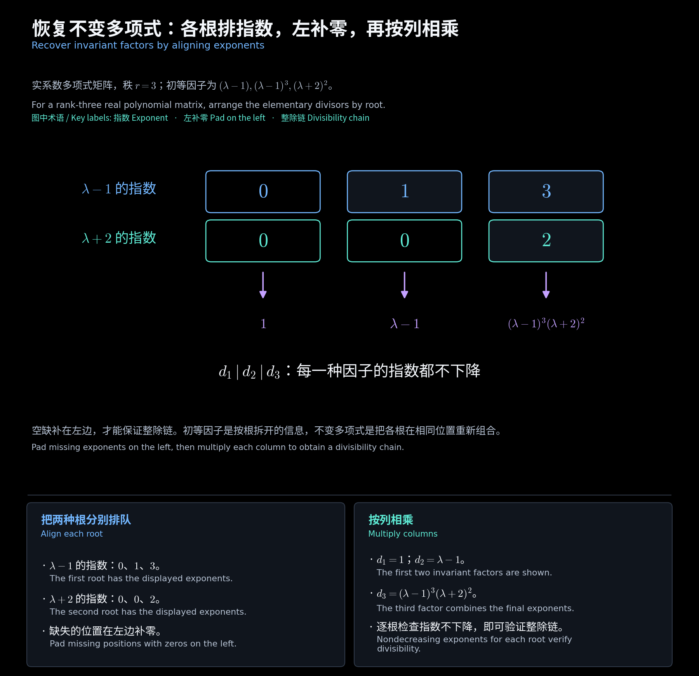
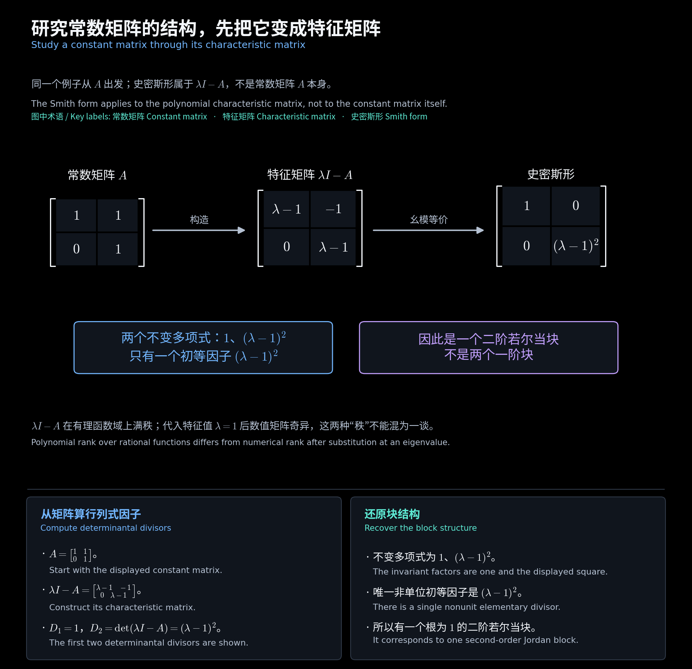

# 第七章　初等因子与特征矩阵

[阅读导航](00_阅读导航.md) · [上一章](06_史密斯标准形与不变多项式.md) · [下一章](08_特征值与不变子空间.md)

对应[第五讲](<../../materials/lectures/Lecture 5-linear algebra.pdf>)第 16—21 页。不变多项式按整除链组织信息；初等因子则按不可约因子组织信息。学会在两种写法之间转换，才能从多项式矩阵过渡到常数矩阵的标准形。

## 一、初等因子保留每一次出现

把每个非零不变多项式分解为首一不可约多项式的幂。所有**正指数的完整因子幂**连同出现重数，称为矩阵的**初等因子**。单位项 $1$ 不产生初等因子，零对角元也不计入。

复数域上的不可约因子都是一次式，因此初等因子形如 $(\lambda-\rho)^m$；实数域上还可能有不可约二次式的幂。讨论因式分解时必须先确定标量域。

**补充例题：不能把同一个根的各项合并。**

$$
S=\operatorname{diag}\bigl(1,(\lambda-1)^2,(\lambda-1)^3(\lambda+2)\bigr).
$$

它的初等因子是

$$
(\lambda-1)^2,\qquad (\lambda-1)^3,\qquad \lambda+2.
$$

前两项来自不同不变多项式，必须分别保留。写成 $(\lambda-1)^5$ 会丢失分块信息。后面将看到，原来的两项分别对应二阶和三阶若尔当块。

## 二、从初等因子恢复不变多项式

已知矩阵秩为 $r$ 后，按下列步骤恢复完整列表。

1. 对每个不同的不可约因子，单独收集其全部正指数并从小到大排序。
2. 不足 $r$ 项时，在**左侧补零**。
3. 对应位置的因子幂相乘，得到 $d_1,\ldots,d_r$；再按原矩阵大小补上零行列。

左补零使每种因子的指数都不下降，从而保证 $d_i\mid d_{i+1}$。

**补充例题：** 某多项式矩阵秩为 $3$，初等因子为 $\lambda-1$、$(\lambda-1)^3$、$(\lambda+2)^2$。

| 因子 | 第 1 项指数 | 第 2 项指数 | 第 3 项指数 |
| --- | --- | --- | --- |
| $\lambda-1$ | 0 | 1 | 3 |
| $\lambda+2$ | 0 | 0 | 2 |

于是

$$
(d_1,d_2,d_3)=\bigl(1,\lambda-1,(\lambda-1)^3(\lambda+2)^2\bigr).
$$

这里给出的是一般多项式矩阵，并非三阶常数矩阵的特征矩阵。后一种矩阵的不变多项式总次数必须等于常数矩阵阶数，不能混用题设。

<!-- diagram:21_factor_alignment:start -->

**图解 · 恢复不变多项式：各根排指数，左补零，再按列相乘**

**读图：** 每种根的指数单独从小到大排，不足的位置在左边补零，再按列相乘。这样每一行的指数都不下降，恢复出的不变多项式自然构成整除链；图示对象是秩为 3 的一般多项式矩阵。

<!-- diagram:21_factor_alignment:end -->

## 三、初等因子不记录单位项和零块

**补充反例：**

$$
H=\operatorname{diag}(\lambda,0),\qquad
K=\operatorname{diag}(1,\lambda).
$$

二者同为二阶、初等因子都只有 $\lambda$，但秩分别为 $1,2$，所以不等价。对一般多项式矩阵，要同时知道**大小、秩、初等因子及重数**，才能恢复唯一的史密斯形。

因此，同型、同秩、初等因子多重集合相同，足以判断幺模等价。“初等因子相同就等价”须有这些条件。

## 四、分块矩阵如何合并信息

分块对角矩阵的初等因子是各块初等因子的**多重集合并集**，秩则相加。并集保留重复次数。

**补充例题一：** $H=\operatorname{diag}(\lambda^2,\lambda)$ 的初等因子为 $\lambda^2,\lambda$；按指数升序恢复，得到 $S_H=\operatorname{diag}(\lambda,\lambda^2)$。

**补充例题二：** $K=\operatorname{diag}(\lambda,\lambda-1)$ 的初等因子为 $\lambda,\lambda-1$。两种根的指数都补为 $(0,1)$，故 $S_K=\operatorname{diag}(1,\lambda(\lambda-1))$。

这说明：**各块的不变多项式不能直接拼接为整块矩阵的不变多项式**，而应先收集初等因子，再重新排序配对。

## 五、特征矩阵连接两类矩阵

对常数矩阵 $A\in\mathbb F^{n\times n}$，定义**特征矩阵**与**特征多项式**

$$
X_A(\lambda)=\lambda I-A,\qquad
\chi_A(\lambda)=\det(\lambda I-A).
$$

特征矩阵的最高次系数为 $I$，行列式是首一 $n$ 次多项式。因此它在有理函数域上满秩，有恰好 $n$ 个非零不变多项式，并且

$$
\chi_A=d_1\cdots d_n,\qquad \sum_{i=1}^n\deg d_i=n.
$$

把 $\lambda$ 代为某个特征值后，矩阵秩可以下降；这不影响它作为多项式矩阵满秩。例如 $\lambda I-A$ 满秩与 $\rho I-A$ 奇异可以同时成立。

以后说“常数矩阵 $A$ 的不变多项式或初等因子”，指的是 **$\lambda I-A$ 的不变多项式或初等因子**。若对常数可逆矩阵 $A$ 本身作多项式幺模化简，只会得到单位矩阵，无法反映其特征值。

<!-- diagram:35_characteristic_matrix:start -->

**图解 · 研究常数矩阵的结构，先把它变成特征矩阵**

**读图：** 特征矩阵的史密斯形保留了如何分块的信息。本例只有一个初等因子 $(\lambda-1)^2$，对应一个二阶块；若把两个一阶因子合并，就会误判矩阵结构。

<!-- diagram:35_characteristic_matrix:end -->

## 六、从原矩阵算出完整的因子信息

**作业例题：第四次作业第 4 题。**

$$
A=\begin{bmatrix}-7&-12&-6\\3&5&3\\3&6&2\end{bmatrix},\qquad
X_A=\begin{bmatrix}\lambda+7&12&6\\-3&\lambda-5&-3\\-3&-6&\lambda-2\end{bmatrix}.
$$

存在非零常数元素，所以 $D_1=1$。代入 $\lambda=-1$ 后三行互为倍数、秩为 $1$，故所有二阶子式都含 $\lambda+1$。又有一个子式

$$
\begin{vmatrix}\lambda+7&6\\-3&-3\end{vmatrix}=-3(\lambda+1),
$$

所以 $D_2=\lambda+1$。行列式给出 $D_3=(\lambda+1)^2(\lambda-2)$，从而

$$
\boxed{S_{X_A}=\operatorname{diag}\bigl(1,\lambda+1,(\lambda+1)(\lambda-2)\bigr)}.
$$

复数域上的初等因子是 $\lambda+1,\lambda+1,\lambda-2$，特征多项式为 $(\lambda+1)^2(\lambda-2)$。重复的两项 $\lambda+1$ 将对应两个一阶块，而不是一个二阶块。

这一题的计算顺序可用于多数小矩阵：**构造特征矩阵 → 求行列式因子 → 依次相除 → 分解并保留重数**。最后同时检查整除链、总次数和原矩阵阶数。

[阅读导航](00_阅读导航.md) · [上一章](06_史密斯标准形与不变多项式.md) · [下一章](08_特征值与不变子空间.md)
