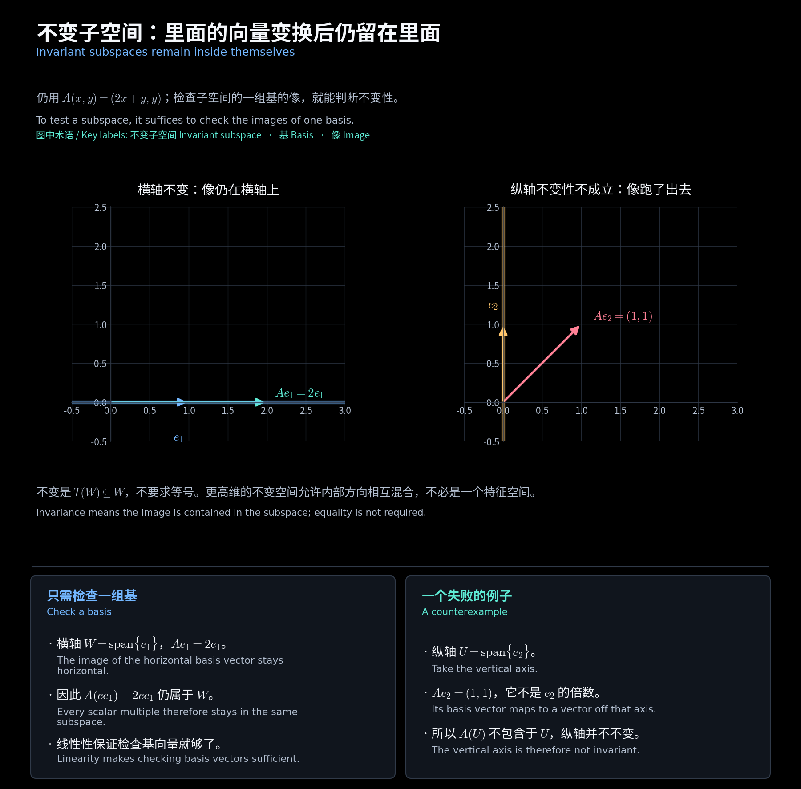
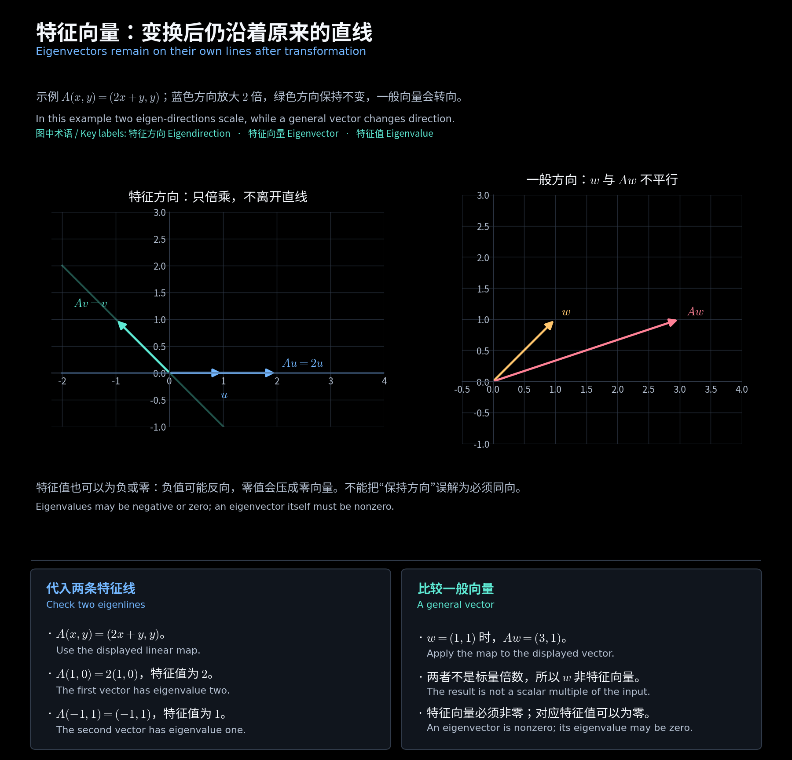

# 第八章　特征值与不变子空间

[阅读导航](00_阅读导航.md) · [上一章](07_初等因子与特征矩阵.md) · [下一章](09_相似不变量与自然标准形.md)

对应[第六讲](<../../materials/lectures/Lecture 6-linear algebra.pdf>)第 2—16、19 页。以下设 $V$ 是 $\mathbb F$ 上的 $n$ 维空间，$T:V\to V$ 为线性算子，$A$ 是它在一组基下的矩阵。特征向量描述作用后只发生倍乘的方向；不变子空间则允许一整个子空间中的向量相互混合。

## 一、换基与相似的含义

若原基为 $B$、新基为 $C=BP$，则 $P$ 的列是新基向量在旧基下的坐标，有

$$
[v]_B=P[v]_C,\qquad A_C=P^{-1}A_BP.
$$

因此相似矩阵描述的是同一个线性算子在不同基下的表示。算子没变，坐标矩阵可以改变；求出特征向量的坐标列 $x$ 后，抽象空间中的向量仍要还原为 $Bx$。

## 二、不变子空间与分块结构

子空间 $W\subseteq V$ 满足 $T(W)\subseteq W$ 时，称为 **$T$-不变子空间**。只需检查 $W$ 的一组基的像是否仍在 $W$ 中。不要求 $T(W)=W$。

把 $W$ 的基放在整个空间的基的前面，矩阵具有形式

$$
[T]=\begin{bmatrix}A_W&B_{12}\\0&A_{22}\end{bmatrix}.
$$

左下块为零，因为前面的基向量的像没有补空间方向的分量。如果选定的补空间也不变，右上块也为零，才能得到块对角矩阵。**一个不变子空间本身不保证存在不变补空间。**

**补充例题：不变空间不一定是特征空间。** 在 $\mathbb C_2[t]$ 上取微分算子 $D(f)=f'$，令 $W=\operatorname{span}\{1,t\}$。因为 $D(1)=0,D(t)=1$，有

$$
D(W)=\operatorname{span}\{1\}\subsetneq W.
$$

$W$ 不变，但其中 $t$ 不是特征向量，所以 $W$ 不是一个特征空间。

<!-- diagram:23_invariant_subspace:start -->

**图解 · 不变子空间：里面的向量变换后仍留在里面**

**读图：** 横轴的一组基的像仍在横轴，因此整条横轴不变；纵轴的基向量的像跑出了纵轴，因此该子空间不变性不成立。只需检验子空间的一组基，不用枚举其中所有向量。

<!-- diagram:23_invariant_subspace:end -->

## 三、特征值与特征空间怎样计算

若 $T(v)=\rho v$ 且 $v\ne0$，则 $\rho$ 为**特征值**，$v$ 为相应**特征向量**。零可以是特征值；零向量不能作为特征向量。

**特征空间**包含该根的全部特征向量及零向量：

$$
E_\rho(T)=\ker(T-\rho I),\qquad
E_\rho(A)=\ker(A-\rho I).
$$

计算分三步：解 $\det(\lambda I-A)=0$ 得到根 $\rho$；解 $(A-\rho I)x=0$ 求出特征空间的一组基；题目给定抽象基时，再还原为 $v=Bx$。

标量域必须保留。例如实旋转矩阵 $\begin{bmatrix}0&-1\\1&0\end{bmatrix}$ 的特征多项式为 $\lambda^2+1$，没有实特征值，但在复数域有 $i,-i$。

<!-- diagram:22_eigen_directions:start -->

**图解 · 特征向量：变换后仍沿着原来的直线**

**读图：** 蓝色向量变长但仍在横轴方向上，绿色方向的向量保持不变；一般向量则被剪切到另一条方向。特征向量的关键是像仍为它的标量倍数，而非所有向量都能只做缩放。

<!-- diagram:22_eigen_directions:end -->

## 四、代数重数不等于几何重数

**代数重数** $a_\rho$ 是 $\rho$ 作为特征多项式根的重数；**几何重数** $g_\rho$ 是特征空间的维数：

$$
g_\rho=n-\operatorname{rank}(A-\rho I),\qquad 1\le g_\rho\le a_\rho.
$$

把特征空间的一组基扩充为整个空间的基，左上块为 $\rho I_{g_\rho}$，所以特征多项式至少含 $(\lambda-\rho)^{g_\rho}$。这解释了后一不等式。

**补充例题：三重根只有一个独立特征向量。** 微分算子在基 $(1,t,t^2)$ 下为

$$
N=\begin{bmatrix}0&1&0\\0&0&2\\0&0&0\end{bmatrix}.
$$

$\chi_N=\lambda^3$，所以 $a_0=3$；但 $Nx=0$ 要求 $x_2=x_3=0$，因此 $E_0=\operatorname{span}\{e_1\}$，$g_0=1$。对应的抽象特征向量是非零常数多项式。

## 五、什么时候可以对角化

不同特征值的特征空间之和是**直和**。若 $v_j\in E_{\rho_j}$ 且 $\sum_jv_j=0$，对等式作用 $\prod_{j\ne k}(T-\rho_jI)$，只剩非零常数乘 $v_k$，故各 $v_k=0$。

但这些特征空间的直和未必填满整个空间。矩阵在 $\mathbb F$ 上**可对角化**，当且仅当能找到 $n$ 个线性无关的 $\mathbb F$ 上的特征向量，即

$$
\boxed{\sum_{\rho\in\mathbb F}g_\rho=n}.
$$

等价地，特征多项式在 $\mathbb F$ 中完全分裂，并且每个根都有 $g_\rho=a_\rho$。复数域上分裂条件自动满足。重根并不排除对角化，例如 $I_n$；有 $n$ 个互异特征值则一定可对角化。

**补充例题：同一特征多项式的不同结果。** $I_2$ 与 $\begin{bmatrix}1&1\\0&1\end{bmatrix}$ 的特征多项式都是 $(\lambda-1)^2$，但几何重数分别为 $2,1$。前者可对角化，后者不可对角化。

## 六、作业中的平移算子

在 $\mathbb C_n[t]$ 上令 $T_a(f)(t)=f(t+a)$，其中 $a\ne0$。由二项式展开，基 $(1,t,\ldots,t^n)$ 下的矩阵为上三角矩阵，主对角元全为 $1$。例如 $n=2$ 时

$$
[T_a]=\begin{bmatrix}1&a&a^2\\0&1&2a\\0&0&1\end{bmatrix},\qquad
\chi_{T_a}=(\lambda-1)^3.
$$

一般地，若 $f$ 的次数为 $m\ge1$、首项系数为 $c_m$，则 $f(t+a)-f(t)$ 的首项为 $mc_ma\,t^{m-1}\ne0$。所以只有常数多项式能满足 $T_a(f)=f$，即

$$
E_1(T_a)=\operatorname{span}\{1\},\qquad a_1=n+1,\quad g_1=1.
$$

当 $n\ge1$ 时，平移算子不可对角化。这里有限维空间是次数不超过 $n$ 的多项式空间，维数为 $n+1$；不能把它与无限维空间 $\mathbb C[t]$ 混淆。

## 七、特征向量与矩阵幂

若 $Av=\rho v$，则 $A^kv=\rho^kv$。若已有特征向量基并令 $A=P\Lambda P^{-1}$，便有

$$
A^k=P\Lambda^kP^{-1}.
$$

若特征向量不足以成基，就需要广义特征向量与若尔当链。后面的第十、十一章正是补足这些方向的方法。

[阅读导航](00_阅读导航.md) · [上一章](07_初等因子与特征矩阵.md) · [下一章](09_相似不变量与自然标准形.md)
