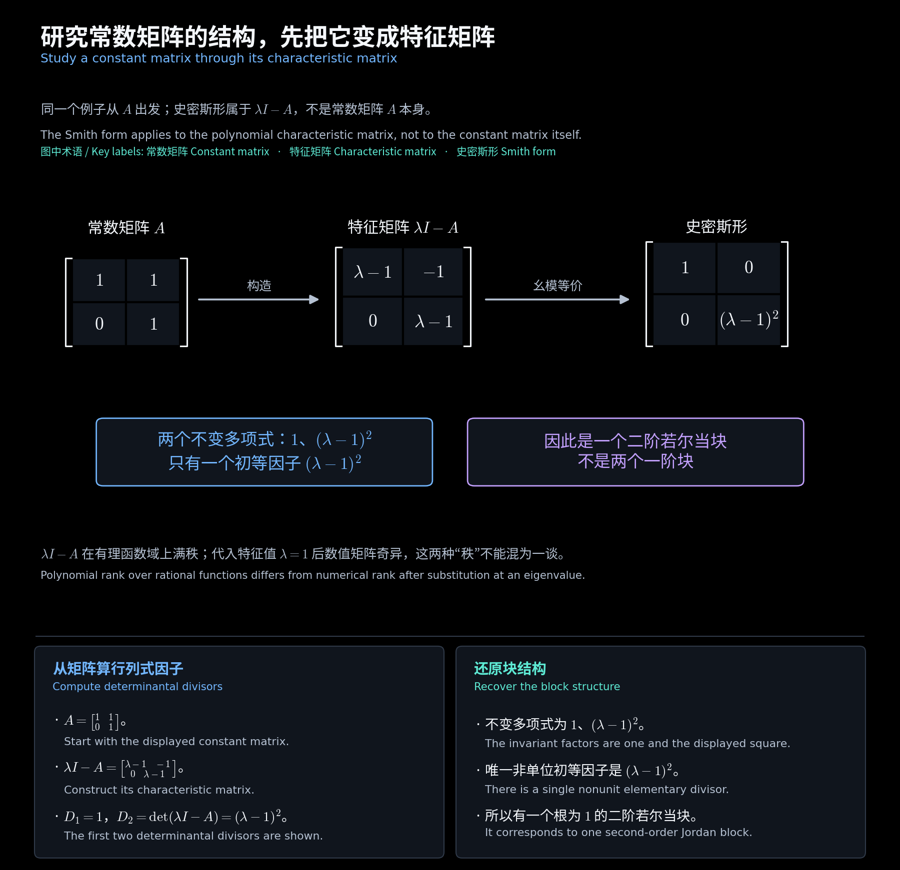
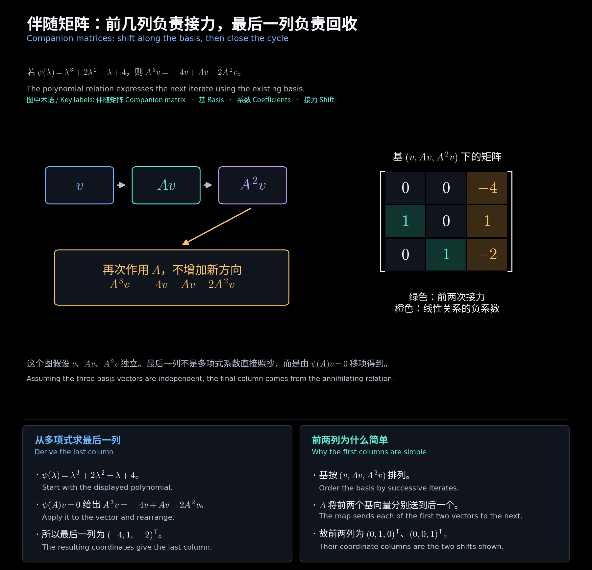

# 第九章　相似不变量与自然标准形

[阅读导航](00_阅读导航.md) · [上一章](08_特征值与不变子空间.md) · [下一章](10_复数与实数若尔当标准形.md)

对应[第六讲](<../../materials/lectures/Lecture 6-linear algebra.pdf>)第 17—18、20—24 页。特征多项式相同还不足以判断相似；本章利用特征矩阵的不变多项式，把一个常数矩阵化为由伴随块组成的**自然标准形**，也称**有理标准形**。

## 一、哪些量在相似后保持不变

若 $B=P^{-1}AP$，则

$$
\lambda I-B=P^{-1}(\lambda I-A)P.
$$

所以特征多项式、特征值及其代数重数不变。若 $Ax=\rho x$，则 $B(P^{-1}x)=\rho(P^{-1}x)$，故特征空间一一对应，几何重数也不变。特征向量的坐标通常会改变。

更完整的判据是：对同域上的同阶常数矩阵，

$$
\boxed{A\sim B\iff\lambda I-A\text{ 与 }\lambda I-B\text{ 幺模等价}}.
$$

因此可以比较特征矩阵的完整不变多项式，或初等因子及重数来判断相似。特征矩阵的大小和满秩条件已由矩阵阶数确定。

**补充反例：相同特征多项式仍不足够。** $I_2$ 的特征矩阵史密斯形为 $\operatorname{diag}(\lambda-1,\lambda-1)$；$\begin{bmatrix}1&1\\0&1\end{bmatrix}$ 的则为 $\operatorname{diag}(1,(\lambda-1)^2)$。两者不相似。

<!-- diagram:35_characteristic_matrix:start -->

**图解 · 研究常数矩阵的结构，先把它变成特征矩阵**

**读图：** 特征矩阵的史密斯形保留了如何分块的信息。本例只有一个初等因子 $(\lambda-1)^2$，对应一个二阶块；若把两个一阶因子合并，就会误判矩阵结构。

<!-- diagram:35_characteristic_matrix:end -->

## 二、列伴随矩阵怎样写

对首一多项式

$$
\psi(\lambda)=\lambda^m+c_{m-1}\lambda^{m-1}+\cdots+c_1\lambda+c_0,
$$

定义**列伴随矩阵** $C(\psi)$：次对角线全为 $1$，末列为 $(-c_0,-c_1,\ldots,-c_{m-1})^{\mathsf T}$，其余为零。$m=1$ 时是 $[-c_0]$。

**补充例题：**

$$
\psi=\lambda^3+2\lambda^2-\lambda+4
\quad\Longrightarrow\quad
C(\psi)=\begin{bmatrix}0&0&-4\\1&0&1\\0&1&-2\end{bmatrix}.
$$

注意末列按常数项、一次项、二次项顺序取负，不能倒序。它的特征矩阵有低阶常数子式，因此

$$
\det(\lambda I-C(\psi))=\psi,\qquad
S_{\lambda I-C(\psi)}=\operatorname{diag}(I_{m-1},\psi).
$$

也就是说，一个 $m$ 阶伴随块对应一个 $m$ 次的非常数不变多项式。

<!-- diagram:24_companion_cycle:start -->

**图解 · 伴随矩阵：前几列负责接力，最后一列负责回收**

**读图：** 在循环基 $(v,Av,A^2v)$ 下，前两次作用只是把向量送到下一个基向量。第三次作用由多项式关系拉回已有三个方向，因此最后一列是关系式移项后的系数。

<!-- diagram:24_companion_cycle:end -->

## 三、从史密斯形构造自然标准形

设 $A$ 为 $n$ 阶，去掉特征矩阵不变多项式中的单位项后，剩下

$$
\psi_1\mid\psi_2\mid\cdots\mid\psi_\ell,\qquad \deg\psi_i\ge1.
$$

则

$$
\boxed{A\sim N=\operatorname{diag}(C(\psi_1),\ldots,C(\psi_\ell))},\qquad
\sum_i\deg\psi_i=n.
$$

构造顺序是：求 $\lambda I-A$ 的史密斯形，去掉 $1$，为每个剩下的多项式写一个伴随块，按整除链顺序拼成块对角矩阵。不要求多项式在当前域内分解成一次因子，因此这一标准形在实数域、复数域及一般域上都可使用。

推导思路是：每个伴随块的特征矩阵等价于 $\operatorname{diag}(I_{\deg\psi_i-1},\psi_i)$，全部拼起来恰好恢复 $\lambda I-A$ 的史密斯形，再用上一节的相似判据。

注意三类矩阵的区别：史密斯形的元素是多项式；自然标准形和若尔当标准形的元素都是常数。史密斯化简得到的左右幺模矩阵可能含 $\lambda$，不能直接当作常数换基矩阵 $P$。

## 四、完整例题包括换基矩阵

**补充例题：**

$$
A=\begin{bmatrix}1&1\\0&1\end{bmatrix},\qquad
\lambda I-A=\begin{bmatrix}\lambda-1&-1\\0&\lambda-1\end{bmatrix}.
$$

$D_1=1,D_2=(\lambda-1)^2$，故唯一非常数不变多项式为 $\psi=(\lambda-1)^2=\lambda^2-2\lambda+1$，自然标准形为

$$
N=C(\psi)=\begin{bmatrix}0&-1\\1&2\end{bmatrix}.
$$

要找换基矩阵，可取 $v=e_2$，则 $Av=(1,1)^{\mathsf T}$，二者独立。令

$$
P=(v,Av)=\begin{bmatrix}0&1\\1&1\end{bmatrix}.
$$

由 $(A-I)^2=0$ 得 $A^2v=-v+2Av$，所以在新基 $(v,Av)$ 下，第一列为 $(0,1)^{\mathsf T}$，第二列为 $(-1,2)^{\mathsf T}$。直接验证

$$
AP=PN=\begin{bmatrix}1&2\\1&1\end{bmatrix},\qquad \det P=-1\ne0,
$$

故 $P^{-1}AP=N$。**求到标准形与求到换基矩阵是两项不同要求**；后者必须同时验证矩阵等式和可逆性。

## 五、伴随块来自循环基

若 $v,Av,\ldots,A^{m-1}v$ 独立，且

$$
A^mv=-c_0v-c_1Av-\cdots-c_{m-1}A^{m-1}v,
$$

则这组向量张成一个不变子空间，限制矩阵恰好是 $C(\psi)$。这解释了伴随矩阵的列结构，并为第十三章的循环子空间作准备。

**作业例题：第五次作业第 4 题的微分算子。** 在 $\mathbb C_n[t]$ 上令 $D(f)=f'$。其特征矩阵为上双对角结构，非零超对角元是 $-1,-2,\ldots,-n$，故

$$
S_{\lambda I-[D]}=\operatorname{diag}(I_n,\lambda^{n+1}),\qquad
N_D=C(\lambda^{n+1}).
$$

直接取基 $\bigl(t^n/n!,t^{n-1}/(n-1)!,\ldots,t,1\bigr)$，求导将每个基向量送到下一个，最后送到零，矩阵次对角线全为 $1$，正好得到该自然标准形。

下一章会把同一个算子写成超对角线为 $1$ 的若尔当块。两种写法的基顺序不同，不能混用伴随块与若尔当块的方向。

[阅读导航](00_阅读导航.md) · [上一章](08_特征值与不变子空间.md) · [下一章](10_复数与实数若尔当标准形.md)
