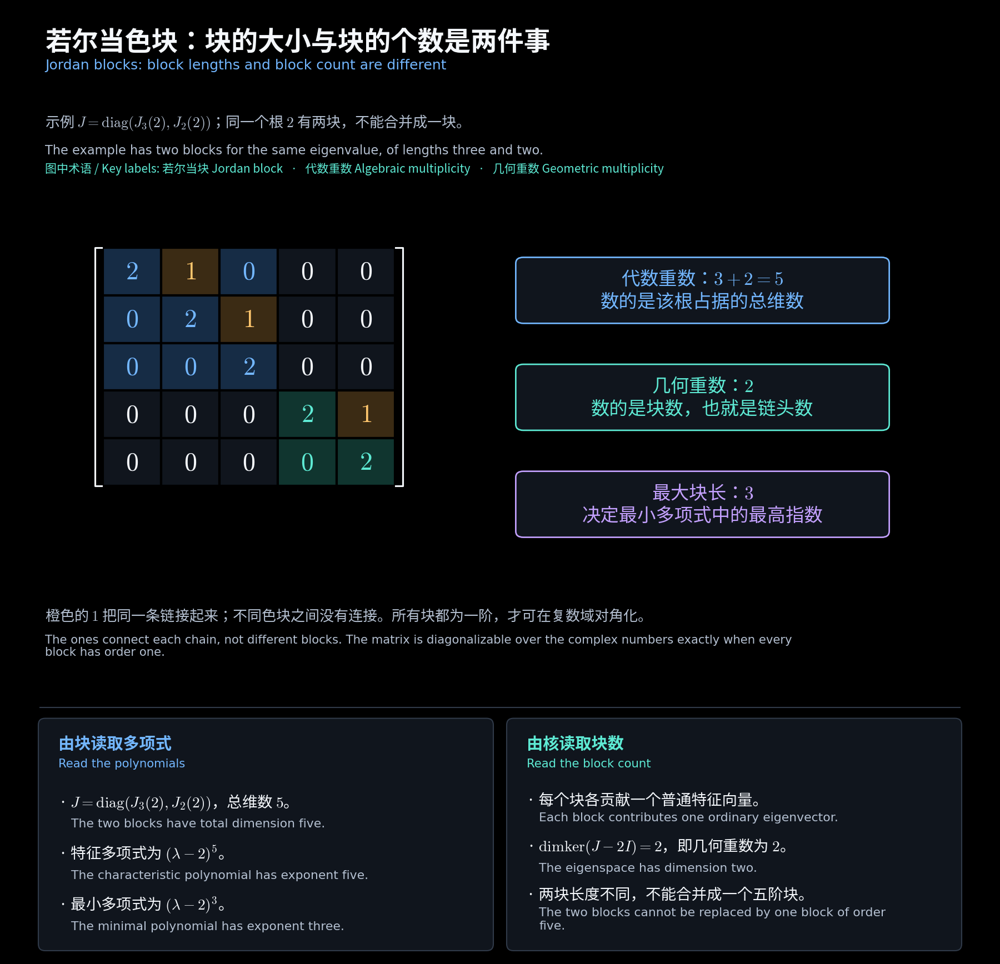
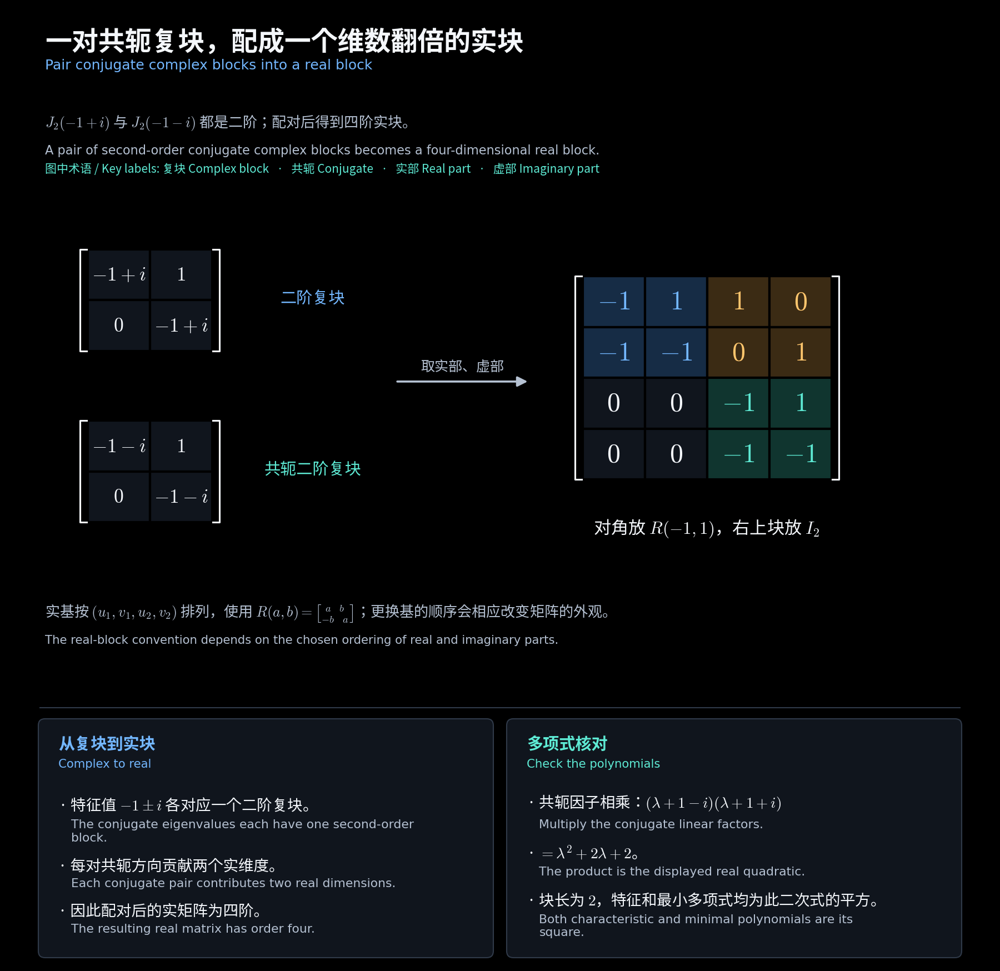

# 第十章　复数与实数若尔当标准形

[阅读导航](00_阅读导航.md) · [上一章](09_相似不变量与自然标准形.md) · [下一章](11_若尔当链与子空间分解.md)

对应[第七讲](<../../materials/lectures/Lecture 7-linear algebra.pdf>)第 2—11 页。**若尔当标准形**也称 Jordan 标准形。它用每个特征值处的块长记录矩阵无法对角化的部分：一阶块是普通对角元，更大的块需要广义特征向量。数值例题取实数或复数域。

## 一、若尔当块是什么

定义 $m$ 阶**若尔当块**

$$
J_m(\rho)=\begin{bmatrix}
\rho&1&0&\cdots&0\\
0&\rho&1&\ddots&\vdots\\
\vdots&\ddots&\ddots&\ddots&0\\
0&\cdots&0&\rho&1\\
0&\cdots&\cdots&0&\rho
\end{bmatrix},\qquad J_1(\rho)=[\rho].
$$

本讲义固定采用**超对角线为 $1$** 的约定。例如

$$
J_3(2)=\begin{bmatrix}2&1&0\\0&2&1\\0&0&2\end{bmatrix}.
$$

写成 $J_m(\rho)=\rho I+N$ 后，$N^m=0,N^{m-1}\ne0$。所以块长衡量了偏离单纯倍乘作用的幂零部分需要作用多少次才消失。

## 二、一个初等因子对应一个块

$\lambda I-J_m(\rho)$ 有低阶非零常数子式，行列式为 $(\lambda-\rho)^m$，因此它的唯一初等因子就是 $(\lambda-\rho)^m$。反过来，在复数域上，

$$
\boxed{(\lambda-\rho)^m\quad\longleftrightarrow\quad J_m(\rho)}.
$$

把 $A$ 的全部初等因子逐次换成对应块，再拼成块对角矩阵，就得到 $J=P^{-1}AP$。块的排列顺序可以改变，但各根处块的大小和个数唯一。

**补充例题：** 初等因子为 $(\lambda-2)^3,\lambda-2,(\lambda+1)^2$ 时，

$$
J=\operatorname{diag}(J_3(2),[2],J_2(-1)).
$$

总阶数是 $3+1+2=6$。根 $2$ 的代数重数为 $4$、几何重数为 $2$；根 $-1$ 的两种重数分别为 $2,1$。不能把根 $2$ 的两个因子合并成一个四阶块。

<!-- diagram:25_jordan_blocks:start -->

**图解 · 若尔当色块：块的大小与块的个数是两件事**

**读图：** 这是同一个根有三阶、二阶两块的五维例子。总格数给代数重数 5，块数给几何重数 2，最长块给最小多项式指数 3；三个数字各自回答不同问题。

<!-- diagram:25_jordan_blocks:end -->

## 三、从块长读出重数与可对角化性

| 要读出的量 | 若尔当块中的含义 |
| --- | --- |
| 根 $\rho$ 的代数重数 | 该根各块大小之和 |
| 根 $\rho$ 的几何重数 | 该根的块数 |
| $\dim\ker(A-\rho I)^k$ | 该根每个块贡献 $\min(k,\text{块长})$ |
| 最小多项式中 $\lambda-\rho$ 的指数 | 该根的最大块长，详见第十二章 |
| 复数域上的可对角化性 | 所有块都为一阶 |

例如特征多项式 $(\lambda-1)^4$ 既可能对应四个一阶块，也可能对应一个四阶块，或块长为 $3,1$、$2,2$、$2,1,1$。只知道四重根不能确定具体形状。

## 四、自然标准形为什么还能继续拆块

若首一多项式 $p,q$ 互素，则

$$
C(pq)\sim\operatorname{diag}(C(p),C(q)).
$$

原因是右侧特征矩阵的不变多项式可由互素因子重新组合，得到与 $C(pq)$ 相同的史密斯形。把每个不变多项式按不同根拆成互素因子后，就能继续化为若尔当块。

**补充例题：**

$$
C((\lambda-1)^2(\lambda+2))
\sim\operatorname{diag}(J_2(1),[-2]).
$$

这里两部分互素。反之，$\operatorname{diag}([1],[1])$ 不能合成 $J_2(1)$；两者几何重数不同，因子也不互素。

## 五、实矩阵的非实根如何处理

实矩阵的非实根成共轭对出现，而且 $a+bi,a-bi$（$b>0$）的若尔当块必须按**相同大小**配对。定义

$$
R(a,b)=\begin{bmatrix}a&b\\-b&a\end{bmatrix},\qquad
\mathcal R_m(a,b)=\begin{bmatrix}
R(a,b)&I_2&0&\cdots&0\\
0&R(a,b)&I_2&\ddots&\vdots\\
\vdots&\ddots&\ddots&\ddots&0\\
0&\cdots&0&R(a,b)&I_2\\
0&\cdots&\cdots&0&R(a,b)
\end{bmatrix}.
$$

一对 $m$ 阶共轭复块对应一个 $2m$ 阶实块 $\mathcal R_m(a,b)$。实根处的普通若尔当块保留不变。实形的超对角**块**是 $I_2$，不能写成单个标量 $1$。

**补充例题：** $J_2(-1+i),J_2(-1-i)$ 配成

$$
\mathcal R_2(-1,1)=\begin{bmatrix}
-1&1&1&0\\-1&-1&0&1\\0&0&-1&1\\0&0&-1&-1
\end{bmatrix}.
$$

对应的实初等因子为 $((\lambda+1)^2+1)^2$。本例中每个共轭复块为二阶，配对后的实块为四阶。

<!-- diagram:26_real_jordan:start -->

**图解 · 一对共轭复块，配成一个维数翻倍的实块**

**读图：** 二阶块与它的共轭块配对，用复链向量的实部、虚部作新基，就得到四阶实块。对角的两个二维块负责共轭根，橙色的单位块负责链之间的接力。

<!-- diagram:26_real_jordan:end -->

## 六、三阶矩阵的全部标准形

**作业例题：第六次作业第 2 题。**

$$
A=\begin{bmatrix}4&6&0\\-3&-5&0\\-3&-6&1\end{bmatrix}.
$$

对特征矩阵，$D_1=1$；因为 $\operatorname{rank}(A-I)=1$，全部二阶子式都含 $\lambda-1$，其中一个恰为 $-6(\lambda-1)$，故 $D_2=\lambda-1$。又有 $D_3=(\lambda-1)^2(\lambda+2)$，于是

$$
(d_1,d_2,d_3)=\bigl(1,\lambda-1,(\lambda-1)(\lambda+2)\bigr).
$$

自然标准形为

$$
N=\operatorname{diag}([1],C(\lambda^2+\lambda-2))
=\begin{bmatrix}1&0&0\\0&0&2\\0&1&-1\end{bmatrix}.
$$

初等因子为 $\lambda-1,\lambda-1,\lambda+2$，故复、实若尔当形都是 $J=\operatorname{diag}(1,1,-2)$。虽然根 $1$ 重复出现，所有块仍为一阶，矩阵可对角化。

补出一组可直接验证的特征向量：

$$
P=\begin{bmatrix}-2&0&1\\1&0&-1\\0&1&-1\end{bmatrix},\qquad
\det P=-1,\qquad AP=P\operatorname{diag}(1,1,-2).
$$

## 七、十一阶矩阵由初等因子重建

**作业例题：第六次作业第 3 题。** 根 $-1$ 的块长为 $1,2,2$，根 $-1+i$ 与 $-1-i$ 各有块长 $1,2$。令 $x=\lambda+1,q=x^2+1$，指数升序并左补零后得到

$$
\psi_1=x,\qquad\psi_2=x^2q,\qquad\psi_3=x^2q^2.
$$

三项次数为 $1,4,6$，总和为 $11$，因此

$$
S_{\lambda I-A}=\operatorname{diag}(I_8,\psi_1,\psi_2,\psi_3),\qquad
N=\operatorname{diag}([-1],C(\psi_2),C(\psi_3)).
$$

复形为根 $-1$ 处的三个块，以及两个非实根处各两个块。实形可直接写为

$$
J_{\mathbb R}=\operatorname{diag}\bigl([-1],J_2(-1),J_2(-1),R(-1,1),\mathcal R_2(-1,1)\bigr).
$$

总大小为 $1+2+2+2+4=11$。检查总维数能发现漏掉重复因子、遗漏单位不变多项式或共轭块配错大小等问题。

[阅读导航](00_阅读导航.md) · [上一章](09_相似不变量与自然标准形.md) · [下一章](11_若尔当链与子空间分解.md)
