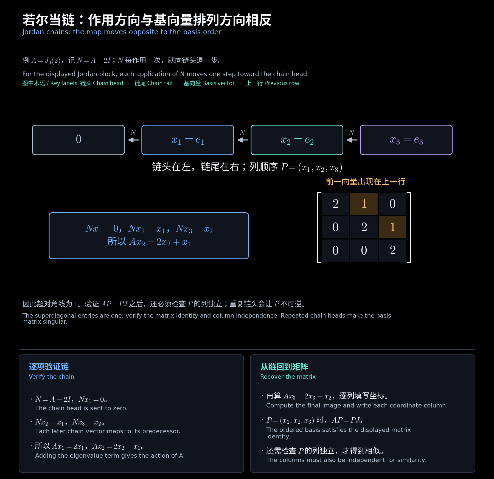
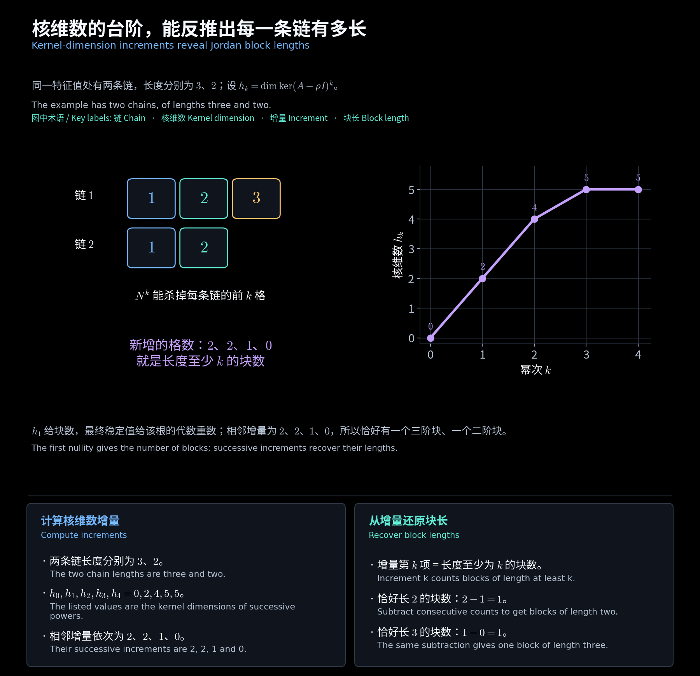

# 第十一章　若尔当链与子空间分解

[阅读导航](00_阅读导航.md) · [上一章](10_复数与实数若尔当标准形.md) · [下一章](12_最小多项式与第一分解.md)

对应[第七讲](<../../materials/lectures/Lecture 7-linear algebra.pdf>)第 12—21 页。上一章确定了若尔当块的形状；本章寻找组成换基矩阵的向量，使 $AP=PJ$ 且 $P$ 可逆。以下先在复数域讨论 $n$ 阶矩阵，最后说明实基的构造。

## 一、为什么需要广义特征向量

固定特征值 $\rho$，记 $N_\rho=A-\rho I$。非零向量 $x$ 是**确切 $k$ 阶广义特征向量**，是指

$$
N_\rho^kx=0,\qquad N_\rho^{k-1}x\ne0.
$$

一阶就是普通特征向量。仅知道 $N_\rho^3x=0$，只能说阶数至多为 $3$；还要检查 $N_\rho^2x\ne0$ 才能说恰为三阶。

**补充例题：** 对 $A=J_3(2)$，有 $N_2e_1=0,N_2e_2=e_1,N_2e_3=e_2$。所以 $e_1,e_2,e_3$ 的确切阶数分别为 $1,2,3$，而不都是普通特征向量。

## 二、链关系决定矩阵中的列顺序

若一组向量满足

$$
N_\rho x_1=0,\quad x_1\ne0,\qquad
N_\rho x_{r+1}=x_r\quad(1\le r<m),
$$

则称为长度 $m$ 的**若尔当链**，$x_1$ 是链头，$x_m$ 是链尾。每个 $x_r$ 恰为 $r$ 阶。

按链头到链尾排列 $P_\rho=(x_1,\ldots,x_m)$，有

$$
AP_\rho=P_\rho J_m(\rho).
$$

这是因为 $Ax_r=\rho x_r+x_{r-1}$，其中 $x_0=0$，所以第 $r$ 列在第 $r-1$ 行有一个 $1$。倒序放列会改变块的方向。

课件对完整链还加了**不可延长**条件 $x_m\notin\operatorname{im}N_\rho$。满足递推的截短链可能仍可延长，例如 $J_3(0)$ 中的 $(e_1,e_2)$ 可由 $e_3$ 延长。不能因为某个向量恰为二阶，就把它所在的完整块判断为二阶。

<!-- diagram:27_jordan_chain:start -->

**图解 · 若尔当链：作用方向与基向量排列方向相反**

**读图：** N 每作用一次就把链尾向链头推近一步，而换基矩阵的列按链头到链尾排列。这一反向关系解释了为什么若尔当块中的 1 位于超对角线。

<!-- diagram:27_jordan_chain:end -->

## 三、从链尾开始求完整基

单链内部一定线性无关：若一条关系中最高非零系数对应 $x_r$，作用 $N_\rho^{r-1}$ 后只剩该系数乘 $x_1$，矛盾。

同一根的多条链合起来独立，当且仅当链头独立；不同根的链位于互相独立的广义特征空间。实际求解可按下面的顺序。

1. 先由初等因子或下一节的核维数确定各块长度，优先处理长链。
2. 对目标长度 $m$，选 $v\in\ker N_\rho^m\setminus\ker N_\rho^{m-1}$ 作链尾，依次计算 $x_r=N_\rho^{m-r}v$。按课件的完整链定义还要检查 $v\notin\operatorname{im}N_\rho$。
3. 补选其余链，确保同根的链头独立。选不到合适向量时，要调整已有选择，不能任取核中的向量拼接。
4. 把全部链按各块顺序拼成 $P$，检查列数为 $n$、$\operatorname{rank}P=n$，并验证 $AP=PJ$。

**补充例题：最简单的换基。**

$$
A=\begin{bmatrix}2&3\\0&2\end{bmatrix},\qquad x_1=3e_1,\quad x_2=e_2.
$$

因为 $(A-2I)x_2=x_1$，取 $P=\operatorname{diag}(3,1)$，便有 $P^{-1}AP=J_2(2)$。若直接取 $(e_1,e_2)$，超对角元仍是 $3$，尚未归一化。

对 $\operatorname{diag}(J_2(\rho),[\rho])$，$e_1,e_3$ 都是特征向量，但只有 $e_1$ 能由 $e_2$ 延长；$e_3$ 不在 $\operatorname{im}(A-\rho I)$ 中。因此不是每个特征向量都能当长链的链头。

## 四、不求初等因子也能反推块长

记

$$
h_0=0,\qquad h_k=\dim\ker(A-\rho I)^k.
$$

一个 $m$ 阶块对 $h_k$ 贡献 $\min(k,m)$；其他根的块上 $A-\rho I$ 可逆，不贡献核。故

$$
\boxed{\text{长度至少为 }k\text{ 的块数}=h_k-h_{k-1}},
$$

$$
\boxed{\text{长度恰为 }k\text{ 的块数}=2h_k-h_{k-1}-h_{k+1}}.
$$

第一差分按 $k$ 增大不应上升，而且最终为零；稳定后的 $h_k$ 等于根 $\rho$ 的代数重数。最长块长是第一次出现 $h_k=h_{k+1}$ 时的 $k$。

**补充例题：** 已知 $h_1,h_2,h_3,h_4=2,4,5,5$，则增量为 $2,2,1,0$，表示至少一阶有两块、至少二阶有两块、至少三阶有一块。因此块长为 $3,2$，代数重数为 $5$，几何重数为 $2$。

<!-- diagram:28_nullity_staircase:start -->

**图解 · 核维数的台阶，能反推出每一条链有多长**

**读图：** 第 k 次幂会杀掉每条链前 k 格，所以核维数依次为 2、4、5、5。新增的 2、2、1、0 格就是长度至少为 k 的块数，从而读出块长为 3 和 2。

<!-- diagram:28_nullity_staircase:end -->

## 五、四阶矩阵的完整若尔当基

**作业例题及补充计算：** 第六次作业第 1 题给出

$$
A=\begin{bmatrix}2&0&2&1\\6&1&4&4\\10&0&0&4\\7&0&-7&2\end{bmatrix}.
$$

特征多项式为 $(\lambda-1)^3(\lambda-2)$。直接求核得到

$$
E_1=\operatorname{span}\{(0,1,0,0)^{\mathsf T}\},\qquad
E_2=\operatorname{span}\{(1,2,1,-2)^{\mathsf T}\}.
$$

根 $1$ 的代数重数为 $3$、几何重数为 $1$，所以只有一个三阶块；根 $2$ 对应一个一阶块。原作业只要求普通特征向量，下面补出完整换基矩阵。

对根 $1$ 取

$$
x_1=\begin{bmatrix}0\\6\\0\\0\end{bmatrix},\quad
x_2=\begin{bmatrix}-9\\-26\\-6\\21\end{bmatrix},\quad
x_3=\begin{bmatrix}5\\0\\0\\-14\end{bmatrix},\qquad
x_4=\begin{bmatrix}1\\2\\1\\-2\end{bmatrix}.
$$

依次检查 $(A-I)x_1=0,(A-I)x_2=x_1,(A-I)x_3=x_2,Ax_4=2x_4$，得到

$$
P=(x_1,x_2,x_3,x_4),\qquad \det P=-18,\qquad
\boxed{P^{-1}AP=\operatorname{diag}(J_3(1),[2])}.
$$

这里只能找到两个独立的普通特征向量，但广义特征向量仍可补成四维空间的基。若题目原基为 $(\alpha_1,\ldots,\alpha_4)$，链头 $x_1$ 对应的抽象向量是 $6\alpha_2$，其余各列同样按原基还原。

## 六、普通特征空间与广义特征空间

定义根 $\rho$ 的**广义特征空间**，课件也称**若尔当子空间**：

$$
G_\rho=\{x:\text{存在 }k\ge1,\ (A-\rho I)^kx=0\}
=\ker(A-\rho I)^n.
$$

它由该根全部若尔当链生成，维数为该根的代数重数；普通特征空间 $E_\rho=\ker(A-\rho I)$ 由各条链的链头生成，维数为块数。

$$
G_\rho=\bigoplus_{\text{该根各链}}\operatorname{span}\{x_1,\ldots,x_m\},\qquad
\mathbb C^n=\bigoplus_\rho G_\rho.
$$

每个链空间都不变，因为 $Ax_r=\rho x_r+x_{r-1}$。上例中 $G_1=\operatorname{span}\{x_1,x_2,x_3\}$，而 $E_1=\operatorname{span}\{x_1\}$，不能把它们混为一谈。

下一章的第一分解将从互素多项式的角度解释按根分空间；第十三章的第二分解则按不变多项式组织循环空间。

## 七、从复链构造实基

设 $A$ 为实矩阵，特征值 $a+bi$（$b>0$）的一条链为 $z_r=u_r+iv_r$。分离链关系的实部和虚部，令 $u_0=v_0=0$，有

$$
Au_r=au_r-bv_r+u_{r-1},\qquad
Av_r=bu_r+av_r+v_{r-1}.
$$

因此按 $(u_1,v_1,u_2,v_2,\ldots,u_m,v_m)$ 排列实基，矩阵就是上一章的 $\mathcal R_m(a,b)$。这也解释了实块中 $R(a,b)$ 的符号和超对角块 $I_2$ 的来源。

验证换基时，最后始终检查两件事：**$AP=PJ$，以及 $P$ 可逆。** 只有矩阵等式而列向量重复时，不能得到相似变换。

[阅读导航](00_阅读导航.md) · [上一章](10_复数与实数若尔当标准形.md) · [下一章](12_最小多项式与第一分解.md)
