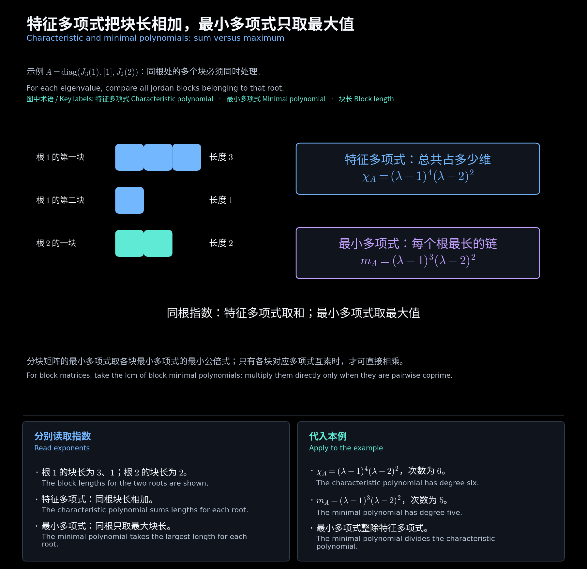
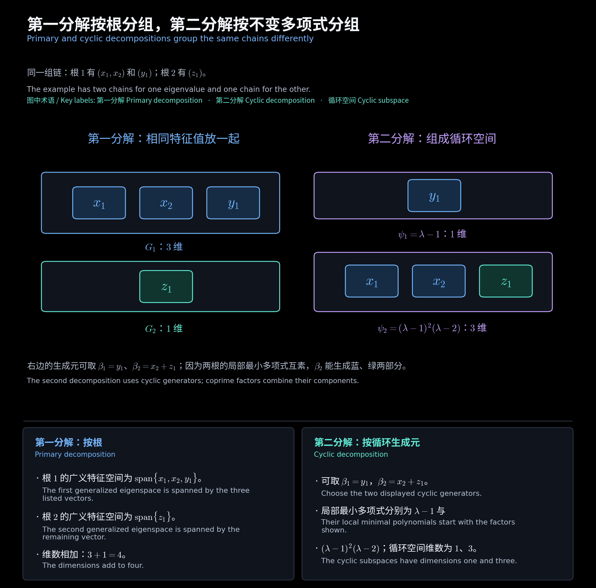

# 第十二章　最小多项式与第一分解

[阅读导航](00_阅读导航.md) · [上一章](11_若尔当链与子空间分解.md) · [下一章](13_循环子空间与第二分解.md)

对应[第八讲文件](<../../materials/lectures/Lecture 8-linear algebra.pdf>)第 2—17 页，即第 3.4 节。原文件封面标作第九讲。以下设 $V$ 是域 $\mathbb F$ 上的有限维空间，$T\in L(V)$；用 $z$ 表示零化多项式的不定元，$A$ 表示 $T$ 的**坐标**矩阵。具体数值例题在复数域上讨论。

## 一、先分清零化的对象

若 $p(z)=\sum_k c_kz^k$，则 $p(T)=\sum_k c_kT^k$，其中 $T^0=I$。满足 $p(T)v=0$ 的多项式组成理想，其唯一非零**首一生成元**称为**向量处的最小多项式** $m_v$：

$$
\{p:p(T)v=0\}=\langle m_v\rangle,\qquad
p(T)v=0\iff m_v\mid p.
$$

存在性来自 $v,Tv,\ldots,T^{\dim V}v$ **线性相关**；最低次非零零化多项式首一化后唯一。**零多项式**可以零化，但不是最小多项式；规定 $m_0=1$。

在子空间 $W$ 上零化，要求对每个 $w\in W$ 都有 $p(T)w=0$。能同时零化 $W$ 中所有向量的非零首一多项式中，次数最低者称为**子空间处的最小多项式** $m_W$。若 $(w_1,\ldots,w_r)$ 是 $W$ 的基，则

$$
m_W=\operatorname{lcm}(m_{w_1},\ldots,m_{w_r}),\qquad
U\subseteq W\subseteq V\Longrightarrow m_U\mid m_W\mid m_T.
$$

取 $W=V$，得到**整体最小多项式** $m_T=m_V$，并规定 $m_{\{0\}}=1$。若 $T(W)\subseteq W$，则称 $W$ 为 **$T$-不变子空间**，此时 $T|_W$ 是从 $W$ 到自身的限制算子，$m_W$ 也是该限制算子的最小多项式。定义 $m_W$ 本身不要求 $W$ 不变。

**补充例题：局部与整体不同。** 对 $T=\operatorname{diag}(1,2)$，

$$
m_{e_1}=z-1,\qquad m_{e_2}=z-2,\qquad
m_{e_1+e_2}=m_T=(z-1)(z-2).
$$

因为 $p(T)(e_1+e_2)=p(1)e_1+p(2)e_2$，需要同时在两个根处为零。

## 二、矩阵最小多项式的三种计算方法

由 $[p(T)v]_B=p(A)[v]_B$，算子与其矩阵的最小多项式一致，相似换基也不改变它。对 $d\ge1$ 阶矩阵，记 $zI-A$ 的首一**行列式因子**为 $D_k$，$D_0=1$，**不变多项式**为 $d_1\mid\cdots\mid d_d$。

| 已知信息 | 求法 |
| --- | --- |
| 特征矩阵的不变多项式 | $m_A=d_d=D_d/D_{d-1}=\chi_A/D_{d-1}$ |
| 复数域上的若尔当块 | 每个根取最大块长：$m_A(z)=\prod_\rho(z-\rho)^{b_\rho}$ |
| 分块对角矩阵 $A=\operatorname{diag}(A_1,\ldots,A_r)$ | $m_A=\operatorname{lcm}(m_{A_1},\ldots,m_{A_r})$ |

这里 $\chi_A=\det(zI-A)$；$b_\rho$ 是根 $\rho$ 的最大块长，不是该根所有块长之和。**凯莱—哈密顿定理**给出 $\chi_A(A)=0$，因此 $m_A\mid\chi_A$。全部不变多项式的乘积才是 $\chi_A$。

分块公式只有在各块最小多项式两两**互素**时才能改为乘积。例如 $\operatorname{diag}(1,1)$ 的最小多项式是 $z-1$。

课件中的右整除判据也可保留为：$p(A)=0$ 当且仅当存在**多项式矩阵** $Q(z)$，使 $p(z)I=Q(z)(zI-A)$；右除法的常数余式就是 $p(A)$。

**作业例题一：第八次作业第 1 题。**

$$
A=\begin{bmatrix}-7&16&8\\-4&9&4\\-4&7&5\end{bmatrix},\qquad
\chi_A=(z-1)(z-3)^2.
$$

$\operatorname{rank}(A-3I)=2$，所以根 $3$ 的**几何重数**为 $1$；其**代数重数**为 $2$，故对应一个二阶块。因此

$$
\boxed{m_A=(z-1)(z-3)^2}.
$$

**作业例题二：第八次作业第 2 题。**

$$
A=\operatorname{diag}(B,C),\qquad
B=\begin{bmatrix}0&1\\-1&2\end{bmatrix},\quad
C=\begin{bmatrix}0&1\\-4&-4\end{bmatrix}.
$$

直接算得 $(B-I)^2=0$、$B-I\ne0$，以及 $(C+2I)^2=0$、$C+2I\ne0$。两个块的最小多项式互素，故

$$
\boxed{m_A=\operatorname{lcm}((z-1)^2,(z+2)^2)=(z-1)^2(z+2)^2}.
$$

<!-- diagram:29_minimal_vs_characteristic:start -->

**图解 · 特征多项式把块长相加，最小多项式只取最大值**

**读图：** 同一根出现多个块时，特征多项式要数它们一共占多少维，最小多项式只要求能杀掉最长的一块。图中根 1 的指数分别为 4 和 3，不能混用。

<!-- diagram:29_minimal_vs_characteristic:end -->

## 三、第一分解：按互素因子分空间

设 $W$ 为 $T$-不变子空间，$m_W=\varphi_1\cdots\varphi_r$，各因子首一、非常数且两两互素。则

$$
\boxed{W=\bigoplus_{i=1}^r W_i},\qquad
W_i=W\cap\ker\varphi_i(T),\qquad m_{W_i}=\varphi_i.
$$

证明思路：令 $q_i=m_W/\varphi_i$。由**贝祖等式**可选 $e_i=b_iq_i$，使其模 $\varphi_i$ 余 $1$，模其余因子余 $0$。于是 $w_i=e_i(T)w\in W_i$，且 $w=\sum_iw_i$；同一组算子还能逐一取出分量，故和是**直和**。

在复数域上取 $\varphi_i=(z-\rho_i)^{b_i}$，得到按特征值分组的**广义特征空间**。对整体空间，

$$
G_\rho=\ker(T-\rho I)^{b_\rho},\qquad
\dim G_\rho=\text{该根全部若尔当块长之和}.
$$

**作业例题三：两组相近的初等因子不能混用。**

| 来源 | 各根的块长 | 整体维数 | 广义特征空间维数 | 最小多项式 |
| --- | --- | --- | --- | --- |
| 第七次第 3 题、第八次第 3 题 | $-3:(1,1,2)$；$-2\pm5i:(1,2)$ | $10$ | $4,3,3$ | $(z+3)^2((z+2)^2+25)^2$ |
| 第七次第 4 题、第八次第 4 题 | $-1:(1,2,2)$；$-1\pm i:(1,2)$ | $11$ | $5,3,3$ | $(z+1)^2((z+1)^2+1)^2$ |

每行**维数**按表中根的顺序排列。两组在每个根处的最大块长都为 $2$，所以 $G_\rho=\ker(A-\rho I)^2$；但不能把 $G_\rho$ 的维数也写成 $2$。

<!-- diagram:30_two_decompositions:start -->

**图解 · 第一分解按根分组，第二分解按不变多项式分组**

**读图：** 四维补充例子把同一组链分两次组。左边按根把三个根 1 的方向放在一起；右边按不变多项式组织循环分量，生成元 $x_2+z_1$ 可以同时带出不同根的方向，因此分量维数无需逐项对应。

<!-- diagram:30_two_decompositions:end -->

## 四、整个子空间的最小多项式可由一个向量取得

**结论：** 若 $W$ 不变，则存在 $x\in W$ 使 $m_x=m_W$。这在任意标量域上成立。

**作业证明：第七次作业第 1 题。** 若 $W=\{0\}$，取 $x=0$。否则分解为互异首一**不可约因子**的幂：

$$
m_W=\prod_i p_i^{a_i},\qquad q_i=m_W/p_i^{a_i}.
$$

由最小性，可选 $v_i\in W$ 使 $(m_W/p_i)(T)v_i\ne0$。置 $y_i=q_i(T)v_i$，不变性保证 $y_i\in W$，且

$$
p_i(T)^{a_i}y_i=0,\qquad p_i(T)^{a_i-1}y_i\ne0,
\qquad m_{y_i}=p_i^{a_i}.
$$

互素局部最小多项式的向量求和，其最小多项式等于这些多项式的乘积；这是上述互素投影能分别取出分量的结果。因此

$$
\boxed{x=\sum_i y_i\in W,\qquad m_x=\prod_i p_i^{a_i}=m_W}.
$$

**做题顺序：** 先区分向量处、子空间处和整体；再用最大不变多项式、最大块长或分块**最小公倍式**求解。验证候选多项式时，既要证明零化，也要排除更低次的可能。

[阅读导航](00_阅读导航.md) · [上一章](11_若尔当链与子空间分解.md) · [下一章](13_循环子空间与第二分解.md)
