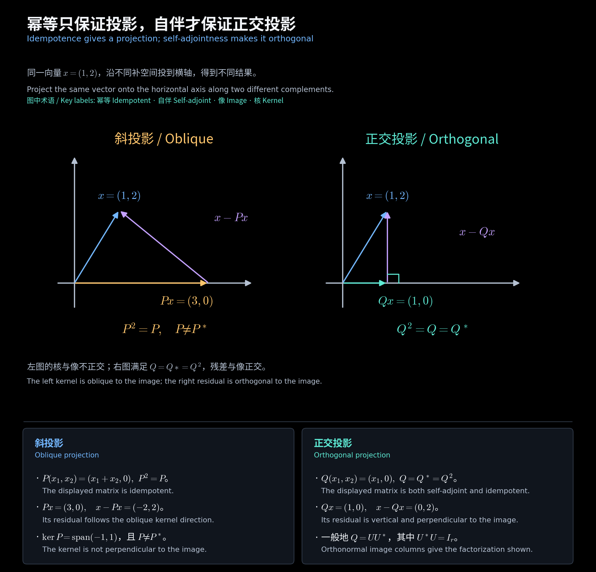

# 投影与伴随变换

对应第 10(1) 讲文件第 6—21 页，亦为第 10(2) 文件第 2—17 页的复习内容。投影依赖“投向哪里”和“沿哪里投”；伴随依赖所用内积。

## 一、直和分解与幂等

$$
V=S\oplus T,\quad x=s+t,\qquad Px=s,\qquad
P^2=P,\quad \im P=S,\quad\ker P=T.
$$

反过来，$P^2=P$ 本身就给出唯一分解：

$$
x=Px+(I-P)x,\quad P(I-P)x=0,\quad
z\in\im P\cap\ker P\Longrightarrow z=Pz=0.
$$

$$
V=\im P\oplus\ker P,\quad \im(I-P)=\ker P,\quad
\ker(I-P)=\im P,\quad P(I-P)=(I-P)P=0.
$$

$$
P\sim\operatorname{diag}(I_r,0),\quad r=\rank P=\operatorname{tr}P,
\quad\sigma(P)\subseteq\{0,1\}.
$$

像与核的基拼成相似变换矩阵。幂等矩阵总能对角化，但一般不 Hermitian，因而未必能酉对角化。

## 二、正交补与正交投影

$$
S^\perp=\{x:\langle s,x\rangle=0,\ \forall s\in S\},\quad
V=S\mathbin{\oplus^\perp}S^\perp,\quad
\dim S^\perp=\dim V-\dim S.
$$

有限维时，给 $S$ 的正交规范基补全为全空间的正交规范基；新增的基向量恰好张成 $S^\perp$。

$$
U=[u_1\ \cdots\ u_r],\quad U^*U=I_r,
\qquad P_S=UU^*,\quad P_S^*=P_S=P_S^2.
$$

$$
x=P_Sx+(I-P_S)x,\qquad
\langle P_Sx,(I-P_S)x\rangle=0,
\quad\|x\|^2=\|P_Sx\|^2+\|(I-P_S)x\|^2.
$$

**作业例题：HW9.5。**

$$
A=A^*=A^2\iff A=UU^*,\quad U^*U=I_r,\quad r=\rank A.
$$

若只知像空间的一组独立列 $B$，先求 Gram 矩阵，得到 $P_S=B(B^*B)^{-1}B^*$。正交投影也是最近点：对 $s\in S$，

$$
\|x-s\|^2=\|x-P_Sx\|^2+\|P_Sx-s\|^2\ge\|x-P_Sx\|^2.
$$

<!-- diagram:38_projection_adjoint:start -->

**图解 · 幂等只保证投影，自伴才保证正交投影**

**读图：** 两图投向同一条横轴，但左图沿斜核方向投影，右图沿垂直方向投影。幂等只保证可以分解为像与核；加入自伴条件，核才等于像的正交补，得到 $UU^*$。

<!-- diagram:38_projection_adjoint:end -->

## 三、伴随的定义及坐标公式

$T:V\to W$ 的伴随 $T^*:W\to V$ 满足 $\langle Tx,y\rangle_W=\langle x,T^*y\rangle_V$。注意定义域与陪域交换。

$$
[Tx]=Ax,\quad G_V,G_W\text{ 为两组基的 Gram 矩阵},
$$

$$
(Ax)^*G_Wy=x^*G_VCy\quad(\forall x,y)
\Longrightarrow G_VC=A^*G_W
\Longrightarrow\boxed{C=G_V^{-1}A^*G_W}.
$$

两组基均正交规范时 $C=A^*$。这是“伴随算子的矩阵等于共轭转置”的必要基条件。

**教学补充例题：**

$$
G_V=\operatorname{diag}(1,2),\quad G_W=I,\quad
A=\begin{bmatrix}1&1\\0&1\end{bmatrix}
\Longrightarrow C=\begin{bmatrix}1&0\\1/2&1/2\end{bmatrix}\ne A^*.
$$

## 四、伴随的运算与核像关系

$$
(ST)^*=T^*S^*,\quad (aT+bS)^*=\bar aT^*+\bar bS^*,\quad
(T^*)^*=T.
$$

$$
y\in\ker T^*\iff\langle Tx,y\rangle=0\ (\forall x)
\iff y\in(\im T)^\perp.
$$

$$
\boxed{W=\im T\mathbin{\oplus^\perp}\ker T^*,\qquad
V=\ker T\mathbin{\oplus^\perp}\im T^*}.
$$

伴随 $T^*$ 与前面自然标准形中的“伴随矩阵”是两个不同概念；后者英文是 companion matrix。

[中文阅读导航](00_阅读导航.md)
