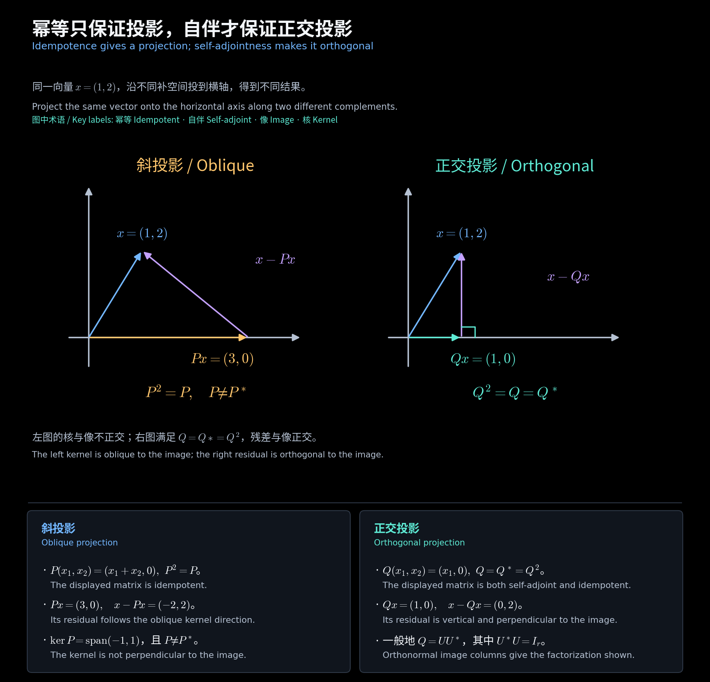

# 谱投影与谱分解

对应第 11 讲文件第 3—23 页。设状态向量由若干特征空间的分量叠加而成。谱投影回答“其中属于特征值 $\lambda$ 的分量是多少”，矩阵 $A$ 随后把这个分量乘以 $\lambda$。

## 一、从换基矩阵读出投影

课件的 simple 表示存在一组特征基，允许重特征值。将右特征向量排为 $X=[x_1,\ldots,x_n]$，将 $X^{-1}$ 的行记为 $y_i^*$。由于 $y_i^*x_j=\delta_{ij}$，$y_i^*z$ 就是 $z$ 在这组基下的第 $i$ 个坐标。

$$
z=\sum_i x_i(y_i^*z),\qquad Az=\sum_i\lambda_i x_i(y_i^*z),\qquad
P_\lambda=\sum_{i:\lambda_i=\lambda}x_i y_i^*,\quad A=\sum_\lambda\lambda P_\lambda .
$$

在特征基上一列一列检查，$P_\lambda$ 保留属于 $\lambda$ 的基向量，并将其余基向量送到零。这就确定了整个映射，也证明了按不同特征值分组的投影唯一。

$$
P_\lambda^2=P_\lambda,\quad P_\lambda P_\mu=0\ (\lambda\ne\mu),\quad
\sum_\lambda P_\lambda=I,\quad
\operatorname{rank}P_\lambda=\dim\ker(A-\lambda I).
$$

**读图：** 图中的两种投影都满足幂等性。判断谱投影是否正交，还要检查投影方向和核是否垂直，或在正交规范基下检验自伴性。

## 二、投影可以沿斜方向

取 $A=\begin{bmatrix}1&1\\0&2\end{bmatrix}$。特征向量可取 $(1,0)^T,(1,1)^T$，故 $(s,t)^T=(s-t)(1,0)^T+t(1,1)^T$。直接读取分量：

$$
P_1=\begin{bmatrix}1&-1\\0&0\end{bmatrix},\quad
P_2=\begin{bmatrix}0&1\\0&1\end{bmatrix},\qquad A=P_1+2P_2.
$$

$P_1P_2=0$，但两个特征方向夹角为 $45^\circ$。当 $A$ 正规时可选正交规范特征基；此时 $X^{-1}=X^*$，$P_\lambda=X_\lambda X_\lambda^*$ 自伴，各分量才彼此正交。

## 三、用多项式构造谱投影

若已知所有互异特征值，可以构造一个多项式，在目标特征值上取 1、在其余特征值上取 0。代入可对角化矩阵后，它与谱投影在每个特征向量上取值相同：

$$
P_\lambda=\prod_{\mu\ne\lambda}\frac{A-\mu I}{\lambda-\mu}.
$$

作业 11 第 6 题的矩阵满足 $A^2=I$ 且 $A\ne\pm I$。最小多项式为 $(t-1)(t+1)$，因此 $P_+=(I+A)/2$、$P_-=(I-A)/2$。例如 $A(P_-z)=(Az-z)/2=-P_-z$，一行就能核对符号。若只有一个特征值而含长度大于 1 的 Jordan 链，链上的幂零项仍须保留，如 $J_2(\lambda)=\lambda I+N$、$N\ne0$。

## 四、实矩阵的共轭对

课件第 7—10 页把共轭特征方向合回实平面。若 $A$ 为实矩阵，$A(u+iv)=(a+ib)(u+iv)$，分离实部、虚部即得 $Au=au-bv,\ Av=bu+av$。在有序基 $(u,-v)$ 下，这个平面的矩阵为

$$
\begin{bmatrix}a&-b\\ b&a\end{bmatrix}.
$$

## 分章例题

### 例 1　从特征基求投影

$A=\begin{bmatrix}2&2\\0&4\end{bmatrix}$。求两个谱投影，并把 $z=(1,3)^T$ 分解到两个特征空间。

**解。** 特征值为 2、4，对应方向为 $(1,0)^T,(1,1)^T$。将 $(s,t)^T$ 写成 $(s-t)(1,0)^T+t(1,1)^T$，逐项读出投影。

$$
P_2=\begin{bmatrix}1&-1\\0&0\end{bmatrix},\quad P_4=\begin{bmatrix}0&1\\0&1\end{bmatrix},\quad z=(-2,0)^T+(3,3)^T.
$$

### 例 2　正交投影的归一化

$A=\begin{bmatrix}3&1\\1&3\end{bmatrix}$。用单位特征向量写出谱分解。

**解。** 对 $u_\pm=(1,\pm1)^T$，有 $Au_+=4u_+$、$Au_-=2u_-$。因 $u_\pm^Tu_\pm=2$，外积要除以 2。

$$
P_\pm=\tfrac12 u_\pm u_\pm^T,\qquad P_++P_-=I,\qquad A=4P_++2P_- .
$$

### 例 3　重特征值的分组

$A=\operatorname{diag}(3,3,-1)$。求特征值 3 的谱投影及其秩，说明更换该平面内的正交规范基会怎样。

**解。** 前三个坐标方向中，前两个属于同一个特征空间。令 $E=[e_1,e_2]$。任取二阶酉矩阵 $W$，$EW$ 仍张成同一平面。

$$
P_3=EE^*=\operatorname{diag}(1,1,0),\quad \operatorname{rank}P_3=2,\quad (EW)(EW)^*=EE^*.
$$

### 例 4　用插值公式构造投影

设 $A$ 可对角化，互异特征值为 $0,2,5$。求 $P_2$，并在三个特征空间上验证其作用。

**解。** 令 $p(t)=c\,t(t-5)$。由 $p(2)=1$ 得 $c=-1/6$。对任一特征向量 $Av=\lambda v$，多项式作用等于标量 $p(\lambda)$。

$$
P_2=\frac{A(5I-A)}{6},\quad (p(0),p(2),p(5))=(0,1,0),\qquad P_2^2=P_2 .
$$

### 例 5　由投影求矩阵幂

设 $P^2=P$，$A=2P-(I-P)$。求 $A^5$，再求它对 $z\in\ker P$ 的作用。

**解。** 置 $Q=I-P$。由于 $PQ=QP=0$，正整数次幂中的混合项全为零，两条分量可单独取幂。

$$
A^5=2^5P+(-1)^5Q=33P-I,\qquad Pz=0\ \Longrightarrow\ A^5z=-z .
$$

### 例 6　由矩阵得到谱分量

$A=\begin{bmatrix}1&2\\0&-1\end{bmatrix}$，$z=(0,2)^T$。不用求逆矩阵，将 $z$ 分成特征值 $+1,-1$ 的两个分量。

**解。** 计算得 $A^2=I,\ Az=(4,-2)^T$。半和与半差分别满足 $Az_+=z_+$、$Az_-=-z_-$。

$$
z_+=\tfrac12(z+Az)=(2,0)^T,\quad z_-=\tfrac12(z-Az)=(-2,2)^T,\quad z_++z_-=z .
$$

### 例 7　共轭特征值的实平面

令 $R=\begin{bmatrix}0&-1\\1&0\end{bmatrix}$。求复数域上的两个谱投影并验证共轭关系。

**解。** 由 $R^2=-I$ 得特征值 $\pm i$；对这两个值插值。由于 $R$ 为实矩阵，两式互为共轭。

$$
P_i=\frac{R+iI}{2i}=\tfrac12(I-iR),\quad P_{-i}=\tfrac12(I+iR),\quad iP_i-iP_{-i}=R .
$$

### 例 8　判断何时缺少幂零项

$J=\begin{bmatrix}3&1\\0&3\end{bmatrix}$。能否写成仅按特征值对谱投影加权的分解？求 $J^2$ 核对。

**解。** 唯一特征值为 3，若谱投影之和为 $I$，加权和只能是 $3I$。实际上 $N=J-3I$ 满足 $N\ne0,\ N^2=0$。

$$
J^2=(3I+N)^2=9I+6N=\begin{bmatrix}9&6\\0&9\end{bmatrix}.
$$

[中文阅读导航](00_阅读导航.md) · [本讲中英对照](../lecture11/01_谱投影与谱分解.md)
