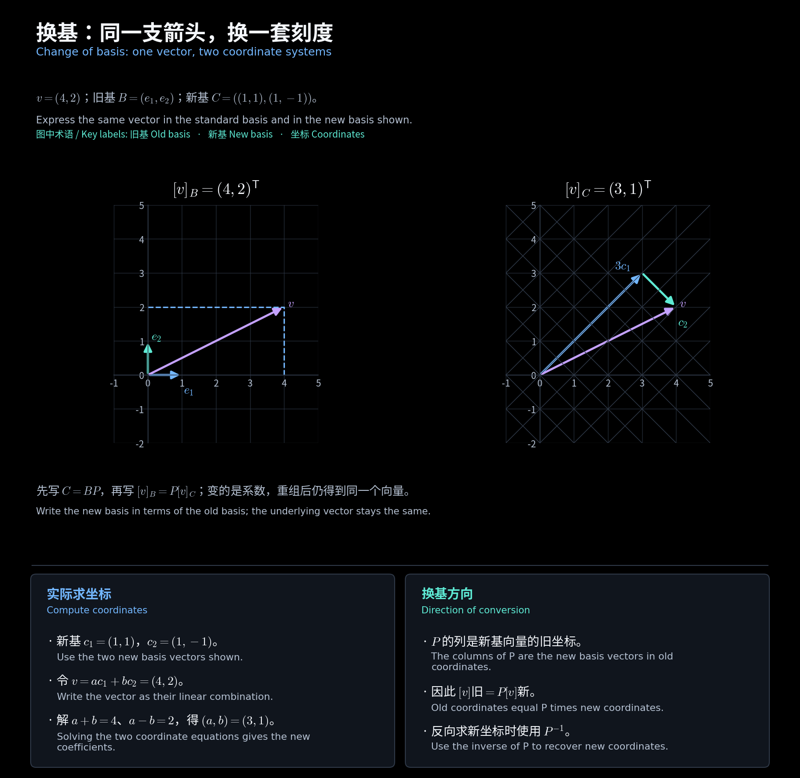

# 满秩分解

第 12(1) 讲文件第 2—6 页。给定 $A=[a_1,\ldots,a_n]\in\mathbb C^{m\times n}$，设 $\operatorname{rank}A=r$。用 $r$ 个独立的输出方向描述全部列，便把 $A$ 写成两个较窄矩阵的积。

## 一、先取原矩阵的主元列

对 $A$ 行化简以找到主元位置，从原矩阵取相应列构成 $B$。把每个 $a_j$ 对 $B$ 的坐标记为 $c_j$，再按原顺序排列为 $C$。主元列在 $C$ 中对应单位阵的各列，故 $C$ 行满秩。

$$
B=[a_{j_1},\dots,a_{j_r}],\quad Bc_j=a_j,\quad
C=[c_1,\dots,c_n],\qquad A=BC .
$$

定理 5.10 的块写法将主元列用置换 $Q$ 移至前方，再记录消元的行变换 $P$。这时 $PAQ=\binom{I_r\ \ D}{0\ \ 0}$。取 $B=P^{-1}\binom{I_r}{0}$、$C=[I_r\ D]Q^{-1}$ 即可恢复原列序。

**读图：** 图中同一向量在不同基下有两组坐标。满秩分解对每一列都做这件事：基换为 $BS$，所有坐标行列组成的矩阵随之换为 $S^{-1}C$。

## 二、例 5.6：前两列相关时怎样选

$$
A=\begin{bmatrix}1&2&1&1&4\\2&4&3&0&8\\3&6&4&1&12\end{bmatrix}.
$$

第二列是第一列的两倍，第三列独立，故取 $B=[a_1,a_3]$。第四列可由 $3a_1-2a_3=(1,0,1)^T$ 得到，第五列等于 $4a_1$。这三条关系给出全部坐标：

$$
C=\begin{bmatrix}1&2&0&3&4\\0&0&1&-2&0\end{bmatrix},\qquad
A=\begin{bmatrix}1&1\\2&3\\3&4\end{bmatrix}C.
$$

## 三、分解的不唯一性

若 $A=B_1C_1=BC$ 都是满秩分解，则 $\operatorname{im}B=\operatorname{im}A=\operatorname{im}B_1$。因此 $B=B_1S$，其中 $S$ 是可逆的 $r$ 阶换基矩阵。由 $B_1SC=B_1C_1$ 及 $B_1$ 列独立，得 $C=S^{-1}C_1$。可逆的中间换基完全描述了不唯一性。

## 分章例题

### 例 1　从主元列读出因子

将 $A=\begin{bmatrix}1&2&0&1\\0&0&1&-1\\1&2&1&0\end{bmatrix}$ 作满秩分解。

**解。** 第 2 列为第 1 列的两倍，第 4 列为第 1 列减第 3 列。选 $B=[a_1,a_3]$，把四列的坐标依次排成 $C$。

$$
B=\begin{bmatrix}1&0\\0&1\\1&1\end{bmatrix},\quad C=\begin{bmatrix}1&2&0&1\\0&0&1&-1\end{bmatrix},\quad A=BC .
$$

### 例 2　由一行得到秩一分解

设 $A=\begin{bmatrix}2&-4&6\\-1&2&-3\\3&-6&9\end{bmatrix}$，求最小中间维数和一组因子。

**解。** 所有行均为 $(1,-2,3)$ 的倍数，倍数依次为 $2,-1,3$。矩阵非零，秩恰为 1。

$$
A=\begin{bmatrix}2\\-1\\3\end{bmatrix}\begin{bmatrix}1&-2&3\end{bmatrix},\qquad \operatorname{rank}(BC)\le\min(\operatorname{rank}B,\operatorname{rank}C).
$$

### 例 3　跟踪行变换

令 $A=\begin{bmatrix}1&2&3\\2&4&6\end{bmatrix}$。用 $R_2\gets R_2-2R_1$ 求 $P$ 并还原左因子。

**解。** 对单位阵实施相同行变换即得 $P$。$PA$ 只剩一个非零行；撤销行变换时，取 $P^{-1}$ 的第一列。

$$
P=\begin{bmatrix}1&0\\-2&1\end{bmatrix},\quad PA=\begin{bmatrix}1&2&3\\0&0&0\end{bmatrix},\quad A=(P^{-1}e_1)[1,2,3]=(1,2)^T[1,2,3].
$$

### 例 4　更换列空间的基

设 $A=BC$ 是秩二分解，$C=\begin{bmatrix}1&0&2\\0&1&1\end{bmatrix}$。若新基为 $B'=BS$，$S=\begin{bmatrix}1&1\\0&1\end{bmatrix}$，求 $C'$。

**解。** 解 $SC'=C$ 得 $C'=S^{-1}C$。$S^{-1}$ 的第一行把旧坐标的第二个分量从第一个分量中减去。

$$
S^{-1}=\begin{bmatrix}1&-1\\0&1\end{bmatrix},\quad C'=\begin{bmatrix}1&-1&1\\0&1&1\end{bmatrix},\quad B'C'=BSS^{-1}C=A.
$$

### 例 5　左右因子各保留什么

设 $A=BC$，$B=[(1,0,1)^T,(0,1,1)^T]$，$C=\begin{bmatrix}1&0&1\\0&1&1\end{bmatrix}$。求 $\ker A$ 与 $\operatorname{im}A$。

**解。** $B$ 列独立，故 $BCx=0$ 等价于 $Cx=0$。$C$ 的前两列为 $I_2$，其像是整个中间空间。

$$
\ker A=\operatorname{span}\{(-1,-1,1)^T\},\qquad \operatorname{im}A=\{(s,t,s+t)^T:s,t\in\mathbb R\}.
$$

### 例 6　检查候选分解是否满秩

给定 $A=\begin{bmatrix}1&2\\2&4\end{bmatrix}$。$A=I_2A$ 是否为满秩分解？给出符合定义的因子。

**解。** $\det A=0$，且第一列非零，故 $r=1$。候选左因子有两列，右因子只有秩一；按原列间的倍数可直接压缩。

$$
A=\begin{bmatrix}1\\2\end{bmatrix}\begin{bmatrix}1&2\end{bmatrix},\quad \operatorname{rank}B=\operatorname{rank}C=1 .
$$

### 例 7　复数列上的坐标

令 $u=(1,i)^T$，$A=[u,iu,(1-i)u]$。求满秩分解，并找一个非零右零向量。

**解。** 取唯一基列 $u$，坐标由题面直接给出。要构造核向量，令第一列与第二列的线性组合抵消。

$$
B=u,\quad C=[1,\ i,\ 1-i],\quad A=BC,\qquad C(-i,1,0)^T=-i+i=0 .
$$

### 例 8　由秩分解构造投影

设 $A=BC$ 是满秩分解，$B=\begin{bmatrix}1&0\\0&1\\1&0\end{bmatrix}$。求 $\operatorname{im}A$ 上的正交投影。

**解。** 由于 $C$ 行满秩，$\operatorname{im}A=\operatorname{im}B$。投影 $Bu$ 的系数满足 $B^T(Bu-z)=0$，而 $B^TB=\operatorname{diag}(2,1)$。

$$
P=B(B^TB)^{-1}B^T=\begin{bmatrix}1/2&0&1/2\\0&1&0\\1/2&0&1/2\end{bmatrix},\qquad Pz=((z_1+z_3)/2,z_2,(z_1+z_3)/2)^T .
$$

[中文阅读导航](00_阅读导航.md) · [本讲中英对照](../lecture12/01_满秩分解.md)
