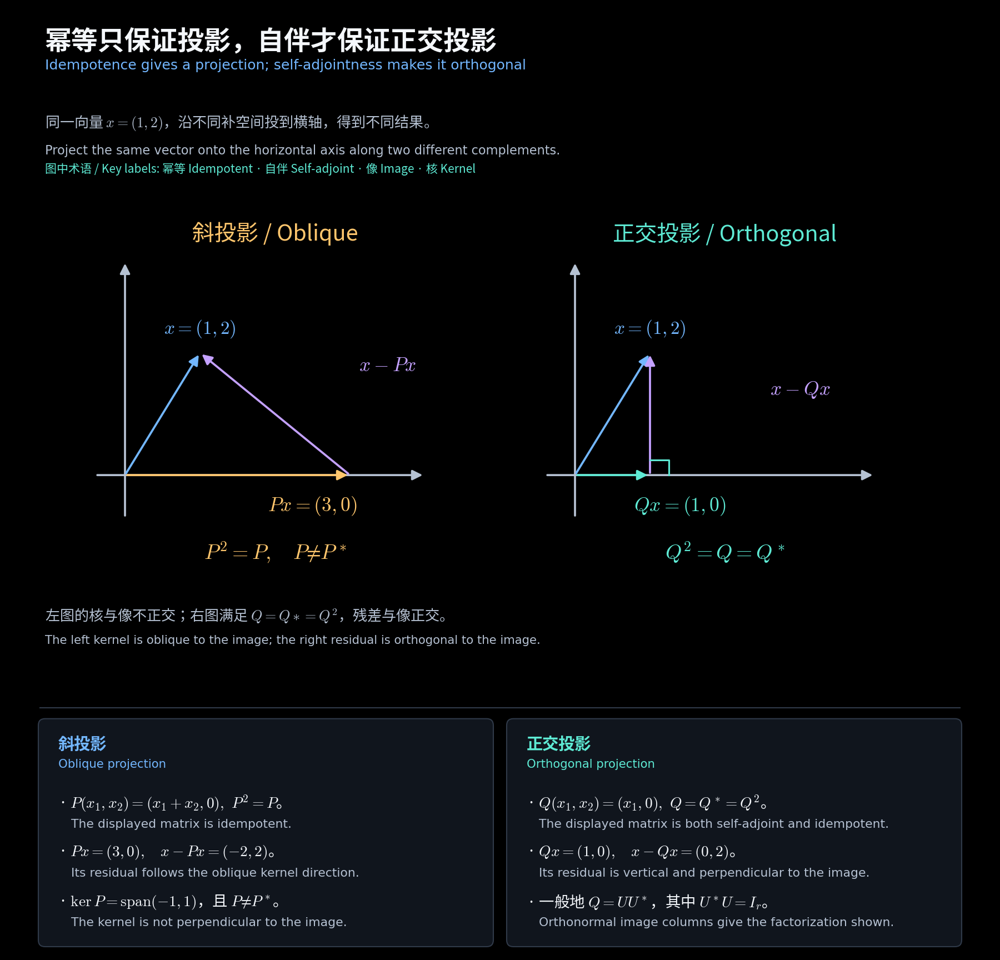

# UR 分解与最小二乘

第 12(1) 讲文件第 7—15 页。课件把复矩阵的薄 QR 分解写成 $A=UR$。若 $A$ 为 $m\times r$ 且列满秩，$U$ 有 $r$ 个正交规范列，$R$ 是 $r$ 阶上三角阵，对角线取正实数。

## 一、上三角系数从哪里来

$$
v_j=a_j-\sum_{i<j}u_i(u_i^*a_j),\qquad
r_{ij}=u_i^*a_j\ (i<j),\quad r_{jj}=\|v_j\|,\quad u_j=v_j/r_{jj}.
$$

第 $j$ 列只需要前 $j$ 个正交方向，所以第 $j$ 列系数在对角线下全为零。列满秩保证 $\|v_j\|>0$。又 $A^*A=R^*R$，正对角 Cholesky 因子的唯一性确定 $R$，继而 $U=AR^{-1}$。对行满秩矩阵可先分解 $A^*$，取伴随得 $A=LW$，$L$ 下三角，$WW^*=I_r$。一般秩 $r$ 时，先作 $A=BC$，再分别分解两因子，得到 $A=U_1R_1L_2U_2$。

## 二、为何只解一个三角方程

$$
 b=UU^*b+(I-UU^*)b,\qquad
 \|Ax-b\|^2=\|Rx-U^*b\|^2+\|(I-UU^*)b\|^2.
$$

两项来自正交子空间。第二项与 $x$ 无关，第一项可由回代 $Rx=U^*b$ 消掉。因此 $Ax$ 是 $b$ 的正交投影，残差满足 $A^*(b-Ax)=0$。列满秩保证系数 $x$ 唯一。

**读图：** 把投影子空间取为 $A$ 的列空间，投影的落点就是 $Ax$；从落点指向 $b$ 的差向量与所有列垂直。

## 三、核对课件第 15 页

$$
A=\begin{bmatrix}-3&1&-2\\1&1&1\\1&-1&0\\1&-1&1\end{bmatrix},\qquad b=(1,0,2,1)^T .
$$

按题面矩阵的列重新执行 Gram–Schmidt，得到 $U=\left[(-3,1,1,1)^T/\sqrt{12},\ (0,2,-1,-1)^T/\sqrt6,\ (0,0,-1,1)^T/\sqrt2\right]$。计算 $R=U^TA$ 与 $U^Tb$ 得

$$
R=\begin{bmatrix}\sqrt{12}&-4/\sqrt{12}&8/\sqrt{12}\\0&4/\sqrt6&1/\sqrt6\\0&0&1/\sqrt2\end{bmatrix},\qquad U^Tb=(0,-3/\sqrt6,-1/\sqrt2)^T .
$$

从最后一行回代得 $x_3=-1,\ x_2=-1/2,\ x_1=1/2$。此时 $Ax=(0,-1,1,0)^T$，$b-Ax=(1,1,1,1)^T$。$A$ 的三列各自元素之和都是零，故残差正交，最小残差平方为 4。课件页末的 $(2,0,-1/2)^T$ 代回不能满足这一条件。

## 分章例题

### 例 1　逐列正交化

设 $A=\begin{bmatrix}1&1\\1&0\\0&1\end{bmatrix}$。用 Gram–Schmidt 求薄 QR。

**解。** $q_1=(1,1,0)^T/\sqrt2$，$r_{12}=q_1^Ta_2=1/\sqrt2$。减去投影得 $v_2=(1/2,-1/2,1)^T$，其范数为 $\sqrt6/2$。

$$
q_2=(1,-1,2)^T/\sqrt6,\quad R=\begin{bmatrix}\sqrt2&1/\sqrt2\\0&\sqrt6/2\end{bmatrix},\qquad A=[q_1,q_2]R .
$$

### 例 2　薄因子与投影

令 $Q=[(1,0,1)^T/\sqrt2,e_2]$。求 $Q^TQ$ 和 $QQ^T$，并求 $b=(2,4,0)^T$ 的投影。

**解。** 两列正交且长度为 1。先算 $Q^Tb=(\sqrt2,4)^T$，再用 $Q$ 将这两个系数还原为三维向量。

$$
Q^TQ=I_2,\quad QQ^T=\begin{bmatrix}1/2&0&1/2\\0&1&0\\1/2&0&1/2\end{bmatrix},\quad QQ^Tb=(1,4,1)^T .
$$

### 例 3　用回代解拟合

设 $A=QR$ 列满秩，$R=\begin{bmatrix}2&-1\\0&3\end{bmatrix}$，$Q^Tb=(1,6)^T$，$\|b\|^2=41$。求最小二乘解与最小残差平方。

**解。** 解三角方程 $3x_2=6,\ 2x_1-x_2=1$。正交分解将残差平方化为 $\|b\|^2-\|Q^Tb\|^2$。

$$
x=(3/2,2)^T,\qquad \min_x\|Ax-b\|^2=41-(1^2+6^2)=4 .
$$

### 例 4　拟合一条直线

对 $(t,y)=(-1,1),(0,2),(1,4)$ 拟合 $y=c+dt$。求 $c,d$ 并检查残差。

**解。** 设计矩阵的两列为 $a=(1,1,1)^T,b=(-1,0,1)^T$，已彼此正交。因此各系数等于观测向量在该列上的内积除以该列长度平方。

$$
c=\tfrac{1+2+4}{3}=\tfrac73,\quad d=\tfrac{-1+4}{2}=\tfrac32,\quad y-ca-db=\tfrac16(1,-2,1)^T .
$$

### 例 5　修正三角因子的相位

设 $A=QR$，$Q^*Q=I$，$R=\begin{bmatrix}-2&1\\0&3i\end{bmatrix}$。如何把 $R$ 的对角元变为正实数？

**解。** 取对角酉矩阵 $S=\operatorname{diag}(-1,i)$，左乘 $S^*$ 分别消去两行的对角相位；同时将 $Q$ 右乘 $S$。

$$
Q'=QS,\qquad R'=S^*R=\begin{bmatrix}2&-1\\0&3\end{bmatrix},\qquad Q'R'=QSS^*R=A .
$$

### 例 6　从满行秩得到下三角因子

令 $A=\begin{bmatrix}1&0&0\\1&1&0\end{bmatrix}$。从 $A^T$ 的薄 QR 写出 $A=LW$，并检验 $WW^T$。

**解。** $A^T$ 的列为 $e_1,e_1+e_2$，其正交化方向为 $e_1,e_2$。令 $Q=[e_1,e_2]$，则 $A^T=Q\begin{bmatrix}1&1\\0&1\end{bmatrix}$。

$$
L=\begin{bmatrix}1&0\\1&1\end{bmatrix},\quad W=\begin{bmatrix}1&0&0\\0&1&0\end{bmatrix},\quad A=LW,\quad WW^T=I_2 .
$$

### 例 7　秩亏时为何有多解

对 $A=\begin{bmatrix}1&2\\1&2\end{bmatrix}$、$b=(0,2)^T$，求全部最小二乘解。

**解。** 记 $s=x_1+2x_2$。两个预测值都是 $s$，残差平方只依赖这一个标量。配方后在 $s=1$ 取得最小值。

$$
\|Ax-b\|^2=s^2+(s-2)^2=2(s-1)^2+2,\quad x=(1-2t,t)^T,\quad t\in\mathbb R .
$$

### 例 8　核验候选最小二乘解

令 $A=\begin{bmatrix}1&0\\0&1\\1&1\end{bmatrix},\ b=(1,1,3)^T$。判断 $x_0=(1,1)^T$ 是否最优，并求修正量。

**解。** $r_0=b-Ax_0=(0,0,1)^T$，故 $A^Tr_0=(1,1)^T$。修正量满足 $(A^TA)\delta=A^Tr_0$。

$$
\begin{bmatrix}2&1\\1&2\end{bmatrix}\delta=(1,1)^T,\quad \delta=(1,1)^T/3,\quad x_*=(4/3,4/3)^T,\quad b-Ax_*=\tfrac13(-1,-1,1)^T .
$$

[中文阅读导航](00_阅读导航.md) · [本讲中英对照](../lecture12/02_UR分解与最小二乘.md)
