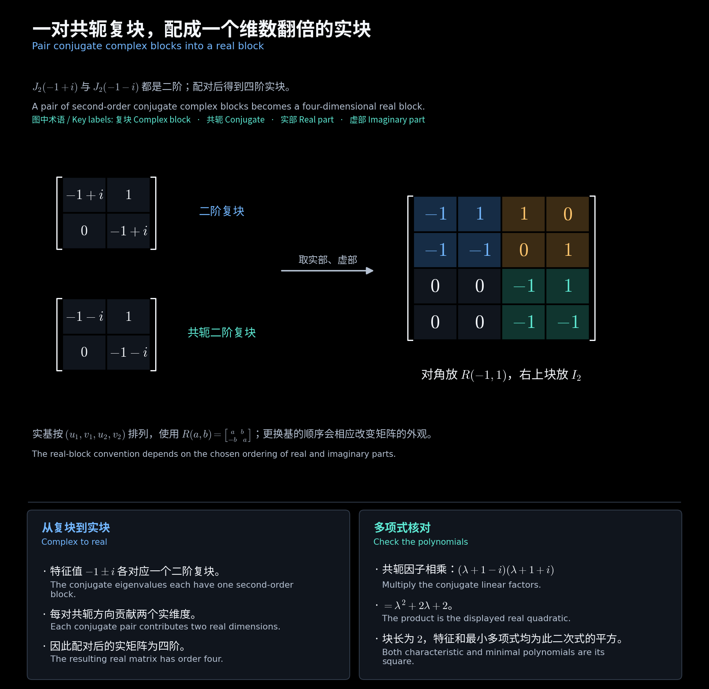

# 极分解

对应第 12(1) 讲文件第 16—21 页。复数 $z=\rho e^{i\theta}$ 把模长与相位分开。方阵的极分解把伸缩写成半正定 Hermitian 矩阵，把保持长度的部分写成酉矩阵。

## 一、从奇异值分解构造

$$
A=VDU^*,\qquad H_1=(A^*A)^{1/2}=UDU^*,\qquad
H_2=(AA^*)^{1/2}=VDV^*,\qquad W=VU^* .
$$

直接回乘有 $A=WH_1=H_2W$。在输入侧先作 $H_1$，它沿右奇异向量伸缩；再作 $W$ 把右奇异向量送到左奇异向量。输出侧的 $H_2$ 描述相同的伸缩量，作用方向改为左奇异向量。

**读图：** 先看图中的二维旋转块。标量极分解在实平面上把统一的伸缩量与转角分开；矩阵极分解还允许不同正交方向具有不同伸缩量。

## 二、唯一性取决于零奇异值

若 $A$ 可逆，则 $H_1$ 正定，$W=AH_1^{-1}$ 唯一。若 $A$ 奇异，$H_1,H_2$ 作为半正定平方根仍然唯一；$W$ 在 $\ker A$ 上怎样延拓为酉映射一般有多种选择。第 20 页把整个分解写为唯一，需要补上这一条件。

$$
 A=\begin{bmatrix}2&0\\0&0\end{bmatrix},\quad H_1=H_2=A,\quad
 W_\theta=\begin{bmatrix}1&0\\0&e^{i\theta}\end{bmatrix},\quad W_\theta H_1=A .
$$

## 三、正规矩阵的两个正因子

$A$ 正规时 $A^*A=AA^*$，故两侧的半正定平方根相同，记为 $H$，于是 $A=WH=HW$。反过来，若 $W$ 酉、$H$ 半正定且二者交换，则 $A^*A=H^2=AA^*$。

例如 $A=\begin{bmatrix}0&-1\\2&0\end{bmatrix}$ 先沿第一坐标放大两倍，再旋转 $90^\circ$。此时 $H_1=\operatorname{diag}(2,1)$，$H_2=\operatorname{diag}(1,2)$。交换顺序时伸缩轴要一起换，否则所得矩阵不同。

## 分章例题

### 例 1　复数的模与相位

将 $z=-3+4i$ 写成 $wh$，其中 $|w|=1,\ h\ge0$。用矩阵公式核对。

**解。** 正因子为 $\sqrt{\bar z z}$。因为 $z\ne0$，相位由 $z/h$ 唯一确定。

$$
h=\sqrt{(-3)^2+4^2}=5,\qquad w=(-3+4i)/5,\qquad \bar w w=1,\quad wh=z .
$$

### 例 2　符号如何进入酉因子

对 $A=\operatorname{diag}(-4,2)$，求右极分解。

**解。** 先将 $A^TA$ 的非负特征值逐个开方，再以 $AH^{-1}$ 确定正交因子。

$$
A^TA=\operatorname{diag}(16,4),\quad H=\operatorname{diag}(4,2),\quad W=\operatorname{diag}(-1,1),\quad A=WH .
$$

### 例 3　左右伸缩轴

给定 $A=\begin{bmatrix}0&-1\\3&0\end{bmatrix}$，求 $A=WH_1=H_2W$。

**解。** $A^TA=\operatorname{diag}(9,1)$，$AA^T=\operatorname{diag}(1,9)$。取正平方根，并用右极因子反算 $W$。

$$
H_1=\operatorname{diag}(3,1),\quad H_2=\operatorname{diag}(1,3),\quad W=AH_1^{-1}=\begin{bmatrix}0&-1\\1&0\end{bmatrix}.
$$

### 例 4　秩一矩阵的全部酉延拓

对 $A=\begin{bmatrix}0&2\\0&0\end{bmatrix}$，求所有满足 $A=WH,\ W^*W=I,\ H\ge0$ 的 $W$。

**解。** 由 $A^*A=\operatorname{diag}(0,4)$ 得 $H=\operatorname{diag}(0,2)$。第二列须满足 $We_2=e_1$；第一列可取任意与 $e_1$ 正交的单位向量。

$$
W_\theta=\begin{bmatrix}0&1\\e^{i\theta}&0\end{bmatrix},\quad W_\theta H=A,\quad W_\theta^*W_\theta=I,\quad \theta\in\mathbb R .
$$

### 例 5　由 SVD 直接构造

设 $A=VDU^T$，$D=\operatorname{diag}(4,1)$，$U=\begin{bmatrix}0&1\\1&0\end{bmatrix}$，$V=I$。求 $H_1,H_2,W$。

**解。** 从 $A^TA=UD^2U^T$、$AA^T=VD^2V^T$ 取正平方根。$W$ 需将 $U$ 的各列依次送到 $V$ 的对应列。

$$
H_1=UDU^T=\operatorname{diag}(1,4),\quad H_2=VDV^T=D,\quad W=VU^T=U,\quad WH_1=\begin{bmatrix}0&4\\1&0\end{bmatrix}.
$$

### 例 6　从交换性判正规

给定 $W=\begin{bmatrix}0&-1\\1&0\end{bmatrix},\ H=\operatorname{diag}(a,b)$，其中 $a,b>0$。对哪些参数 $A=WH$ 正规？

**解。** $A^TA=H^2$，$AA^T=WH^2W^T$；旋转把两条坐标轴交换。因此正规条件化为两个正对角元的平方相等。

$$
A^TA=\operatorname{diag}(a^2,b^2),\quad AA^T=\operatorname{diag}(b^2,a^2),\quad A\text{ 正规}\iff a=b .
$$

### 例 7　非对角正因子

已知 $A=\begin{bmatrix}-1&-2\\2&1\end{bmatrix}$。验证 $H=\begin{bmatrix}2&1\\1&2\end{bmatrix}$ 是右正因子，并求 $W$。

**解。** $H$ 的特征值为 3、1，故 $H$ 正定。直接平方得 $H^2=A^TA$，由正平方根唯一性确定 $H$。

$$
H^2=\begin{bmatrix}5&4\\4&5\end{bmatrix},\quad H^{-1}=\tfrac13\begin{bmatrix}2&-1\\-1&2\end{bmatrix},\quad W=AH^{-1}=\begin{bmatrix}0&-1\\1&0\end{bmatrix}.
$$

### 例 8　反解输入方向的伸缩量

设 $A=WH$，$W$ 酉，$H=\operatorname{diag}(3,1)$。求单位向量 $x=(1,i)^T/\sqrt2$ 的输出长度，并求所有达到最大伸缩量的单位向量。

**解。** 酉矩阵保持长度，故 $\|Ax\|^2=x^*H^2x$。对一般单位向量 $v=(v_1,v_2)^T$，用 $|v_1|^2+|v_2|^2=1$ 化简。

$$
\|Ax\|=\sqrt{(9+1)/2}=\sqrt5,\qquad \|Av\|^2=1+8|v_1|^2\le9 .
$$

取等当且仅当 $v=e^{i\theta}e_1$，最大伸缩量为 3。

[中文阅读导航](00_阅读导航.md) · [本讲中英对照](../lecture12/03_极分解.md)
